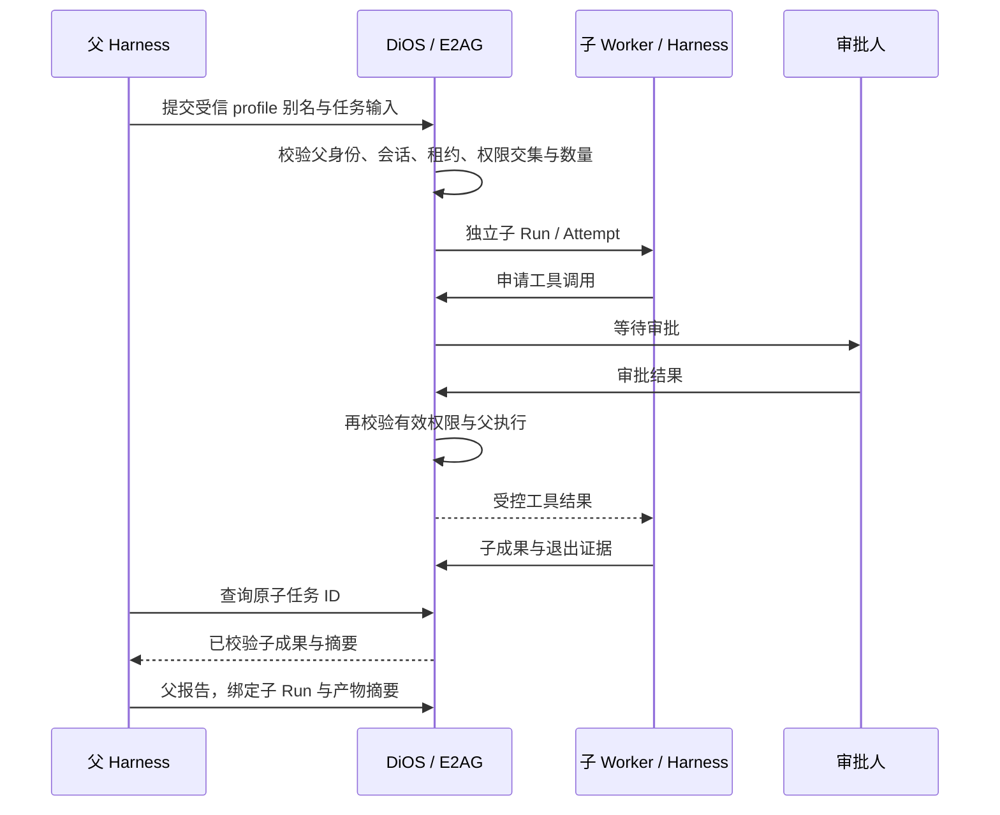

# 异构 Harness 父子任务与成果校验

DiOS 的父子任务通道支持不同 Harness 组合。父 Agent 通过受控 MCP 提交子任务，子 Agent 使用自己的 Worker、运行配置和模型会话；E2AG 持续校验父执行、委派祖先、权限交集和工具审批。任务状态、产物和恢复账本由 DiOS 管理。

## 执行边界



底座提供任务、授权和证据能力；示例协调器属于应用调用方。静态评审仅作为合成输入的验收样例，DiOS 不解释评审问题、客户项目或岗位流程。协调器允许选择 Cursor、Codex 或 DSH；管理员固定镜像、配置、子 profile 和凭据授权，任务文本不能更换这些配置。

SDK 0.1.8 的 ACP 执行入口支持异步结果校验器。模型返回子任务 ID 后，[协调器](../../examples/runtime/acp_child_coordinator.py)通过父执行绑定的通道读取该子任务，要求状态成功、存在已校验结果及结果产物，再将真实子结果、Run ID 和产物摘要写入父报告。校验失败、证据缺失或取消均不产生成功结果帧。较大成果超出通道内联限制时，此示例会拒绝完成；引用式大型成果汇总由上层应用实现。

## 实测矩阵

| 父 → 子 | 审批后完成、子成果回读 | 父任务撤权 | 父 Worker 失联与对账 |
|---|---|---|---|
| Cursor → DSH / ECNU Max | 通过 | 通过 | 通过 |
| DSH / ECNU Max → Codex | 通过 | 通过 | 通过 |
| Codex → Cursor | 通过 | 通过 | 通过 |

每组均记录两个独立 Worker 控制进程、不同工作负载进程和模型会话。成功场景仅产生一个子任务及一次获批检索。父任务撤权发生在子工具等待审批期间，子任务取消，后到审批被拒绝，工具调用为零。

失联场景真实终止父 Worker 控制进程，同时确认原工作负载仍存活；在隔离数据库中注入租约到期，验证父任务进入 `reconciliation_required`，原尝试保持唯一，子任务取消且旧审批无效。随后由验证脚本模拟操作者取消并停止原工作负载，恢复器使用原尝试完成对账。该场景覆盖所有权失效和进程退出对账；活动模型会话重新绑定、物理跨主机故障转移仍待独立验收。

[机器可读证据](evidence/mixed-harness-children-20261125.json)记录各场景身份、镜像、进程、会话、产物摘要、测试结果及原始记录摘要。全部使用独立数据库和合成输入。

## Codex 凭据适配

Codex 的文件认证读取 `CODEX_HOME/auth.json`，见[官方认证文档](https://developers.openai.com/codex/auth)。应用镜像中的[入口脚本](../../applications/static-review/examples/codex/secret-entrypoint.py)将 `/tmp/auth.json` 链接到 `/run/secrets/codex-auth`，保留可写会话目录和只读凭据。重复初始化接受同一链接，已有其他文件或链接则拒绝启动。DiOS 继续要求 Secret 挂载到 `/run/secrets`，按 profile、引用、版本和摘要授权。

认证文件轮换由操作者或 Secret Provider 负责。长时间运行中的账号 Token 自动刷新仍需专门验证；此次短任务成功不能证明刷新过程可用。

## 复跑与交付

验证入口为 [qualify_child_harnesses.py](../../scripts/qualify_child_harnesses.py)。准备两个已授权的私有 profile 目录，各自包含 `profile.json`、`secrets.json`，子 profile 另含 `tools.json`。固定已构建镜像摘要；父镜像安装 SDK 0.1.8 和通用协调器，子镜像安装对应应用。Codex 镜像还需上述认证入口。OPA evaluator 使用既有受信配置。

```bash
backend/.venv/bin/python scripts/qualify_child_harnesses.py qualify \
  --output /private/new-qualification \
  --parent-dir /private/parent --child-dir /private/child \
  --parent-harness cursor --child-harness dsh \
  --parent-image sha256:PARENT_DIGEST --child-image sha256:CHILD_DIGEST \
  --policy-evaluator /private/opa.json --scenario success
```

`--scenario` 还支持 `parent-revoke` 和 `parent-worker-loss`；每次使用新输出目录，保留失败现场和原任务身份。脚本真实调用已配置模型并使用 Docker，需要相应网络与凭据。每个 Worker 仅取得自身 profile 授权的凭据。

交付包含 SDK wheel、应用入口与协调器、验证脚本和证据。底座 API/数据库协议未变更，无需迁移或重启现有任务。镜像摘要作为应用 Revision 的输入，由部署方登记；现有应用配置不自动切换镜像。

后续按 #35/#58 推进切换 actor 的认证委派、活动会话恢复绑定、更多原生工具路径、物理跨主机及独立 G2 验收。金额/Token 预算按既定资源治理任务实现。
