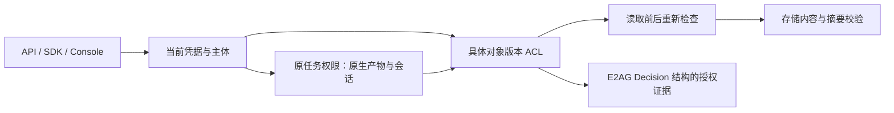

# 对象读取、下载与撤销

对象授权绑定主体、对象 ID 和具体版本。相同内容摘要复用存储，访问权限仍按对象分别判断。新版本默认不继承旧版本授权。文件、原生任务产物与会话引用使用同一套版本引用。



## 权限与一致性

| 对象或操作 | 规则 |
| --- | --- |
| 独立文件无显式授权 | 管理者可访问；普通主体不可读 |
| 原生产物、会话无对象 ACL | 沿用原 Run 权限；产物另需 `artifact.read` |
| 原生对象有 ACL | 原 Run 权限与对象 ACL 同时满足；空授权列表撤销所有普通主体访问 |
| `object.read` | 读取版本元数据与可见关联 |
| `object.download` | 与 `object.read` 同时满足后读取内容 |
| 关系查询 | 检查源对象，过滤无权访问的内部目标；外部引用仅为不透明标识 |
| 版本分页 | 逐版本过滤；游标表示已扫描位置，空页仍可能有下一页 |

主体身份采用 issuer、audience、scope、principal ID、subject 和 actor；凭据、主体启用状态及上游身份仍由现有身份 Provider 实时校验。换发同一身份的凭据不改变对象授权；主体或 actor 被重新分配后不匹配原授权。

策略修改采用期望版本和幂等回执，策略版本、修改者、时间与授权列表持久保存。重放已成功请求返回原回执，不重做写入；撤销之后重放旧授权不会恢复权限。过期授权按数据库时间失效。

初次读取和拒绝决策保存对象引用、主体、动作、策略版本、原因及时间，复用 E2AG `Decision` 证据结构。HTTP 对象访问使用数据访问授权；Worker 执行与工具调用继续使用原 E2AG Work 授权链。对象分享不发放任务执行授权。

## 实际读取边界

统一对象下载、原产物下载、预览和 Markdown 下载均通过同一读取服务。服务在每个存储块读取前后复查当前凭据、原 Run 权限与对象 ACL；存储读取阻塞期间发生撤销，待发送块也会被拒绝。

下载前校验完整内容，实际发送阶段再次逐块检查并校验长度和摘要。HTTP 响应使用 `Cache-Control: no-store`；SDK 对返回内容再次验证长度与摘要，不把中断或截断内容计为成功。不存在免鉴权的存储地址或长期下载凭证。

撤销提交后，后续授权检查拒绝读取。已通过检查并交给网络或客户端的字节无法追回。当前保证基于同一控制数据库上的串行授权边界；跨节点缓存、可用性和一致性资格属于后续多节点工作。

## 接口

API 前缀为 `/api/os/runtime`，对象路径为 `/objects/{kind}/{id}/versions/{version}`。

| 方法与后缀 | 用途 |
| --- | --- |
| `GET` 对象路径 | 授权后的元数据 |
| `GET /download` | 完整性校验后的二进制内容；会话引用没有可下载内容 |
| `GET /relations` | 授权后的来源关联 |
| `GET /policy` | 管理者读取策略及修订号 |
| `PUT /policy` | 管理者授予或撤销；提供 `expected_revision`、`idempotency_key`、`grants` |

API 的每条 grant 包含 `principal_id`、`actions`、`expires_at`。服务端解析可信身份目录中的主体，限定当前 scope，并把有效期限制在主体有效期内。提交空 `grants` 撤销该版本所有普通主体访问。

Python SDK 0.1.13 提供 `object_policy`、`set_object_policy`、`download_object`。原 `artifact` 下载自动经过相同服务端控制。原 Harness 镜像继续沿用已验证版本；此次增加的是应用侧 HTTP 客户端能力。

可信本地管理 CLI 提供 `object policy-show` 和 `object policy-set`：

```bash
python -m app.runtime.cli --scope example object policy-show file OBJECT_ID --version 1
python -m app.runtime.cli --scope example object policy-set file OBJECT_ID --version 1 \
  --file empty-grants.json --expected-revision 1 --key stable-revoke-key --actor operator:admin
```

`empty-grants.json` 内容为 `[]`。CLI 的非空授权使用完整可信主体绑定；面向应用的 API 只接收主体 ID。CLI 直接访问数据库，属于管理权限，不面向普通用户。

## 验证与后续

[工程证据](evidence/object-access-20261126.json)覆盖同摘要跨 ACL、版本隔离、关联过滤、并发策略修改、幂等重放、下载中撤销、令牌撤销、原下载入口、备份恢复和已部署 API/CLI/SDK 联动。开发环境采用两个独立短期测试身份验证对象权限；原 OAuth 测试身份的上游可用性未计入本项完成证据。

对象留存、删除、墓碑与派生引用传播由 S02-1.03 承接，完整对象生命周期资格由 S02-1.04 承接。

## 设计依据

[Zanzibar](https://www.usenix.org/conference/atc19/presentation/pang)强调授权变更与对象内容之间的因果顺序。当前实现采用现有数据库事务、对象版本与每次读取的最新决策；未引入分布式授权缓存。[RFC 9111](https://www.rfc-editor.org/rfc/rfc9111.html)规定 `no-store` 的缓存语义；已交付客户端的内容保留上述撤销边界。
