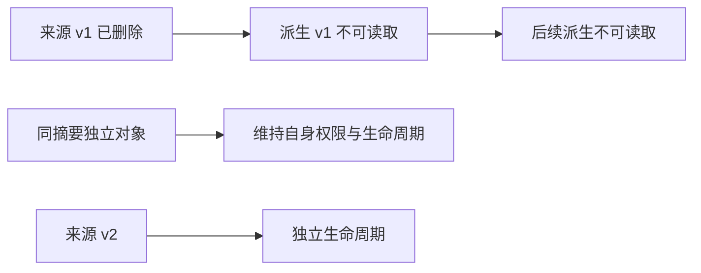

# 对象留存、删除与来源失效

对象生命周期绑定具体版本。保留期内拒绝删除，保留期限只能延长；显式删除或到期后阻断内容读取，保留原对象身份、内容摘要、Run/Attempt 关联和来源边。Linux 本地安装通过离线标记清扫回收底层内容。

## 状态和约束

| 状态 | 含义与读取行为 |
| --- | --- |
| `active` | 按当前对象 ACL 和原任务权限读取 |
| `deleted` | 已提交删除标记；所有内容读取入口拒绝 |
| `expired` | 到达配置的 `expires_at`；读取即时失效，无需等待清理任务 |
| `source_unavailable` | 显式 `derived_from` 来源链存在已删除或到期版本；派生成果读取拒绝 |

`retain_until` 是最短保留期限，`expires_at` 是可选到期时刻。后者不得早于前者。保留期结束后，对象可以删除；未配置 `expires_at` 的对象不会自动到期。原生任务尚未终结时，拒绝显式删除它的产物或会话引用。

每次修改使用期望修订号与幂等键；并发修改只能有一个成功。已删除、到期的版本不能恢复为有效版本，重放旧请求也不会改变状态。可以为同一文件发布新的独立版本，旧的来源边仍固定到原版本。

## 读取与来源传播

统一对象下载、原产物下载、预览、Markdown 下载和 E2AG 子任务结果读取均检查生命周期。正在读取的流在后续块检查中观察到删除或到期后停止发送。原任务完成状态保持历史事实，结果内容可能已不可访问。

来源失效沿已登记的 `derived_from` 关系传递。`associated_with` 和外部不透明引用不自动传播删除。读取即时检查来源，不依赖异步队列追赶。新增派生关系拒绝闭环；遍历超过深度 64 或 4096 个节点时停止并拒绝读取。



共享内容通过摘要复用，但删除标记按对象版本记录。因此，删除一个对象不会破坏相同摘要的独立对象。管理者可通过生命周期接口查询墓碑、摘要和原任务关联；备份恢复保留这些状态与来源边。

## 管理接口

以下接口限定管理者使用，基于 `/api/os/runtime/objects/{kind}/{id}/versions/{version}`：

| 方法与后缀 | 请求 |
| --- | --- |
| `GET /lifecycle` | 返回修订号、留存和到期时刻、直接或派生失效状态、原因及原始关联 |
| `PUT /retention` | `expected_revision`、`idempotency_key`、`retain_until`、可选 `expires_at` |
| `POST /delete` | `expected_revision`、`idempotency_key`、`reason` |

Python SDK 0.1.14 提供 `object_lifecycle`、`retain_object`、`delete_object`。CLI 提供 `object lifecycle`、`object retain`、`object delete`，统一使用 `--version`、`--expected-revision`、`--key` 和 `--actor`。

普通读取接口对不可用对象返回 `NOT_FOUND`，沿用 `no-store`。生命周期管理接口保留墓碑信息；原 Run、Attempt 和产物 ID 不重建。

## 离线物理回收

物理回收面向一个 SQLite 数据库和一个本地内容目录组成的安装，引用检查覆盖所有 scope。存储目录自动记录数据库绑定；多个数据库共用目录、远程 Worker 暂存目录和绑定不匹配的目录拒绝回收。PostgreSQL、共享文件系统和远程对象存储的物理回收需要对应 Provider 的隔离协议，按 W4 扩展验证。

回收前先排空任务，停止该安装的 API、Worker、工具网关及其他写入进程。所有进程须使用支持当前存储维护协议的版本。数据库与本地存储持有 Linux 共享进程锁；回收取得两者的独占锁，备份使用共享锁。运行中的组件阻止回收，回收期间的新组件拒绝进入。旧版和绕过 Provider 的外部文件操作需要运维层停止。

标记范围包括文件版本、原生产物、历史归档、远程上传与分块、工具结果、工具回执和退出恢复回执。有效引用、保留期未结束或尚在执行的任务会保留内容。只选择已有对象版本明确失效的内容；未登记的孤立文件保留。会话引用只管理 DiOS 身份与关联，厂商内部会话库由对应 Harness Provider 管理。

```bash
# 先排空并停止该安装的全部写入组件；默认仅预览。
python -m app.runtime.cli --database-url sqlite+aiosqlite:////data/runtime.sqlite \
  object-collect --artifacts /data/objects --actor operator:admin

python -m app.runtime.cli --database-url sqlite+aiosqlite:////data/runtime.sqlite \
  object-collect --artifacts /data/objects --actor operator:admin \
  --apply --key maintenance-001
```

`--max-items` 限制引用盘点量，默认 100000，上限 1000000，超限停止。清扫前验证文件摘要与路径，计划持久化后才删除文件；每个文件完成后同步目录并记录结果。中断后使用同一键重试，续接前重新检查全部当前引用。重新发布的同摘要有效对象会保留内容，已完成请求返回原回执。

`content_collection` 返回 `retained`、`pending`、`collected` 或 `retained_shared`，分别表示保留、清扫待确认、该版本内容引用已回收，以及续接时因新引用而保留。`collected_bytes` 统计本次维护计划累计确认回收的逻辑内容字节，不代表单次调用释放的磁盘块数。

备份保留墓碑、来源边、回收计划与状态；已回收或待确认回收的版本不要求复制其内容。恢复后普通读取仍按墓碑拒绝。迁移到不同目录后，经正常组件初始化建立新的存储绑定，再停止组件并用新的维护键完成回收；原维护键绑定原安装地址，任务和对象身份保持不变。

S02-1.04 的[完整生命周期资格](evidence/object-lifecycle-qualification-20261126.json)已通过：两主体真实 API、原 Cursor 成果、共享内容回收及异目录恢复保持权限和身份关联。基础状态证据与[物理回收工程证据](evidence/object-collection-20261126.json)共同支持 S02-1.03 的工程完成。

## 依据与验证

[S3 Object Lock](https://docs.aws.amazon.com/AmazonS3/latest/userguide/object-lock.html)区分版本保留期限与删除标记。[W3C PROV-DM](https://www.w3.org/TR/prov-dm/)提供实体失效和派生关系的基础语义。[CNCF Distribution](https://distribution.github.io/distribution/about/garbage-collection/)采用共享内容标记清扫，并要求清扫期间只读或停止服务。DiOS 复用这些机制的职责划分，生命周期采用当前数据库和已有授权检查。

[本批工程证据](evidence/object-lifetime-20261126.json)记录数据库、读取入口、E2AG 子任务通道、备份恢复及已部署 API/CLI/SDK 验证。
