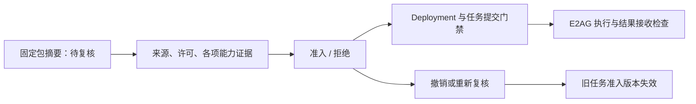

# 包来源、许可与能力准入

DiOS 以固定包摘要为准入对象。包内容、来源版本、许可证或能力声明发生变化，都会产生新摘要并进入待复核状态。所有传递依赖分别通过准入后，Deployment 才能启动验证任务。

## 声明与证据

包 manifest 可携带 `declaration`：

```json
{
  "source": {"uri": "https://github.com/example/agent", "revision": "完整40或64位小写十六进制提交或内容标识"},
  "license": "Apache-2.0",
  "capabilities": ["repository.read", "report.create"]
}
```

来源必须指向 HTTPS 位置和固定提交或内容标识。许可证使用 [SPDX 表达式](https://spdx.github.io/spdx-spec/v2.3.1/SPDX-license-expressions/)，由 `packaging.licenses` 校验和规范化。声明随 manifest 一同参与包摘要。未声明来源、许可与能力的历史包可查看和锁定，受控运行需要补齐声明并完成复核。

复核声明采用 [in-toto Statement v1](https://github.com/in-toto/attestation/blob/main/spec/v1/statement.md)：`subject` 绑定包名及 manifest 的 SHA-256，`predicateType` 为 `urn:dios:package-review:v1`，`predicate` 包含精确声明与检查结果。这里的 predicate 定义 DiOS 的准入检查语义；[SLSA](https://slsa.dev/spec/v1.2/provenance) 构建来源验证可作为检查证据接入，当前未自动授予 SLSA 等级。

每份复核必须包含 `source`、`license` 及每个 `capability:<名称>` 的检查，全部通过才能准入。检查结构为：

```json
{
  "result": "passed",
  "evidence": {"kind": "file", "id": "对象ID", "version": 1},
  "digest": "sha256:证据内容摘要"
}
```

证据复用通用对象服务的 `file` 或 `artifact`，绑定版本、摘要和作用域；缺失、跨作用域、摘要不符、已删除或过期的证据阻断准入。来源、许可证适用性及能力实测由受信复核者确认。登记操作不运行包代码、不访问外部来源、不自动扩大工具权限。

## 状态、授权与撤销



准入账本按作用域、包摘要和复核版本追加，数据库禁止修改或删除旧记录。写入采用预期版本比较与幂等键，竞争复核只有一方成功。查询保留最新状态及分页历史。

任务提交在同一数据库事务中固定每个包的复核版本。E2AG 在执行授权、续接、工具所需的当前授权检查及结果接受时检查该版本：撤销或任何新复核会使旧绑定失效，重新批准后仍需提交新任务。机器执行、会话绑定、工具授权与预算继续沿用现有 E2AG 链路。

Deployment 提交及激活时重新检查现行准入，普通任务提交同样受门禁控制。客户端不能提供或替换任务的 `package_admissions`。只有通过受控 Revision 发布和任务提交形成的绑定可以进入这条路径。

## 管理入口

Linux 受信本地管理 CLI：

```sh
.venv/bin/python -m app.runtime.cli --database-url "$DIOS_RUNTIME_DATABASE_URL" \
  --scope example package-review record --file review.json \
  --expected-version 0 --key review-001 --actor reviewer

.venv/bin/python -m app.runtime.cli --database-url "$DIOS_RUNTIME_DATABASE_URL" \
  --scope example package-review show 'sha256:包摘要' --after 0 --limit 50
```

`review.json` 包含 `manifest`、`decision`、`statement`。`decision` 为 `admitted`、`rejected` 或 `revoked`；首次复核预期版本为 0，后续使用当前版本。`--actor` 是受信本地操作审计标识，远程用户审批身份与企业目录 API/Console 入口由 K04-1.04 接入。

新增 `runtime_package_admission_schema` 与不可变复核账本，迁移保留原表。应用到既有数据库需要先排空任务，再执行已有迁移与恢复流程。已入队且未捕获准入版本的旧包任务无法获取新的执行授权。

## 工程验证

[工程证据](evidence/package-admission-20261126.json)：78 项相关测试通过、0 跳过，涵盖来源/许可声明、固定证据、跨作用域拒绝、竞争复核、不可变历史、部署与任务门禁、E2AG 撤销及重新批准、真实 Docker 执行和备份恢复。开发环境已迁移部署，85 个任务、89 次尝试、239 个产物身份完整保留。
