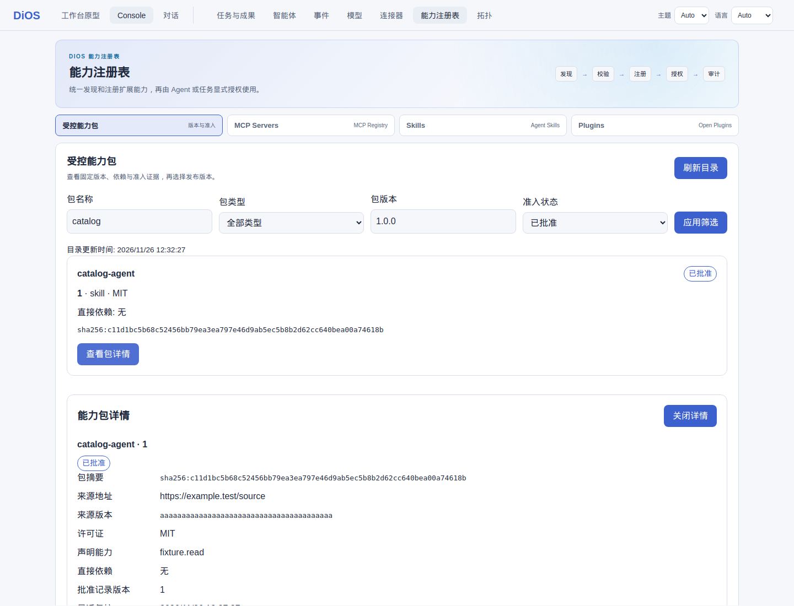

# 统一能力包目录

Console 的“Registry → 受控能力包”、管理 CLI 和上层平台 Python 客户端共用 `PackageCatalog` 查询。目录提供固定版本、摘要、直接依赖、来源、许可证、声明能力、批准记录及当前证据有效性，执行仍通过 E2AG 授权。

## 接口契约

| 查询 | HTTP | CLI | Python TaskClient |
| --- | --- | --- | --- |
| 筛选与分页 | `GET /api/os/runtime/packages` | `registry catalog` | `package_catalog()` |
| 包详情与证据引用 | `GET /api/os/runtime/packages/{digest}` | `registry detail DIGEST` | `package_detail(digest)` |
| 关联执行版本 | `GET /api/os/runtime/packages/{digest}/releases` | `registry releases DIGEST` | `package_releases(digest)` |

筛选参数为 `q`（名称子串，CLI 为 `--query`）、`kind`、`version`、`admission`；分页参数为 `after` 和 `limit`，上限 100。版本遵循现有 PEP 440 规范化，`1`、`1.0` 和 `1.0.0` 查询等价。名称匹配转小写，百分号及下划线作为普通字符处理。响应返回实际筛选条件、完整条目与 `next_after`，按摘要升序分页。

`admission` 筛选最近一次记录的 `pending/admitted/rejected/revoked`。记录为 admitted 的包仍可能因证据过期或删除而不可发布；响应的 `evidence_valid`、`reason` 和 `limitations` 明确给出当前限制。所有入口使用相同判断，审批记录不会被查询修改。

详情返回包文件描述与证据对象引用，文件读取沿用对象授权。内容存储路径、原始配置、密钥和证据字节不包含在目录响应中。关联 Revision 按精确包摘要匹配，每次最多检查 100 个候选；当 `next_after` 非空时需继续查询，即使当前页没有匹配项。目录实时读取，翻页期间准入状态可能更新；发布与执行控制点始终再次核验当前状态。

非法筛选返回 `INVALID_PACKAGE_FILTER`，不存在或越作用域详情返回 `NOT_FOUND`。HTTP 分别使用 422/404，CLI 返回相同错误码的 JSON，SDK 提供 `ApiError`。API 响应禁用缓存。

## 权限与分层

目录复用现有平台管理员访问机制。数字分身平台的管理后端可以使用 `TaskClient` 查询；终端用户身份无权访问全局包目录。DiOS 不包含客户名称、业务流程和客户专用权限。目录查询是只读操作；注册、复核、发布和执行分别遵循已有控制点。

```python
from dios_sdk import TaskClient

client = TaskClient(base_url, platform_operator_token)
page = client.package_catalog(kind="skill", admission="admitted", limit=20)
for package in page["items"]:
    print(package["name"], package["version"], package["admission"], package["limitations"])
```

上述客户端方法随 `dios-sdk==0.1.16` 提供。管理凭据保存在上层平台服务端。API 保持业务无关，上层应用按自己的用户权限组织可见内容。

## Console

“受控能力包”独立展示已登记的固定版本，与现有 MCP、Skills 和 Plugins 发现入口并列。页面支持名称、类型、版本与批准状态筛选、分页、详情深链接、证据与限制、关联执行版本查询、手动刷新以及明确的加载失败和空态。中英语言与 Light/Dark/Auto 主题沿用应用偏好，包名、文件名、来源及证据原文保持原语言。

查询使用既有 SQLAlchemy [JSON 字段访问](https://docs.sqlalchemy.org/en/20/core/type_basics.html#sqlalchemy.types.JSON)与参数化过滤；本项没有新增或更改已发布数据库 schema。

工程结果见 [统一目录证据](evidence/package-catalog-20261126.json)。


