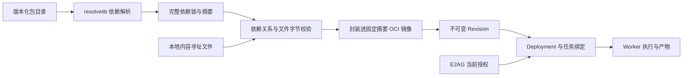

# 包内容与依赖锁定

DiOS 在发布 Revision 时固定包依赖及文件内容，Worker 执行固定摘要的镜像。包目录变化、发布新版本或删除本地包源，都不改变已发布 Revision。包是通用能力载体，客户业务及数据继续由独立应用管理。

## 解析与执行边界



依赖解析采用 [resolvelib](https://github.com/sarugaku/resolvelib)；DiOS 包版本及约束采用 [PEP 440](https://packaging.python.org/en/latest/specifications/version-specifiers/)。文件使用 [OCI descriptor](https://github.com/opencontainers/image-spec/blob/main/descriptor.md) 的 `mediaType`、`digest`、`size` 字段，额外记录包内相对路径和文件权限。包 manifest 和锁文件使用 DiOS 的确定性 JSON 编码计算 SHA-256。

锁文件包含根依赖、完整选中 manifest、每个 manifest 摘要及锁文件摘要。解析器按版本从高到低选取并回溯处理约束冲突；同名同版本的重复声明拒绝进入目录。部署时只验证锁定结果，不重新查询目录或选择版本。

本轮支持本地 Linux OCI 发布。Python、Node 等生态的构建与依赖安装由包生产方完成；DiOS 接收可直接封装的文件。远程 A2A 服务的内部依赖仍按 opaque 记录，提交本地包锁时返回不支持错误。

## 包格式与 CLI

目录文件是 manifest 数组，每个 manifest 包含：

| 字段 | 语义 |
| --- | --- |
| `schema_version` | 固定为整数 1 |
| `name` / `version` | 小写包名及 PEP 440 版本 |
| `kind` | harness、skill、tool、prompt 或 policy |
| `dependencies` | `{name, specifier}` 数组；例如 `{"name":"search","specifier":">=1,<2"}` |
| `files` | `{path, mediaType, digest, size, mode}` 数组 |

`path` 为包内相对路径；`digest` 为文件实际字节的 `sha256:<64位十六进制>`；`size` 为字节数；`mode` 为十进制 420（0644）或 493（0755）。路径穿越、文件与目录冲突、符号链接及特殊文件被拒绝。

根依赖文件同样采用 `{name, specifier}` 数组。以下命令在仓库 `backend` 目录执行，无需数据库：

```sh
.venv/bin/python -m app.runtime.cli package lock \
  --catalog catalog.json --roots roots.json > packages.lock.json
.venv/bin/python -m app.runtime.cli package verify --lock packages.lock.json
```

`verify` 验证锁文件及完整依赖图。真实文件字节在 `revision publish-profile` 阶段验证。包源目录中每个文件以其 SHA-256 的 64 位十六进制命名，不带 `sha256:` 前缀。

执行 profile 增加：

```json
{
  "package_source": {
    "lock": "packages.lock.json",
    "blobs": "blobs"
  }
}
```

这两个路径相对 profile 文件定位。沿用已有 `revision publish-profile --profile ... --key ... --actor ...` 发布，文件会出现在镜像的 `/opt/dios/packages/<name>/<path>`。该目录保留给锁定包；其他挂载及运行时输入不能覆盖它。`package_source` 仅供发布入口使用，Worker 直接读取尚未冻结的 profile 会被拒绝。

发布产物保存 `package_lock`、对应的只读目录摘要和固定镜像摘要，移除本地源路径。没有安装脚本执行、自动网络下载或模型调用。声明依赖关系或发布内容发生变化时，必须发布新 Revision。

## 拒绝条件与治理

| 条件 | 结果 |
| --- | --- |
| 缺失依赖或版本约束不相容 | `PACKAGE_DEPENDENCY_UNSATISFIED` |
| 选中依赖图有环 | `PACKAGE_DEPENDENCY_CYCLE` |
| 同名同版本重复 | `PACKAGE_VERSION_AMBIGUOUS` |
| 锁或 manifest 摘要变化 | `PACKAGE_LOCK_DIGEST_MISMATCH` / `PACKAGE_DIGEST_MISMATCH` |
| 文件大小或内容变化 | `PACKAGE_PAYLOAD_MISMATCH` |
| 文件缺失、符号链接、特殊文件 | `PACKAGE_PAYLOAD_UNAVAILABLE` 或 `PACKAGE_PAYLOAD_MISMATCH` |
| 缺少锁与镜像目录绑定，或其他挂载覆盖包 | `PACKAGE_EXECUTION_BINDING_INVALID` |

目录最多 512 个候选、锁定最多 128 个包、总文件最多 2048 个、总文件大小最多 64 MiB、锁元数据最多 192 KiB。发布还受已有 Revision 总元数据和受控目录条目上限约束。依赖解析最多 1024 轮。

Deployment 和任务读取 Revision 时均复验包锁和执行绑定；直接导入 Revision 不能绕过此校验。包通过校验后继续接受 E2AG 工作授权、工具审批、撤销与恢复检查。来源、许可证及能力声明准入由 K04-1.02 承接；Registry 发布/回滚及目录界面分别由 K04-1.03/.04 承接。

## 工程验证

运行 `DIOS_TEST_DOCKER=1 backend/.venv/bin/python scripts/qualify_package_lock.py --output <结果路径>`，覆盖解析回溯、失败依赖、摘要和路径检查、CLI、发布门禁，以及受影响的 Revision、Deployment、Worker 与挂载回归。原生 Docker 用两组锁定依赖执行真实 Worker；发布后改写源文件，两个 Revision 仍返回各自预期内容，并验证缺少 E2AG 授权无法入队。

[工程证据](evidence/package-lock-20261126.json)：52 项测试通过、0 跳过；开发环境已部署，原 85 个任务、89 次尝试、239 个产物身份完整保留。
