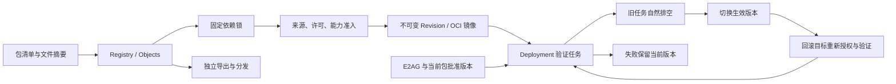

# Registry 包发布、升级与回滚

Registry 保存作用域内不可变的包清单与文件引用；Revision 固定可执行内容；Deployment 负责验证任务、自然排空与版本切换。E2AG 在任务授权、执行和结果接收处保持约束。客户流程与外部知识库、图服务等产品的部署由上层应用及基础设施管理。



## 职责与数据

| 对象 | 责任 |
| --- | --- |
| Registry 包 | 按作用域、名称、规范化版本唯一；清单摘要固定来源、许可、能力、依赖和文件内容。相同版本不可替换，PEP 440 等价版本也不能覆盖。 |
| 文件 Object | 复用现有内容存储、完整性校验、生命周期、备份恢复；Registry 保存精确对象版本。 |
| 包锁 | 明确根依赖与完整闭包。新包注册不会改变已保存包锁。未获准的候选可以注册和导出；发布受控 Revision 必须通过准入。 |
| Revision | 固定镜像、文件挂载摘要、包锁和依赖；不保存来源机器路径。 |
| Deployment / Rollout | 保存候选、当前及上一版本、验证 Run、状态与错误。失败保持旧版本，成功等待既有任务自然结束。 |
| 授权与证据 | 验证 Run 固定每个包的批准版本，并关联 Attempt、会话和结果。切换前再次校验批准版本和当前 E2AG 策略。撤销后重新批准需要新的验证任务。 |

Registry 注册、发布 Revision 与申请 Deployment 分别采用幂等键。注册重试保持同一包身份；重复部署申请复用原验证任务。回滚指向既有不可变 Revision，并使用当前有效的准入与 E2AG 授权重新验证。

## Linux 管理入口

以下命令使用既有 `DIOS_RUNTIME_DATABASE_URL` 与作用域配置。包文件位于 `blobs/<sha256十六进制摘要>`；各命令的 JSON 输出可保存为后续输入。

```bash
python -m app.runtime.cli registry register --manifest package.json --blobs blobs \
  --artifacts /srv/dios/artifacts --key register-agent-1 --actor operator
python -m app.runtime.cli registry lock --roots roots.json > lock.json
python -m app.runtime.cli registry export --lock lock.json \
  --artifacts /srv/dios/artifacts --destination /srv/exports/agent-1
# 按包准入流程记录来源、许可与能力证据，再发布固定 Revision。
python -m app.runtime.cli registry publish-profile --lock lock.json --profile profile.json \
  --artifacts /srv/dios/artifacts --key release-agent-1 --actor operator
python -m app.runtime.cli deployment --policy-file /srv/dios/policy.json request --file deployment.json
python -m app.runtime.cli deployment --policy-file /srv/dios/policy.json reconcile primary
```

`publish-profile` 接受未附加包源的运行 Profile，按传入包锁取回和校验文件，通过既有 OCI 发布器创建 Revision。Deployment 申请仍需显式提供版本、幂等键、验证输入及操作人。注册和导出无需 Docker；导出不会启动模型、插件安装脚本或后端服务。跨环境接收方重新登记并批准来源证据，源环境的批准不自动授予目标环境执行权限。

新增 `runtime_registry_packages` 与 `runtime_registry_receipts` 为只增账本，随数据库迁移和备份恢复管理；已发布 schema 文件保持冻结。当前入口是受信 Linux 管理 CLI，统一 API/Console 目录由 K04-1.04 接续。

## 采用的公开设计

[Helm OCI Registry](https://helm.sh/docs/topics/registries/) 将包分发与安装分开，支持按摘要引用；[Kubernetes Deployment](https://kubernetes.io/docs/concepts/workloads/controllers/deployment/) 将版本、发布状态和回滚组织为独立控制对象。DiOS 复用这两个设计原则，并沿用现有 Objects、OCI 镜像与 Deployment 控制器。当前包目录未实现 OCI Distribution HTTP 服务。

## 工程验证

验证覆盖注册竞争与幂等、等价版本冲突、跨作用域拒绝、内容损坏、独立导出、备份恢复，以及真实 Docker 中的初始发布、失败升级、自然排空、回滚批准失效和重新验证。最终测试与开发部署结果见 [工程证据](evidence/package-registry-20261126.json)。
