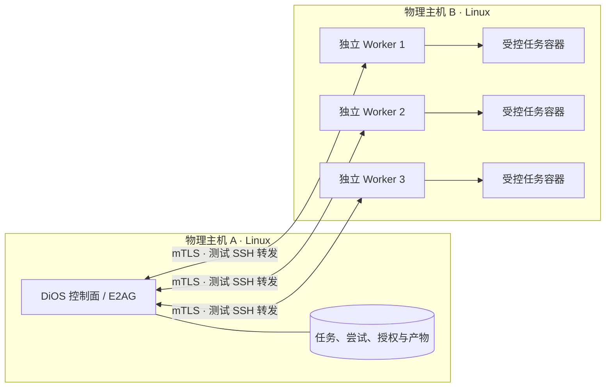

# 两台物理主机上的 Worker 执行与治理

控制面运行于第一台主机的 Ubuntu 24.04 WSL，Worker 与任务容器运行于第二台主机的 Ubuntu 20.04 WSL。两端使用相同固定运行镜像，远端挂载的 248 个 Python 源文件逐文件核对 SHA-256。控制面持有数据库与中心产物，Worker 使用独立本地产物目录，通过 mTLS 接收任务和上传结果。

本项承接 D01-3.02。用户提供的第二台主机已可用于工程验证；物理跨主机的完整故障资格继续按原验收推进。

## 执行路径



SSH 仅用于实验环境访问及 TCP 转发；机器身份、凭据轮换、任务所有权和 E2AG 决策仍由 DiOS 执行。远程 Worker 未连接控制面数据库，也未共享控制面产物目录。

## 验证内容

| 场景 | 断言 |
| --- | --- |
| 额度耗尽后恢复 | 真实冷却到期后仅一个试探任务执行；另一模型资源可独立执行；试探成功后恢复三路并发 |
| 限流后恢复 | 保留第一次失败和原任务身份；重试使用新 Attempt、新 epoch 和独立 Grant；过期执行权上报被拒绝 |
| 机器身份撤销与重复提交 | 被撤销机器不能领取任务，Attempt 数为零；重复幂等提交保持同一 Run；重新启用测试身份后完成原任务且仅有一次执行 |

三路并发依据独立 Worker PID、进程实例、任务容器进程与会话标识判定。任务是受控合成工作负载，额度和限流由测试文件注入；不调用外部模型。

## 环境与资源

第二节点为 8 vCPU、约 8 GiB 内存、Docker 28.1.1。恢复阶段最多同时启动四个可信 Worker 管理容器（其中未获试探资格者退出），每个上限为 1 CPU、512 MiB，测试任务容器为 0.5 CPU、128 MiB，任务容器保持只读根文件系统、无网络及非特权用户。管理容器需要 Docker socket 和宿主 PID 视图，以提供实际进程观测；该权限属于基础设施可信执行管理端。

测试使用独立命名空间、短期 mTLS 证书、临时 SSH 密钥和测试目录。SSH 使用核验过的主机密钥；接入配置、地址与私钥保留在本地工作目录，不纳入公开仓库。测试回收仅作用于该次随机 scope 的容器。

## 重现

先准备第二台 Linux 节点、固定运行镜像与相同 backend/app 源码，配置专用 SSH 别名。镜像和源码摘要应在运行前核对。测试账户需要执行测试容器的权限；预留资源后运行：

```bash
DIOS_TEST_DOCKER=1 backend/.venv/bin/python scripts/qualify_physical_worker.py \
  --ssh-config /path/to/private/ssh_config \
  --host physical-worker \
  --remote-source /path/to/qualification/source \
  --runtime-image sha256:VERIFIED_IMAGE_ID \
  --output workspace/physical-worker-result.json
```

远端准备的测试工作负载镜像为 `dios-worker-fixture:local`，其镜像 ID 必须与控制面引用一致。每次运行自动创建独立任务目录与 mTLS 资格配置，复用既有恢复断言。

## 后续资格

本批覆盖跨物理主机执行、冷却恢复与撤销门禁。网络分区、进程崩溃、测试节点重启、延迟与存储故障注入入口，以及 HA、存储复制和 RPO/RTO 继续由 D01-3.02/.03 承接。整台宿主机重启或影响其他服务的网络变更需先确定维护窗口。

[验证报告](evidence/physical-worker-20261127.json)记录执行结果、两端版本、镜像与源码摘要、独立进程/会话和原任务关联。

## 依据

[OpenSSH ProxyCommand](https://man.openbsd.org/ssh_config#ProxyCommand)与[转发控制](https://man.openbsd.org/sshd_config#AllowTcpForwarding)用于复用已有安全传输。WSL 网络访问遵循 [Microsoft WSL networking](https://learn.microsoft.com/en-us/windows/wsl/networking)；本次采用隔离测试转发，无需修改宿主全局网络模式或防火墙。HA 仍采用已有 [ClusterLabs fencing](https://clusterlabs.org/projects/pacemaker/doc/3.0/Clusters_from_Scratch/html/fencing.html)前提，测试传输连通不构成旧主隔离证明。