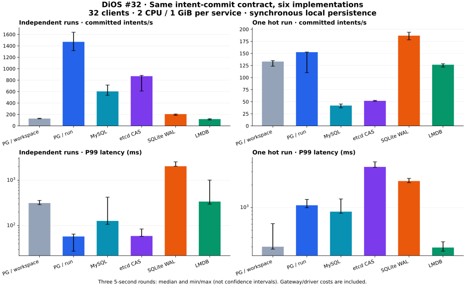

# #32：运行时存储与实现比较

日期：2026-11-11 · 范围：单节点意图提交与恢复 · #32 保持进行中。

## 决策

DiOS 的内核契约不要求关系型数据库。下一步产品化采用两条实现路线：**轻量控制服务采用嵌入式事务存储，SQLite WAL 与 LMDB 进入写入队列及混合查询复测；共享事务服务以 PostgreSQL 按对象并发为首选验证实现**。LMDB 已证明非 SQL 事务 KV 能实现本轮相同的原子状态/证据契约。轻量默认后端保留待定。生产接管仍需完整授权、业务接入、长期容量、备份恢复及部署档位验收。

SQLite 的轻载性能、内置查询与历史工具复用有利于快速产品化；LMDB 在本轮 100/s 到达负载中的尾延迟更稳定。SQLite 相同负载的一轮 P99 达到约 1.94 秒，默认实现冻结前需要解决排队问题并加入查询对照。PG 共享事务路线依据独立 Run 的提交吞吐与现有事务生态进入正式实现。上述取舍限于本轮实现与工作负载。MySQL/etcd 保留对照证据，FoundationDB/TiDB 的分布式能力待多节点阶段评估。

轻量部署可以由一个控制服务管理跨主机 Worker。Worker 经 API 接入，数据库文件仅由控制服务所在主机访问；控制服务的多副本写入、仲裁和自动故障切换属于另一组验收。数据库类型不决定整个 Agent OS 的部署上限。

## 统一条件与结果

所有候选使用同一状态机、身份和请求内容：校验 Run epoch、授权 epoch、撤销、动作/资源和审批单次消费，将新状态与不可变意图记录原子持久化后确认。重放返回原身份，变更参数冲突，工具结果保持 unknown。每个服务限额 2 CPU/1 GiB，使用同一 Docker 存储上的独立卷、单节点同步持久提交；客户端固定两个 WSL 逻辑 CPU、32 个连接/在途槽。环境版本及镜像摘要见 [环境记录](evidence/provider-environment-20261111.json)。

共 **198 个性能用例，0 个提交错误**；每个用例均逐条验证证据链、请求摘要、作用域、epoch、审批与撤销顺序。132 组服务式筛选、36 组嵌入式核心筛选、12 组轻载到达补充、18 组较长窗口复核。下表为 32 并发闭环、每轮 5 秒、3 轮的中位数及最小–最大值；区间表示轮间波动。

| 实现 | 独立任务提交/秒 | 同 Run 提交/秒 | 独立任务 P99 ms | 测量结束内存 MiB |
| --- | ---: | ---: | ---: | ---: |
| PG Workspace 串行 | 127.0（124.2–132.6） | 133.2（123.6–135.2） | 315.3（291.0–360.0） | 372.9（261.5–388.0） |
| PG 按 Run 加锁 | 1,469.6（1,315.8–1,637.4） | 152.6（110.2–152.8） | 57.8（27.4–65.3） | 301.6（227.1–454.2） |
| MySQL 行级事务 | 602.6（534.4–714.2） | 42.0（37.4–45.2） | 127.4（106.8–425.3） | 775.6（628.7–824.6） |
| etcd CAS | 869.0（609.2–882.2） | 51.8（50.8–52.8） | 59.3（57.9–84.6） | 171.4（56.3–267.7） |
| SQLite WAL 服务 | 205.4（182.8–206.4） | 186.8（178.2–193.8） | 2,041.1（2,038.9–2,549.9） | 71.5（54.0–74.8） |
| LMDB 事务服务 | 118.0（103.4–125.2） | 126.6（121.8–128.6） | 340.0（299.4–1,008.9） | 28.9（25.2–38.5） |

内存是用例结束时容器计数，包含缓存和此前实验数据，不能作为最低内存配置。筛选每次创建新命名空间，底层数据逐渐累积；不同候选的索引、日志和缓存机制是实现成本的一部分。CPU 计量区分客户端与服务端。Docker 磁盘计数不支持完整的持久写放大分析，本轮不据此给出磁盘或货币成本排名。

SQLite/LMDB 使用相同的轻量 TCP/JSON 服务封装，事务逻辑在服务内执行；PG/MySQL/etcd 由客户端完成读取、计算和条件提交。结果比较的是完整实现路径，包含协议、驱动、进程位置与往返次数。SQLite/LMDB 两者的封装一致，PG 对照保留相同的 Run 行锁；Workspace 版本额外获取公共锁，并增加一次数据库读取。该对照包含公共串行冲突与额外往返的成本。

### 15 秒窗口复核

每个用例之前清空隔离实验库中的逻辑数据，再进行同样的 2 秒并发预热；引擎物理文件和缓存保留。三轮随机顺序，仍为 32 并发。

| 实现 | 负载 | 提交/秒 | P99 ms |
| --- | --- | ---: | ---: |
| PG 按 Run 加锁 | 64 个独立 Run | 1,715.7（1,620.5–1,776.3） | 34.0（25.3–47.7） |
| PG 按 Run 加锁 | 同一个 Run | 155.6（155.0–167.8） | 1,056.1（998.7–1,081.0） |
| SQLite WAL 服务 | 64 个独立 Run | 183.4（178.0–226.4） | 2,258.8（2,243.4–2,438.4） |
| SQLite WAL 服务 | 同一个 Run | 168.5（156.7–197.4） | 2,549.4（2,338.6–2,936.7） |
| LMDB 事务服务 | 64 个独立 Run | 145.1（142.7–147.4） | 281.4（258.7–316.8） |
| LMDB 事务服务 | 同一个 Run | 144.6（132.3–151.7） | 308.7（246.8–363.8） |

SQLite 100/s 到达负载的异常轮中，服务锁等待 P99 为 1933.41 ms，提交落盘 P99 为 26.28 ms，连接池等待 P99 为 0.0068 ms；这些独立分位数不相加。下一步优先验证公平有界写队列。

同 Run 热点暴露出锁竞争、CAS 重试及排队长尾。无关 Run 应按对象并发；同一冲突域应使用有界、公平队列与背压。增加连接数不会解除单个对象或单写事务的顺序约束。批提交可作为后续实现实验，每个动作必须等该批同步落盘后才能转发。

### 开放到达与轻量运行区间

开放负载从计划到达时刻计时，包含队列等待；队列上限 256，饱和丢弃单列。吞吐只计测量窗口内完成，延迟包含窗口结束后排空的请求。以下同样为三轮统计。

| 实现 | 到达/秒 | 窗口内提交/秒 | P99 ms | 丢弃/总到达（三轮） |
| --- | ---: | ---: | ---: | ---: |
| SQLite WAL 服务 | 25 | 25.0 | 11.4（9.8–11.5） | 0/375 |
| LMDB 事务服务 | 25 | 25.0 | 19.4（17.2–19.6） | 0/375 |
| PG Workspace 串行 | 100 | 100.0 | 17.1（15.1–64.2） | 0/1500 |
| PG 按 Run 加锁 | 100 | 99.8 | 14.5（13.3–15.6） | 0/1500 |
| MySQL 行级事务 | 100 | 99.4 | 61.7（53.6–71.5） | 0/1500 |
| etcd CAS | 100 | 99.8 | 24.3（24.1–25.9） | 0/1500 |
| SQLite WAL 服务 | 100 | 100.0 | 11.9（11.4–1,939.8） | 0/1500 |
| LMDB 事务服务 | 100 | 100.0 | 19.3（18.3–30.1） | 0/1500 |
| PG Workspace 串行 | 500 | 132.4 | 2,257.6（2,238.7–2,664.8） | 4731/7500 |
| PG 按 Run 加锁 | 500 | 499.2 | 32.3（26.6–44.6） | 0/7500 |
| MySQL 行级事务 | 500 | 495.6 | 104.1（84.4–163.0） | 0/7500 |
| etcd CAS | 500 | 497.6 | 50.5（45.0–102.9） | 0/7500 |
| SQLite WAL 服务 | 500 | 200.6 | 3,138.2（2,759.4–4,536.6） | 3993/7500 |
| LMDB 事务服务 | 500 | 119.8 | 2,522.4（2,368.7–2,595.4） | 4827/7500 |

已有 [两档容量假设](capacity-slo-v1.md) 给出峰值事件、审计和续期合计约 1.34/14.53 次/秒；这些为设计估算。本实验的意图事务是持久路径探针，尚未覆盖管理查询、完整授权与所有事件类型，因此按实际混合业务复测后才能验收这两档容量。大日志和产物按独立文件/对象存储归档，查询投影可重建，避免扩大权威事务库。

## 一致性与故障证据

| 实现 | 通过检查 | 杀进程至重新可读（秒） |
| --- | ---: | ---: |
| PG Workspace 串行 | 12/12 | 6.476 |
| PG 按 Run 加锁 | 12/12 | 6.501 |
| MySQL 行级事务 | 12/12 | 6.893 |
| etcd CAS | 12/12 | 3.346 |
| SQLite WAL 服务 | 12/12 | 2.713 |
| LMDB 事务服务 | 12/12 | 2.928 |

六种实现合计 72 项通过：32 路重复提交与参数冲突、审批争抢、撤销后拒绝、旧/当前 epoch、越界资源、提交故障无半状态、响应丢失重放、独立证据验证、实际服务 SIGKILL 后完整已确认集合恢复、服务暂停与查询超时后按身份对账。恢复计时包含连接和应用初始化，仅为单次进程故障样本。

SQL/嵌入式故障注入在写入后、事务提交前触发回滚；etcd 注入在原子请求前。暂停服务模拟不可达，不等同于真实跨节点网络分区。客户端就绪以真实请求成功为准；TCP 连接或客户端对象创建不能单独作为可用性证据。

现有后端回归 **94 项通过、0 项跳过**，见 [回归记录](evidence/provider-runtime-regression-20261111.json)。独立证据验证器另有 7 个测试，覆盖重新计算哈希后的越权、旧 epoch、重复审批、伪造成功和截断链。当前用例不执行模型或业务工具，完整 PEP、跨 Run 授权根与真实 Harness 留给 #30/#34 联合验收。

## 分层与交付边界

| 职责 | 轻量控制服务 | 多节点治理服务 |
| --- | --- | --- |
| 任务、租约、幂等、审批与意图 | 同一嵌入式事务提交点；SQLite WAL/LMDB 按相同接口复测 | 共享事务 Provider；先产品化 PG 对象粒度实现 |
| 事件与证据 | 追加记录、小链头、事务 outbox | 分区追加、复制及保留策略；保持唯一权威提交点 |
| 日志、报告及大产物 | 文件/对象 Provider，按字节校验 | 对象服务、生命周期、权限与可靠复制 |
| 管理查询 | SQLite 查询或可重建投影 | 独立读模型/分析服务，明确水位和新鲜度 |
| Worker | 跨主机 API 接入，进程与 Session 独立观测 | 同一协议及身份契约，按资源和授权调度 |
| 恢复 | 本机事务恢复、备份恢复、明确单控制服务故障域 | 仲裁、旧主隔离、同步复制、故障切换及灾备验收 |

etcd 的事务/CAS 能表达本轮治理状态操作，但作为独立协调服务仍需部署维护；大证据及复杂管理查询需要其他数据路径。组合后端只有在实际需求与收益成立时引入。自建追加日志引擎还需自行承担索引、检查点、损坏检测、恢复和复制，当前优先复用成熟事务存储。

## 版本、许可与运维

SQLite 采用 3.51.3，包含官方列出的 WAL-reset 修复；原有参考实现所链接的 SQLite 版本须在产品化时做同样预检。[SQLite WAL](https://www.sqlite.org/wal.html)。SQLite 无独立数据库服务，WAL 文件限同主机访问；跨主机访问通过控制服务 API。[适用场景](https://www.sqlite.org/whentouse.html)。

LMDB 0.9.33 / py-lmdb 1.7.5 使用同步事务，单写者、并发读者；2 GiB 是虚拟映射上限，容器居民内存仍受限于 1 GiB。[LMDB 文档](https://lmdb.readthedocs.io/en/release/)、[锁定版本及 OLDAP-2.8 许可](https://pypi.org/project/lmdb/1.7.5/)。SQLite 公共领域声明与 APSW 封装许可分别纳入分发清单。[SQLite](https://www.sqlite.org/copyright.html)、[APSW](https://pypi.org/project/apsw/3.51.3.0/)。

PG 16.13 使用 fsync/synchronous_commit；MySQL 8.0.46 使用 InnoDB、flush_log_at_trx_commit=1、sync_binlog=1，并在会话设置 READ COMMITTED；etcd 3.6.5 使用原生 gRPC、同步本地持久化与条件事务。[PG 持久配置](https://www.postgresql.org/docs/16/runtime-config-wal.html)、[MySQL 持久配置](https://dev.mysql.com/doc/refman/8.0/en/innodb-parameters.html)、[etcd 保证](https://etcd.io/docs/v3.6/learning/api_guarantees/)。PG、MySQL 与 etcd 的许可及商业分发方式按各自依赖清单评审。[PG](https://www.postgresql.org/about/licence/)、[MySQL](https://www.mysql.com/about/legal/)、[etcd](https://github.com/etcd-io/etcd/blob/v3.6.5/LICENSE)。

## 下一步与剩余门槛

**#30/#32 下一步先把实验中的原子操作接口接入正式 Runtime：轻量 SQLite 有界写入队列，对象粒度 PG 并发，保留同一任务/尝试/会话身份及恢复契约。** 补齐满队列背压、授权根跨对象排序、升级排空、备份/恢复、历史关联与 API 投影；高频日志和大产物保持独立路径。SQLite 与 LMDB 的轻量默认选择由公平写入、查询索引成本和恢复验证共同决定。

#34 集成完整 E2AG/PEP、原生工具限制及真实 Agent；#54 承接多节点、长时间混合负载、磁盘满/写失败、主机掉电与分区、备份恢复和单位成本。单节点同步提交与进程崩溃测试尚不能验收复制 RPO、HA 或企业 SLO。G2 独立评审仍待安排，#32 的历史迁移、断网 spool 与业务切换工作继续进行。

完整数据见 [汇总及 SHA-256 输入清单](evidence/provider-summary-20261111.json)、[一致性记录](evidence/provider-correctness-20261111.json)。[实验代码与复现说明](../../experiments/providers32/README.md) 保留原始逐轮数据；冷连接试跑单独保存为 pilot 并排除统计。现有评审业务、活跃任务与历史库保持原有运行状态。

## 后续阶段性选择

[ADR 0010](../adr/0010-lightweight-runtime-default.md) 确认 SQLite 为轻量 Runtime 当前默认，有界 FIFO 写入与基本混合查询已验收。共享状态与高可用部署按实际故障模型独立验收。下一步推进历史/API 投影、离线 spool 与恢复交付。
