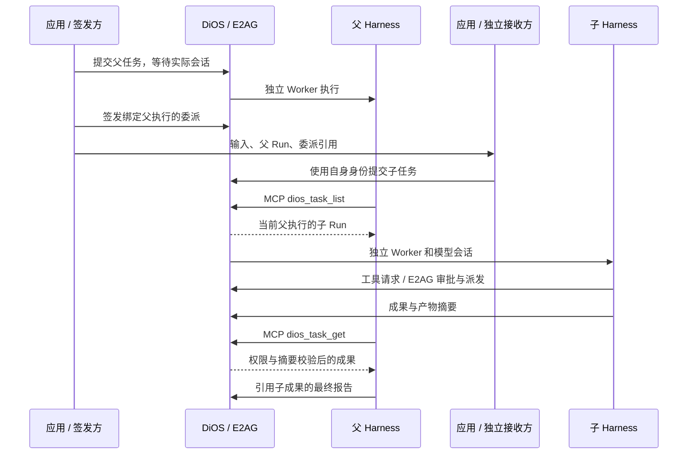

# 异构 Harness 的跨身份任务交接

DiOS 支持应用在两个独立认证身份之间交接父子任务。父 Harness 发现接收方已经提交的子任务，等待其完成，再引用经过校验的成果。应用管理参与方和业务步骤；DiOS 提供身份、权限交集、执行关系、审批、撤权与产物校验。



## 发现与读取

`dios_task_list` 使用现有 MCP `tools/list` 和 `tools/call`，工具名属于 DiOS 扩展。标准交互见 [MCP Tools](https://modelcontextprotocol.io/specification/2025-06-18/server/tools)。通道继续协商 `2025-06-18`，应用无需增加私有 RPC 或把 API 凭据交给模型。

Worker 从已认证执行通道取得父 Run、Attempt、Session 和租约 epoch。查询只返回该执行的直接子任务，最多 32 个，包含 ID、状态、版本、取消标记和当前 Attempt；成果通过既有 `dios_task_get` 单独读取。跨身份发现和成果读取均要求父 Work 获得目标 profile 的 `runtime.read_result`。任一子任务不可读取时整次发现返回授权错误。

SDK 的 `children()` 默认立即返回；MCP 默认等待 20 秒，最大 30 秒。已有子任务立即返回，空结果等待第一次入队。等待期间持续复核父执行和远程 Worker 身份，超时返回 `wait_exhausted`，调用方继续观察同一任务。完成的发现记录包含 Session、规范化参数摘要及返回 ID，ACP 原生工具活动逐次对应这份审计证据。

签发和接收沿用[父执行绑定契约](child-recipients-35.md)。应用保存两个独立幂等键，分别用于签发和接收；接收回执丢失时原键重试。父模型只负责发现和等待。通用示例 [acp_child_coordinator.py](../../examples/runtime/acp_child_coordinator.py) 的 `--receive-child` 模式支持 Cursor、Codex 和 DeepSeek Harness，最终验证器重新取得子成果并绑定产物摘要。

## 独立执行与撤权

父子任务分别拥有 Run、Work、Attempt、Worker 进程、工作负载进程、模型会话和产物。子任务使用自己的认证身份；原始主体和签发依赖保留在委派关系中。父任务结束、撤权或失去所有权时，未完成的子任务按既有取消与恢复机制处理。父报告必须在父授权仍有效时取得子任务的成功成果。

验证使用隔离数据库、合成代码输入、原生 OPA 和实际模型。签发与接收通过 SDK 访问独立的本地 HTTP API；审批使用单独审批者。原始记录保留在操作者的私有验证目录，公开证据仅包含运行标识、镜像、进程/会话关联和产物摘要。

| 父 Harness → 子 Harness | 完成并返回成果 | 父任务撤权 | 父 Worker 失联 |
|---|---|---|---|
| Cursor → DSH / ECNU Max | 通过 | 通过 | 通过 |
| DSH / ECNU Max → Codex | 通过 | 通过 | 通过 |
| Codex → Cursor | 通过 | 通过 | 通过 |

九个场景均保留独立 actor、Worker、工作负载进程和模型会话证据。三个成功场景各执行一次获批检索，父报告引用实际子成果；六个故障场景工具调用为零，旧审批被拒绝，原尝试和部分输出保留。[机器可读证据](evidence/recipient-harnesses-20261125.json)同时记录专项 13 项、相关回归 43 项、镜像内 35 项、安装版 SDK 63 项及设计契约 681 项的结果。开发环境切换保留全部 84 条历史任务身份。

## 运行方式

准备已授权的两个 Harness profile 目录、固定镜像摘要和 OPA 配置。父镜像包含 SDK 0.1.10 及通用协调器，子镜像包含对应应用；每个 Worker 只挂载自身 profile 授权的模型凭据。

```bash
backend/.venv/bin/python scripts/qualify_child_harnesses.py qualify \
  --authenticated-recipient --output /private/new-qualification \
  --parent-dir /private/parent --child-dir /private/child \
  --parent-harness cursor --child-harness dsh \
  --parent-image sha256:PARENT_DIGEST --child-image sha256:CHILD_DIGEST \
  --policy-evaluator /private/opa.json --scenario success
```

`--scenario parent-revoke` 在子工具等待审批时撤销父 Work；`parent-worker-loss` 终止真实父 Worker，确认工作负载仍存活，再在隔离数据库注入租约到期，检查停止子任务和保留唯一原尝试，最后模拟操作者确认退出并完成对账。两者都检查迟到审批无效、工具调用为零和部分输出留存。

底座更新包含发现通道、SDK 和审计关联，无新增数据库迁移。开发部署沿用排空、备份、切换与历史身份校验。应用镜像作为独立 Revision 发布。

外部 Provider actor-token 交换、物理跨主机、活动模型会话重接、严格跨 Provider 撤销排序及独立 G2 验收仍按整体计划推进。
