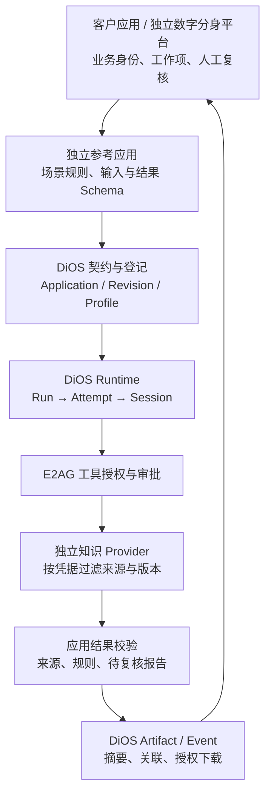

# 三类参考路径的统一接入契约

选型建议、岗位计划汇总和学生导读通过独立应用 `reference-workflows==0.1.0` 接入 DiOS。三条路径共享版本化 Runtime API、E2AG 工具通道、任务状态和产物查询；新增任务类型 `external.reference-workflow/v1` 由管理员登记，内核源码保持不变。

## 对象与接口映射

| 关联 | 上层所有权 | DiOS 能力与接口 |
|---|---|---|
| Workspace、EmployeeBinding | 业务空间、数字员工与岗位绑定由外部平台管理 | 可信主体、Work 授权和 scope；业务上下文只作为不透明引用 |
| WorkItem | 上层生成稳定工作项身份、选择模板并管理业务复核 | `POST /runtime/runs` 的幂等键；Run 中冻结 `payload.sample.id/context_id/sha256` |
| 应用与执行实现 | 应用包、业务规则及输入/结果 Schema | `GET /runtime/contracts`、应用兼容检查、不可变 Revision 和登记 Profile |
| 执行与会话 | 应用通过公开 SDK 发起受管工作负载 | Run → Attempt → 原生容器进程 → Session；`GET /runtime/runs/{id}` |
| 来源与检索 | 独立 Provider 管理资料版本和业务 ACL | 注册 MCP 工具、版本化权限、E2AG Work 与独立 ApprovalRequest；`/runs/{id}/tools` |
| 成果与复核 | `outcome`、引用含义与 `pending_review` 由应用定义 | 固定结果 Schema、Artifact 摘要、事件、下载授权；`/runs/{id}/artifacts/{artifact}/download` |

工具批准只批准此次检索。外发确认、岗位责任人补齐、教师复核和业务验收由上层工作项继续管理。

## 三条路径与原验收预期

| 场景 | 冻结输入和来源 | 应用结果 | 公共能力证据 |
|---|---|---|---|
| 专业服务 | indoor、续航至少 4 小时；spec-A 5 小时、spec-B 3 小时 | 推荐 A，排除 B 并给出续航原因，保留两份引用 | 输入摘要、固定 Revision、批准的来源检索、结构化结果及 Markdown |
| 岗位协作 | role-A/B/C 三份计划，B 缺负责人 | 三份来源完整保留，B 进入待指定列表 | 相同 Run/Attempt/Session、工具和成果接口；汇总规则位于应用 |
| 教育数字分身 | 讲义与教师受限答案分别存储；学生凭据仅授权讲义版本 | 导读仅含 lecture-1，结果及引用均不含受限答案 | Provider 检索前过滤、应用来源集合核验、E2AG 审批和授权下载 |

输入及预期继续使用 [原始合成场景](fixtures/reference-scenarios.json)。[可登记输入](../../examples/reference-workflows/mapping.json) 保存原始文件摘要和三条路径的关联。持续静态评审使用已有独立 `static-review` 应用及 [A01-1.02 生命周期证据](evidence/application-lifecycle-20261126.json)；其覆盖账本、完整故障场景和业务迁移仍按原责任项推进。

这三条路径使用确定性规则运行合成数据，用于验证应用扩展与公共能力契约。实际 Harness 的模型执行和恢复复用已通过的 Cursor / DSH 证据；六项共同治理场景、十八项故障及跨实现参考资格继续由 F03-2.02/.03 和 K01-5.01 承担。

## 新场景扩展

1. 在独立应用中定义业务输入、结果 Schema、来源引用和复核状态；业务验证代码留在应用包。
2. 通过公开 SDK/协议调用所需能力，将执行、工具权限和凭据引用交给管理员登记。
3. 构建独立镜像并固定摘要；声明应用兼容范围，发布 Revision 和输入目录。
4. 用稳定幂等键提交工作，按 Run/Attempt/Session/Artifact 保存输入与成果关联。
5. 核验应用结果、授权拒绝和业务复核规则；应用升级使用已具备的排空、健康检查和回滚机制。

本次新任务类型经公开 SDK、已部署 API、三个原生 Worker 和已有 Console 运行。应用镜像中没有 DiOS 后端或 SQLAlchemy，API/Worker 不导入应用模块。

## 工程证据与入口

[资格报告](evidence/reference-workflows-20261126.json) 汇总独立安装包的九项测试、三条原生执行记录、审批与来源、产物回读，以及 Console 展示和报告下载。调用失败、来源不足与业务复核状态分别记录。

开发 Console 的“任务”入口可选择“参考流程 · 选型建议 / 岗位计划汇总 / 学生导读”。应用包与 Provider 已独立部署，原开发 API 和既有 Worker 保持运行。
