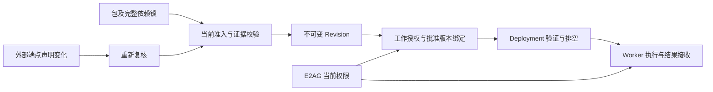

# 能力包 Registry 资格

DiOS 以不可变包摘要、依赖锁、准入证据和 Revision 连接分发与执行。包批准与 E2AG 工作授权共同决定能否执行；升级和回滚均重新验证当前权限。数字分身平台通过统一目录接口消费这些能力，客户流程保留在上层应用。

## 执行约束

携带 `package_lock` 的 Profile 必须通过已保存的 Revision 执行。旧 `enqueue --profile`、本地 Worker、远端 Worker 及 Console 内联 Profile 返回 `PACKAGE_REVISION_REQUIRED`。发布器可以读取候选 Profile 并冻结内容；真正入队时仍检查包准入与工作授权。Console 的 Revision/Deployment 指针及远程 Revision 导出沿用原执行契约。

消费端再次验证固定摘要和准入证据，与 [SLSA 的制品验证原则](https://slsa.dev/spec/v1.2/verifying-artifacts)一致。当前记录来源、许可和能力复核证据；签名信任根验证尚未实现。

## 原验收对应

| 验收 | 可核验行为 | 工程证据 |
| --- | --- | --- |
| K04-1-A01 受控安装 | 摘要、文件、依赖闭包及准入失败均拒绝；旧 Profile 入口无法绕过批准版本绑定 | 包锁、准入、发布门禁及新增执行入口回归 |
| K04-1-A02 升级与回滚 | 六次真实容器执行覆盖初始安装、失败升级、成功升级、保留旧内容、失效授权回滚拒绝和重新授权回滚；保存 Run、Attempt、产物及镜像摘要 | 本次原生 Registry 发布测试 |
| K04-1-A03 目录与分发 | API、CLI、SDK 共用目录查询；Console 提供筛选、分页、详情、限制和证据；包导出独立于部署激活 | 本次目录契约回归；源码摘要一致的 16 项浏览器检查、5 组 API/CLI/SDK 对照与独立 wheel 安装证据 |
| K04-1-A04 能力准入与变化 | 未批准、撤销及证据失效不能发布；Work 固定批准版本；端点版本、能力、协议变化及声明恢复均要求复核，已有任务保留恢复路径 | 本次准入与端点兼容回归 |

固定代码摘要、测试结果、六次容器执行、复用证据校验及开发部署记录见[完整资格证据](evidence/registry-acceptance-20261126.json)。

## 适用条件

发布与复核由受信 Linux 管理身份执行。外部端点资格使用合成协议服务验证；远端服务若保持声明不变而更换实现，声明比较无法发现该变化。远端模型实现回滚不受 DiOS 控制，本地固定镜像与配置可回滚。现有 Objects 和 OCI 发布器负责内容分发，当前未提供 OCI Distribution HTTP Registry 服务。

统一目录及界面见[目录契约](package-catalog-44.md)，安装、升级和回滚操作见[发布契约](package-registry-release-44.md)。
