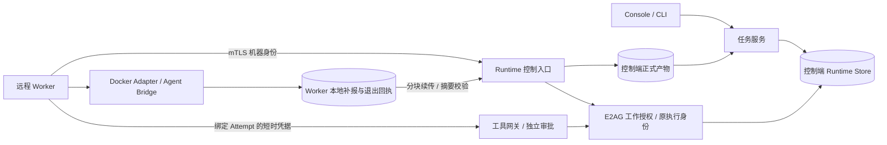

# 远程 Worker 执行与产物通路

文档标识：RUNTIME-REMOTE-1 · 状态：待评审 · 日期：2026-11-19。
关联：#30 / #32 / #33 / #34 / #58；模块责任：Runtime；独立安全评审人待认领。
基线：`02c3d5a`；本批实现位于 `feat/lightweight-runtime-32`。沿用 ADR 0010、领域/API 与 AUTHZ-1.0.0 契约。

## 交付与分层

控制台提交任务后，独立 Worker 经 mTLS 领取工作、汇报进程和会话状态、上传产物，最终报告由控制端统一查询和下载。Worker 使用自己的本地报告队列与退出回执目录；控制端独占访问运行数据库与正式产物目录。



L1 保持任务、Attempt、Worker 进程、Session 和 Artifact 的独立身份；L2 TaskConsole 负责受保护查询及下载，评审结论校验继续属于应用层。Agent 的具体厂商及模型不进入远程控制协议。SQLite 文件只由控制服务访问，远程 Worker 不通过共享文件系统连接数据库。

## 身份与 E2AG

注册和领取使用已登记的客户端证书，校验 audience、scope、profile、证书期限及机器启用状态。登记表把 Worker ID/instance 与证书、机器前缀和 profile 持久绑定。每次调用重新检查；已有登记不能被新证书或进程身份覆盖。

领取与初始 E2AG 执行 Grant 在同一事务提交，授权失败时一起回滚。后续 execute、会话绑定、续期和 accept_result 均由控制端的 WorkAuthorizationVerifier 执行。工具请求复用 #33 的短时凭据和 #34 的审批/派发/回执链路；已撤销的凭据族也阻止执行续权、心跳和新阶段报告。

结果接收独立于执行续权。租约失效后只允许原机器证明原 Attempt 的退出与结果，不能靠补报恢复执行权。撤销或取消不阻止原始失败证据归档；成功接收必须通过当前 E2AG 权限和工具结果已对账检查。拒绝记录在回滚操作后单独保留，包含证书、Worker、动作和原因。

Worker 工具通道的错误审计经网关绑定原 Attempt 保存。审计服务暂不可用时，Agent 仍收到明确的拒绝或待就绪错误；会话就绪竞争可以按协议等待，不会退化成无原因的连接断开。

已登记 Worker 是可信执行宿主。容器 Agent 只访问受控 Unix socket，不能访问控制端证书、数据库连接或管理令牌。恶意宿主防伪和厂商原生工具旁路认证由 #33/#58 继续推进。

## 协议与状态

复用 `dios-worker-tools/1` 的 mTLS 传输与有界帧，新增 `runtime.*` 消息。控制帧字段为 protocol、audience、scope、profile、profile_digest、worker_id、instance、request_id、message。message 包含 method/params，未列出的操作或参数拒绝。

| 操作 | 身份/事务约束 | 结果 |
| --- | --- | --- |
| register / drain | 注册机器证书与进程 instance；drain 不重置 | 注册或停止领取 |
| claim | 领取 nonce、机器槽位、原子 E2AG 授权 | 同请求返回同一 Attempt |
| get / recoverable | 已登记原机器、scope/profile、原 Attempt | 当前状态或有界恢复页 |
| authorize / heartbeat / report | Worker/instance/epoch、有效 Grant、会话 | 授权、续租或原序号补报 |
| observe | 原 handle/进程实例、可信 Worker | 真实运行证据及新鲜度 |
| upload.begin / chunk / finish | 原 Attempt ACL、大小/偏移/摘要 | 可续传的接收位置及完整产物 |
| artifact.read | 本 Attempt 已完整上传的对象 | 有界二进制分块 |
| complete / finish_failed / confirm_cancel | 原所有权、成功校验或实际退出证据 | 原子终态及幂等回执 |
| resolve_exit | 原 Attempt、期望版本、退出回执、E2AG accept_result | 原身份恢复，保留旧 epoch |

副作用边界的请求摘要和响应保存在 `runtime_remote_receipts`；丢失领取或最终响应可重取原结果。阶段报告沿用本地 spool 和原序号，重复/乱序不产生新 Attempt。过期 Worker 的报告保留为待处理证据，不能覆盖新所有者状态。

机器默认一个执行槽位，可在受信登记配置 `slots`（1～32）。活动和结果未知 Attempt 都占槽；新的进程 instance 不能绕过尚未对账的占用。重启恢复仅处理原机器的记录，确认被隔离的旧执行仍活跃时停止原容器并保存退出证据，再校验原输出；缺少退出证据时保持待对账。

服务升级先 scope drain，活跃任务自然完成。ready_for_cutover 为真后切换；网关关闭等待已接纳请求结束。单次观测超时保留未知状态，不自动重派。受管执行沿用禁止离线执行的策略，控制连接失效时停止执行并保留本地输出，恢复后进行对账。

控制网关每五秒巡检过期租约，所有 Worker 均断连时也能进入待对账状态。控制端恢复后继续巡检原记录。

## 产物与存储

上传分块最多 64 KiB，使用 base64 包装原始字节，不在块边界解码 UTF-8。每块先保存内容寻址文件，再持久确认偏移；重复块必须与原摘要和长度相同。完整对象经过 SHA-256 与长度校验后才可引用。

权限通过 scope/Attempt 上传账本判断；知道另一任务的内容摘要不能读取对象。相同内容在底层复用，但每个 Attempt 独立保留关联。本批限制单对象 8 MiB、每 Attempt 最多 16 个上传/32 MiB，总体保留和回收策略由 #32 扩展。

新增独立 remote schema v1，包含注册、请求回执、上传和分块账本。PostgreSQL 同次增量迁移将进程实例字段扩为 TEXT，保留完整容器 ID/启动时间；原有基础 Schema 校验和不变。SQLite 备份涵盖完整上传及未完成上传的分块，可以继续上传。控制端磁盘与发行密钥须分别按既定备份策略保管。

## 配置、启动与升级

控制端沿用 tool-gateway 命令，在 server 配置增加 `runtime_control_enabled: true`。默认示例保持关闭。Gateway 需要工作策略、机器登记、获准 profile 和产物目录；启用工具链时继续配置工具目录与独立审批人。

Worker：

```sh
python -m app.runtime.cli --scope pilot remote-worker \
  --control-file /private/worker-control.json \
  --profile /private/agent-profile.json \
  --artifacts /var/lib/dios/worker-objects
```

client 配置采用 automatic 模式和独立客户端证书，见 `examples/runtime/remote-worker-client.example.json`。Worker 不需要数据库 URL、控制端对象路径、工作授权策略文件或审批管理员凭据。model Secret 仍通过 Worker 本机的受信 Provider 引用，工具 Secret 保留在网关。

升级：scope drain → 等待无活动/未知执行和工具调用 → 备份 → 显式 migrate → 部署网关和 Worker → 恢复领取。新增版本不会在启动时自动迁移。回退先排空，保留新增表及回执，再切回已验证版本；需要还原数据时使用恢复副本并完成原所有权对账。

## 验证与剩余工作

证据：[全量后端](evidence/remote-worker-regression-20261119.json)、[开发部署与浏览器流程](evidence/remote-worker-development-20261119.json)。自动化覆盖真实 mTLS/Docker、SQLite/PostgreSQL、领取/完成响应丢失、重复触发、断连后原结果恢复、旧 epoch 拒绝、E2AG 与机器撤销、中文分块、上传续传、备份和自然排空。

开发环境使用独立 Worker 进程和分离产物目录，通过网络协议连接本机网关。真实双物理主机、Windows 执行适配及第三方模型/Agent 资格由 #58 验证。前端显示在线 Worker、实际并发、最近心跳、观测过期及关联任务；工程验证与用户参与的产品验收分开记录。

#30 保持 In Progress：下一项是分类故障、端点限流/额度熔断、单路试恢复，以及持久定时与重叠触发合并。#32 继续上传/回执保留回收、分页与容量验证；#33 继续证书托管轮换；进入 G2 前完成独立权限评审。

本批工程结果：后端 350 项通过、3 项 SQLite 专属用例在 PostgreSQL 下跳过；前端构建与 9 项测试通过。开发环境完成浏览器提交、实际并发观测、等待审批期间凭据续期、批准执行和报告下载。
