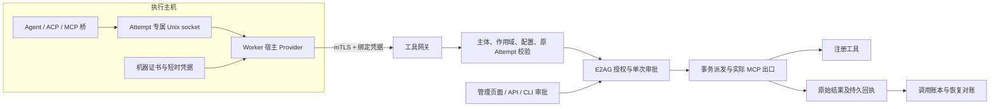

# DS-33-34：跨主机 Worker 身份与工具网关

状态：工程验证已完成，产品验收待用户参与（2026-11-13）；未提交、未推送。证据见 [工程验证记录](runtime-engineering-verification-20261113.md)。
适用基线：`feat/lightweight-runtime-32`，基于 `c705de0` 的本地未提交开发稿。
依赖：ADR 0007、AUTHZ-1.0.0、工作授权/动作门禁、Worker 通道及工具回执。构建、自动化测试和开发部署由开发方持续执行；用户参与产品验收。

## 目标与职责

执行主机上的 Agent 经本地受限通道访问远端工具网关。网关验证机器证书、发送方绑定短时凭据和原执行身份，沿用 E2AG 审批及派发门禁。审批人凭据、上游工具凭据、工具原始结果及回执保留在网关侧；模型凭据按固定 profile 单独挂载。



这是 L1 工具执行 Provider。L2 的员工、业务审批与交付责任继续由 #36/#38/#40 承接，A2A/ACP/MCP 的智能体接入职责保持既定分层。

## 身份与契约

专用 TLS 服务使用 ALPN `dios-worker-tools/1`，每连接一个有界 UTF-8 JSON 请求及响应。服务端直接取得 TLS 对端证书，不接受 HTTP 头自述身份。双向证书链验证、客户端服务名验证、TLS 最低版本 1.2；TLS API 依据 [Python ssl 官方文档](https://docs.python.org/3/library/ssl.html)。此传输为内部可替换 Provider。

网关凭据目录保存证书 DER SHA-256、短时令牌 SHA-256、主体、Worker ID、audience、允许的 scope/profile 组合、起止时间和启用状态。令牌使用至少 32 个随机字节生成的 base64url 字符串，有效窗口最多 900 秒；原文只在 Worker 私有文件和 TLS 请求中出现。网关每次请求、派发前重读目录，支持停用和轮换。此段为兼容 file 模式。自动模式通过注册机器证书签发和续期，令牌原文仅驻留宿主内存，详见 [凭据生命周期](worker-credentials-33.md)。

Worker 每次进程启动使用“登记 ID:随机进程 ID”，instance 继续独立生成。证书和令牌绑定登记 ID 及其进程 ID；原 Attempt 的 worker_id、instance、epoch 必须与数据库所有权一致。新进程保留独立身份，历史进程记录继续用于对账。

请求固定包含 protocol、audience、scope、profile、profile_digest、binding、access_token 和 message。binding 为原 Run/Attempt/Worker/instance/epoch；Session 从服务端 Attempt 读取。允许的方法沿用 describe、ready、request、advance、verify_activity、deny_native；审批、任意工具地址和客户端权限清单不在此接口中。

网关从操作员配置读取 profile 文件及工具映射，核对 Run 固定指纹；profile 或身份停用发生于 MCP 初始化期间时，实际派发前再次检查。TLS 主体及证书摘要进入身份审计和派发证据，令牌原文不进入事件或回执。

## Secret 与控制点

`tool_channel.worker_secret_refs` 列出允许挂载给 Agent 的引用名，并随整个通道策略进入 LaunchSpec 指纹。远端模式只解析这些引用；工具注册的 credential_ref 必须在原工作授权中，且与 Worker 挂载引用互斥。更改分区需要重新固定 profile 与工作授权。

```json
{
  "tool_channel": {
    "tools": {"repository_search": "repository-search"},
    "acp_names": {"mcp__dios__repository_search": "repository_search"},
    "worker_secret_refs": ["model/cursor"]
  }
}
```

Worker 的 TLS 私钥与短时凭据留在宿主 Provider；它们不由通道挂载或传给模型。宿主配置和已有 Docker 挂载仍属于受信操作员边界，需要在 #58 验收中检查挂载目录及网络出口。

## 一致性、容量与恢复

网关调用复用原调用幂等键、单次审批、派发事务和本地回执，不引入第二套调用账本。请求上限 96 KiB，响应上限 2 MiB；最多 64 个已接入连接，每个 Worker 同时处理一个工具消息。本 Provider 按单网关实例设计，多副本的全局并发控制由后续持久调度能力承接。

BUSY 在动作准入前返回，客户端有界等待后用同一请求重试；网络错误、超时和响应丢失不自动重发请求。调用仍可按原 ID 查询。完整结果在网关先持久化，Worker 断连不丢弃已持久化的回执；网关周期恢复每 profile 使用独立扫描游标。

正常关闭网关时停止接受连接，等待已接入调用结束。部署升级先使用已有 scope drain，让活跃任务自然结束，再关闭网关；直接关闭工具网关会使尚未结束的 Agent 暂时无法发起后续工具调用。全局 restore_hold 继续阻止写入和派发。

## 启动与兼容

新增停用示例：`examples/runtime/tool-gateway-{server,client,profiles}.example.json`、`worker-identities.example.json`。示例证书摘要、登记期限和路径需由受信配置替换。开发环境已部署独立测试证书和自动签发配置。

启动接口如下；开发环境使用隔离配置验证：

```sh
python -m app.runtime.cli --scope pilot tool-gateway \
  --config /private/gateway.json --artifacts /srv/dios/objects \
  --policy-file /private/work-policy.json --tools-file /private/tools.json \
  --identities-file /private/worker-identities.json --profiles-file /private/gateway-profiles.json \
  --approvers-file /private/approvers.json --secrets-file /private/tool-secrets.json

python -m app.runtime.cli --scope pilot worker \
  --profile /private/agent-profile.json --artifacts /var/lib/dios/objects \
  --policy-file /private/work-policy.json --secrets-file /private/model-secrets.json \
  --tool-gateway-file /private/gateway-client.json
```

数据库 URL 沿用 `DIOS_RUNTIME_DATABASE_URL`。Worker 的本地 tools/approvers 配置与远端 Provider 互斥。既有 Console/API/CLI 审批入口不变，需与网关使用相同 scope、工具目录和回执存储。

当前 Worker 仍通过既有 RuntimeStore 完成领取、心跳和任务成果存储；本批仅远程化工具链路。可信 Worker 跨主机试点需要已支持的网络数据库拓扑与独立产物安排；SQLite 文件不能通过网络共享充当跨主机控制面。完整的远程任务领取/报告 API、统一产物访问和不可信 Worker 隔离继续由 #30/#32/#33 承接。

工具网关沿用原工具 Schema；自动凭据新增独立 credential schema v1，迁移和备份见凭据生命周期文档。回退可关闭远端配置，恢复本地通道；已派发调用及回执仍须在原网关对账。切换前沿用排空检查，不能将未知调用在另一端重新执行。

## 验收与后续

回归用例 `backend/tests/test_runtime_remote_tools.py` 覆盖证书/令牌/受众/作用域拒绝、旧 instance/epoch、非法方法、原调用审批与重复查询、MCP 初始化期间身份撤销及 profile 停用、派发证据绑定、响应丢失后的回执、凭据期限及挂载分区指纹。

真实验收还包括：双主机 TLS 握手，未知 CA/过期证书/服务名错误/无客户端证书，证书及令牌轮换，进程与主机重启，网关断网/重启/排空，回执与远程看板一致性，以及 Agent 读取宿主凭据和绕过受控出口的反例。自动化测试已通过，#33/#34 保持 In Progress。

#33 短时凭据签发、自动续期、丢失响应恢复和持久撤销已接通，见 [工程证据](worker-credentials-33.md)。下一步将工具 Provider 接入 #30 的完整远程 Worker 控制面及产物访问。#58 负责真实 Agent/双主机资格验证，#40 复用当前审批链路。安全评审人待认领，评审与测试通过后进入 G2。

工程构建、自动化测试和开发部署以 [2026-11-13 验证记录](runtime-engineering-verification-20261113.md) 为当前依据；产品验收和真实第三方端点资格分别跟踪。
