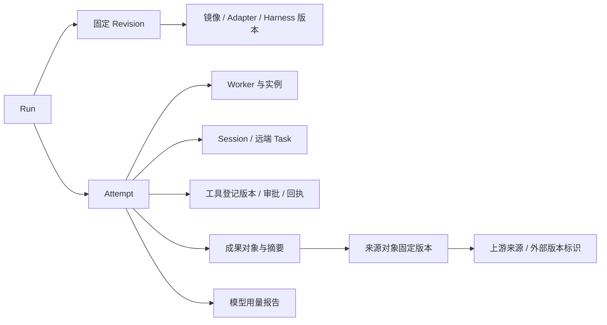
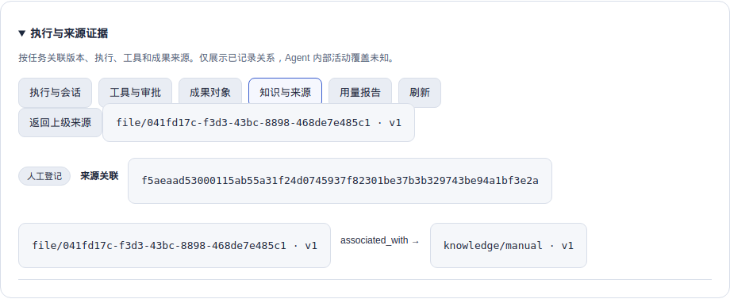

# 执行与来源证据

任务证据入口按同一 Run 关联不可变 Revision、各次 Attempt、Worker、Session、工具审批和结果、成果对象、来源版本及模型用量。API、CLI、SDK 和 Console 使用相同查询语义。



关系使用已有持久身份和明确登记的对象关联。重试、更换 Worker、文件发布新版本和控制面重启均保留原关联。历史 Revision 的校验读取独立于当前 Adapter 版本，因此更换执行实现后仍可查询历史版本。

## 查询契约

`GET /api/os/runtime/runs/{run_id}/evidence`

参数为 `section`、`limit`（1–100，默认 50）和可选 `cursor`。返回当前 Run 摘要、执行版本及依赖摘要、该类记录、`next_cursor`、访问范围和观测时间。Cursor 绑定 scope、Run、记录类别及调用身份；分页涵盖扫描记录，权限过滤后为空的页面仍需继续读取 `next_cursor`。

| section | 关联内容 | 权限 |
|---|---|---|
| `attempts` | 尝试、Worker 实例、会话及远端 Task/Context | `run.read`；会话标识另受对象权限约束 |
| `tools` | 工具登记摘要、动作权限、参数摘要、审批状态、结果状态和原因 | `run.read`、`tool.read` |
| `artifacts` | 成果对象、所属尝试、内容摘要及大小 | `run.read`、`artifact.read`、对象读取权 |
| `sources` | 成果或会话的显式来源关系、固定源版本、源对象摘要 | `run.read`、`artifact.read`；来源两端各自的对象读取权 |
| `usage` | 各次尝试的原始用量报告序列 | `run.read`；保留报告口径，禁止跨快照直接相加 |

来源对象可通过既有对象 `relations` 接口继续逐级追踪；Console 提供“继续查看来源”和返回上级入口。每页按当前权限读取。源码正文、工具参数、执行命令、凭据引用、存储路径和原始工具响应不进入该查询。

```bash
backend/.venv/bin/python -m app.runtime.cli --scope example evidence RUN_ID \
  --artifacts /srv/dios/artifacts --section sources --limit 50
```

数据库配置沿用 `DIOS_RUNTIME_DATABASE_URL`。CLI 是具有数据库访问权的本地运营入口；HTTP/SDK 另执行调用身份检查。

```python
page = client.evidence(run_id, section="sources", limit=50)
while page["next_cursor"]:
    page = client.evidence(run_id, section="sources", cursor=page["next_cursor"])
```

SDK 版本为 0.1.17。对象关联登记继续使用既有 `link_objects` 运营接口；数据查询不创建关系或执行授权。

## 证据等级与缺口

| 标记 | 含义 |
|---|---|
| `platform_recorded` | 平台持久保存的版本、对象或工具生命周期事实 |
| `worker_observed` | Worker 已报告的运行环境观测 |
| `remote_reported` | 远端协议报告或已取得的工具结果 |
| `agent_reported` | Agent 原协议用量报告；保持未核销、不可直接累加 |
| `operator_declared` | 运营者明确登记的来源关系；内容实际使用情况另需执行证据 |
| `unknown` | 缺少相应事实或结果未确定 |

未报告的值保持未知，查询不生成估算值。工具错误回执与完整结果分别记录：`result_unknown` 即使已保留回执，结果证据仍为 `unknown`。平台工具记录覆盖已接入门禁的调用；Harness 内部未上报的活动显示 `not_observed`。没有可见记录可能来自未记录或当前访问范围，页面不会据此推断活动未发生。

执行关系参考 [W3C PROV-DM](https://www.w3.org/TR/prov-dm/) 的活动、实体、主体与来源语义。工具事件分类参考 [OpenTelemetry GenAI tool execution](https://github.com/open-telemetry/semantic-conventions-genai/blob/main/docs/gen-ai/execute-tool.md)，该语义约定当前仍处于 Development。此入口提供持久关系查询；OTLP 与治理性能报告沿 #46 后续工作推进。

## 工程验证

SQLite、PostgreSQL 和相关权限回归共 51 项通过，覆盖跨 Worker 重试、历史 Revision 读取、来源替换后固定版本、审批与结果未知、用量报告分级、跨作用域拒绝、分页与重启、读取中凭据撤销、实际 CLI 和 SDK HTTP 调用。六项浏览器检查覆盖会话、审批、固定源版本、逐级来源、英文及暗色移动视口。

完整证据见[验证记录](evidence/run-evidence-20261126.json)。


