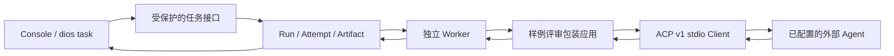

# 任务入口、ACP 接入与成果交付

状态：工程验证与开发部署持续交付；真实 Cursor 切片见 [#56/#58 工程记录](cursor-acp-56-58.md)（2026-11-20）。证据见 [工程验证记录](runtime-engineering-verification-20261113.md)。

关联 #30 最小运行入口、#56 首个 ACP 接入、#58 联合验收；页面沿用 #28 的任务与成果语义。首个应用切片为固定样例的静态评审。

## 用户路径

Console 新增“任务与成果”，地址 `#console/tasks`。用户选择已启用的 Agent 配置及测试样例，填写工作目标后提交。页面显示排队、准备、会话、输出、校验、终态与观测新鲜度；执行完成后查看报告、原始流和诊断附件，支持下载原文件及 Markdown 报告。

任务以持久 Run 保存，提交重试沿用幂等键。浏览器在当前会话保存未确认提交的键；内容变化产生新键，成功确认后清除。取消操作带版本号，冲突后刷新状态；活动进程退出前显示取消待确认。历史详情同时关联 Attempt、Session、进程、事件及产物。轮询按版本保留较新状态，查询失败保留上次结果并显示更新中断。

“执行完成”和“待人工复核”分别表示技术执行状态与报告复核状态。首批复核状态为报告标记，正式 WorkItem 验收/退回流程由 #40 承接。

## 组件与职责



- `app.runtime` 负责持久调度、进程观测、阶段报告、ACP 通信与统一产物结构。ACP 适配器接受应用提供的 prompt 和结果验证器。
- `app.apps.inline_review` 提供合成样例、提示模板、行号/代码引用校验与 Markdown 报告。业务评审规则保留在应用包装层。
- `app.services.task_console` 组合受信执行目录、样例应用和内核运行查询；`/api/os/runtime` 是单操作员 Console 入口。HTTP 只入队，独立 Worker 领取执行。
- `frontend/src/apps/console/components/TaskRunsPage.tsx` 和 `cli/dios task` 消费相同接口。现有员工工作台原型继续使用合成数据；企业员工身份及对象权限按 #36/#38/#40 接入。

## 接入与授权

ACP 客户端按 v1 完成 initialize、可选 authenticate、session/new、可选 mode、session/prompt，处理更新、请求和退出；将会话、输出和完整结果转换为既有 Worker JSONL 协议。输出有界，按完整 UTF-8 JSON 行解析，子进程 EOF 使待响应请求结束；超时保留部分输出。关闭时发送 cancel 并等待退出，超时后在托管容器内终止子进程；非零退出不能形成成功结果。

首个配置样例使用 Cursor 的 `agent acp`、cursor_login 和 ask 模式。提供默认停用的 profile 与预置凭据文件映射；运行镜像、具体 Agent 版本、可执行路径、无人值守认证及网络出口需要在验收环境固定。仓库不包含模型凭据或厂商二进制。

平台已接入 #33/#34 的 [持久工作授权开发稿](work-authorization-33-34.md)，execute / accept_result 分开核验，支持会话绑定、受限续期和撤销。此切片使用受信操作员和固定内联样例；ACP 权限请求全部拒绝，Client 文件/终端能力未开放，发现原生工具活动时拒绝将结果归为成功。ask 模式和这些客户端拒绝不能证明所有内置工具已受控；#33/#34 继续接入工作授权验证器、凭据生命周期、实际工具控制点与续期，#58 验证拒绝效果。

结果验证检查样例 SHA、结果结构、行号范围和证据在对应源码中的存在性。缺陷真实性、漏报及业务影响由后续独立评测和人工复核确定。

## API 与 CLI

| 接口 | 用途 |
| --- | --- |
| GET /api/os/runtime/profiles、samples | 已启用执行配置及固定样例 |
| POST /api/os/runtime/runs | 使用 profile_id、sample_id、goal、idempotency_key 入队 |
| GET /api/os/runtime/runs | 按时间和 ID 游标分页 |
| GET /api/os/runtime/runs/{id} | 阶段、有效输出片段、尝试、事件与产物 |
| POST /api/os/runtime/runs/{id}/cancel | expected_version 约束的取消请求 |
| GET /api/os/runtime/runs/{id}/artifacts/{artifact}/preview | 有界 UTF-8 / Markdown 预览 |
| GET /api/os/runtime/runs/{id}/artifacts/{artifact}/download | 原文件或 format=markdown 报告下载 |

接口须显式启用，并配置操作员 Token；下载也走同一鉴权。运行作用域由服务配置固定。客户端不能提交命令、宿主路径、挂载或凭据。配置目录只返回展示字段；下载校验作用域、Run 关联和内容摘要，使用附件响应；页面不执行报告 HTML、不加载报告内图片。

CLI（工作授权撤销使用 `dios task revoke RUN_ID --revision VERSION`）：

```bash
python3 cli/dios task profiles
python3 cli/dios task samples
python3 cli/dios task submit --profile cursor-inline-review --sample first-item --goal '检查边界条件' --key review-demo-1
python3 cli/dios task list
python3 cli/dios task show RUN_ID
python3 cli/dios task cancel RUN_ID --revision VERSION
python3 cli/dios task preview RUN_ID ARTIFACT_ID
python3 cli/dios task download RUN_ID ARTIFACT_ID --format markdown --output report.md
```

CLI 使用 DIOS_ACCESS_TOKEN 与既有 base URL，支持 --base-url；提交重试复用 --key。下载拒绝覆盖已有文件。

## 启用与产品验收

1. 在隔离环境准备可用的固定版本 Cursor 镜像，包含 backend 包和可执行 Agent；核对 `cursor-acp-config.json` 中绝对可执行路径、认证方式、模式和凭据文件读取权限。网络只开放所需模型服务。
2. 使用新的测试数据库与产物目录。通过已有 runtime CLI 显式 migrate；API 不自动迁移。设置 `DIOS_RUNTIME_DATABASE_URL`、`DIOS_RUNTIME_SCOPE`、`DIOS_RUNTIME_PROFILES_DIR`、`DIOS_RUNTIME_ARTIFACTS_ROOT`、`DIOS_ACCESS_TOKEN` 和 `DIOS_RUNTIME_CONSOLE_ENABLED=true`。受管入口另配置 `DIOS_RUNTIME_POLICY_FILE`，Worker 配置 `DIOS_RUNTIME_SECRETS_FILE`。
3. 将 profile 副本放入受信配置目录，替换示例宿主路径、镜像和网络，设置 `console.enabled=true`；独立 Worker 使用同一数据库、scope、profile 和产物目录。先验证凭据和受控执行，再开放页面入口。
4. 运行下述回归、构建与浏览器检查，记录实际版本、结果与失败项；通过后再推送本批代码。

待执行命令（从 backend 目录）：

```bash
.venv/bin/python -m unittest discover -s tests -p test_runtime_task_console.py -v
.venv/bin/python -m unittest discover -s tests -p test_runtime_acp_bridge.py -v
```

随后执行既有完整后端回归（隔离 PostgreSQL/Docker）、frontend build/lint 和 CLI 回归，再做真实 Cursor 及浏览器验收。当前未执行这些命令。

| 验收场景 | 通过条件 |
| --- | --- |
| 页面入口与窄屏 | 表单、列表、详情和 Markdown 可读，长目标/错误/源码不溢出 |
| API/下载鉴权 | 未认证、错误作用域、跨 Run 产物请求被拒绝 |
| 提交丢回包/刷新重试 | 相同键保持一个 Run，内容改变产生明确冲突 |
| 独立领取 | API 入队不执行，Worker 启动后产生真实进程与会话证据 |
| 中文流与状态新鲜度 | 中文分块完整，旧版本不覆盖新状态，查询失败显示观测问题 |
| 结果与证据 | 报告、摘要、源码 SHA、行号和引用一致；编造引用不成功 |
| 取消竞态 | 旧版本冲突明确，取消待确认直到执行端退出 |
| 崩溃与补报 | 保留原任务/会话/部分输出，完整结果先恢复校验 |
| 工具控制 | Client 文件/终端调用及权限请求拒绝；原生路径列明实际控制证据 |
| Agent 退出/RPC 悬挂 | 子进程退出结束等待，超时保留现场，非零退出不成功 |
| 成果下载 | Markdown 与预览一致，摘要损坏阻断读取，现有目标文件不覆盖 |
| 与既有功能兼容 | Console 其他页、CLI、旧报告摘要及恢复/补报回归通过 |

## 协议依据

- [ACP v1 Session Setup](https://agentclientprotocol.com/protocol/v1/session-setup)
- [ACP v1 Prompt Turn](https://agentclientprotocol.com/protocol/v1/prompt-turn)
- [Cursor ACP](https://cursor.com/docs/cli/acp)

实现依据文档与 #57 的既有探测；本批新增接口和真实 Agent 组合仍待上述验收。

工程构建、自动化测试和开发部署以 [2026-11-13 验证记录](runtime-engineering-verification-20261113.md) 为当前依据；产品验收和真实第三方端点资格分别跟踪。
