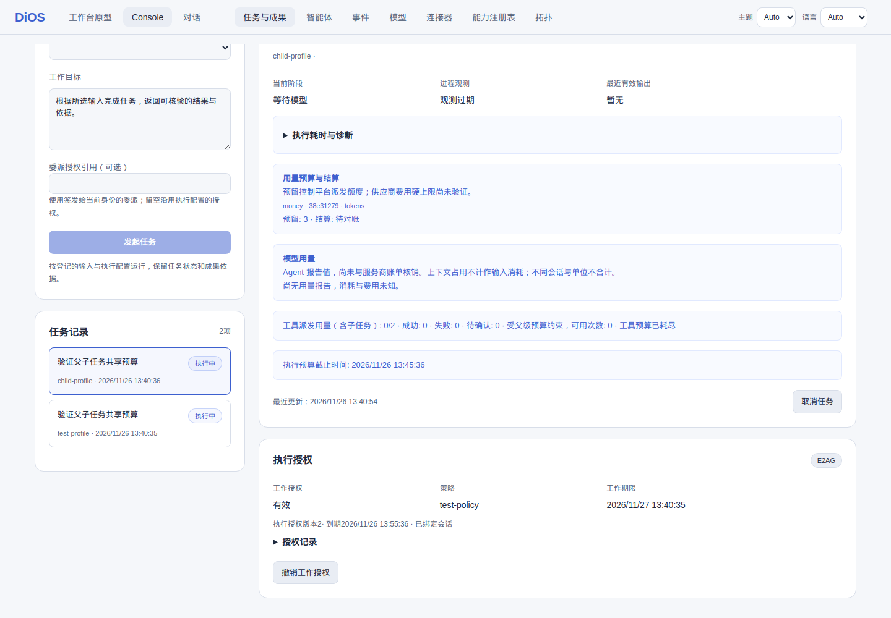

# 父子任务预算

子任务继承祖先任务适用的并发、领取频率和用量账户；自身限制与祖先限制共同生效。继承关系来自已通过 E2AG 的持久子任务绑定，切换执行 Profile 不会脱离父级约束。

这一层级规则与 [cgroup v2 的层级资源约束](https://www.kernel.org/doc/html/latest/admin-guide/cgroup-v2.html#introduction)一致：子级可进一步收窄资源，父级限制覆盖整个子树。DiOS 将该原则应用于任务与派发账本，CPU、内存等进程资源仍由既有运行适配器负责。

## 计账与执行

| 资源 | 计账范围 | 执行控制点 |
| --- | --- | --- |
| 并发、领取频率 | 选择器匹配的任务及其后代；重叠匹配不重复计算 | Attempt 创建事务 |
| Token、金额预留 | 子任务同时占用祖先和自身匹配的账户，每个账户/Attempt 一份预留 | Attempt 创建与预留原子提交 |
| 工具派发 | 各任务绑定上限约束自身及整个子树；祖先上限同时检查 | E2AG 授权、审批消费、派发记账的同一事务 |
| 执行期限 | 自身期限与祖先已绑定期限的最小值 | 首次领取绑定，后续执行、工具和续租复核 |

工具结果未知仍占用额度。取消请求、超时或父级撤权不会返还已经提交的调用次数，也不会把未对账费用清零。重复工具回执沿用原身份。已有任务的绑定期限和工具上限保留；配置停用后，新子任务仍受祖先已绑定上限约束。

Console 工具用量标明“含子任务”；子任务另外显示祖先约束下的可用次数，不展示祖先 ID 或其他分支的明细。API 与 CLI 消费同一 Runtime 查询结果，SDK 的通用任务/工具返回结构可直接读取新增字段。

## 等待容量

`child.get` 在子任务排队且并发、领取频率或费用预算受阻时立即返回 `wait_blocked` 原因列表，`wait_exhausted` 为 false。任务身份保留，调整额度后可继续执行和查询。无阻塞原因时沿用最长 30 秒的有界等待；读取、结果访问和返回前的 E2AG 校验保持生效。

等待中的父进程仍然存活并占用容量。[Ray 的嵌套任务](https://docs.ray.io/en/master/core/tasks/nested-tasks.html#yielding-resources-while-blocked)可在阻塞期间释放逻辑 CPU，但保留 GPU；DiOS 当前并发额度统计实际执行尝试，不能直接按查询等待释放。当前交付提供立即诊断与人工调整后的继续执行。父级安全让出执行位置、恢复后的重新领取以及多个父任务相互占满容量的完整解决仍属于 K04-2.02 的后续验收。

## 工程证据

[预算树验证记录](evidence/task-tree-budgets-20261126.json)覆盖 SQLite/PostgreSQL、独立连接竞争、跨 Profile 与三层继承、父级撤权、未知工具结果、配置停用后的期限保留、真实 Unix 工具通道和预算恢复后子任务执行。测试使用合成任务；商业模型账单能力保持原通道资格。

