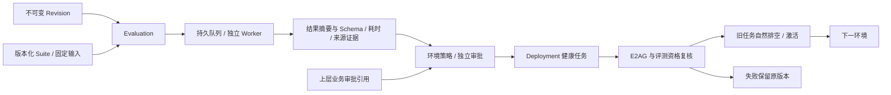

# 技术评测与环境晋级

DiOS 用版本化技术评测决定候选能力是否具备进入目标环境的资格。业务质量指标和业务审批由上层平台维护；DiOS 保留外部审批的 URI、版本和摘要，并执行独立技术审批、E2AG 授权与 Deployment 激活门禁。



## 对象和边界

| 对象 | 固定内容 | 责任 |
|---|---|---|
| Suite | 版本、摘要、1–8 个输入样例、结果 JSON Schema、最长执行耗时 | 操作者维护技术验收条件 |
| Evaluation | 精确 Revision、Suite 引用、输入摘要、E2AG 策略摘要、原始 Run/Attempt/Session/Artifact | Runtime 执行，评测控制器核验 |
| Environment | development/test/production 阶段、Suite 引用、证据有效期、来源环境、业务审批引用要求 | 管理环境晋级规则 |
| Binding | 部署 ID、环境 ID、能力定义 ID | 新部署发布前绑定，绑定后不可改写 |
| Promotion | 评测、环境策略版本、目标部署版本、来源部署、外部引用、独立审批人 | 显式申请、批准、发布 |
| Deployment | 健康任务、活跃/前一 Revision、排空状态、失败原因 | 真实发布与激活控制点 |

环境是 DiOS 内的逻辑发布范围，可覆盖多节点 Worker；基础设施资源由既有部署和资源能力提供。客户、岗位、配方及业务项目模型属于上层应用。

## 门禁语义

评测状态为 `running / passed / failed / inconclusive`。缺少、损坏或无法验证的结果进入 `inconclusive`，补齐证据后可重新核验；已有完整结果不会重复调用模型。查询失败只表示观测不可用。耗时从最早执行尝试开始，包含重试与冷却，到最终尝试结束；排队等待单独保留在原始事件中。

模板采用 JSON Schema 2020-12 的本地引用，禁止网络 Schema 获取。输入复用 Revision 内的登记样例或动态输入契约。单结果核验上限为 64 KiB；较大的成果通过 Artifact 引用提供，评测消费其摘要结果。两个版本只有 Suite 引用和输入摘要完全相同、结果已确定时才可比较。

受控部署的所有发布入口及最终激活都复核：精确 Revision、环境配置版本、评测通过且未过期、结果对象可用、E2AG 策略、独立审批人当前权限、来源环境活跃版本。远程 A2A 端点还必须保持已接受的声明摘要。协议、适配器或工具、知识、模型、提示配置的版本变化，须形成新 Revision 并重新评测；远端内部变更依赖可观测声明，无法证明的内部行为不提供自动回滚保证。

审批权限为 `environment.<环境 ID>.promote`。操作主体、E2AG actor/subject 不能自行批准。发布前发现审批人撤权会持久化 `invalidated`，重新开通账号后仍需新申请。技术审批凭据仅通过请求头传递，CLI 从环境变量读取。

生产环境必须声明前置环境。业务审批引用只记录和绑定，不代替上层系统确认业务审批含义。已存在的无环境绑定部署继续使用原发布能力；受控环境需先创建不可变 Binding，再首次发布到该部署 ID。

## 回滚与故障

失败候选保留旧活跃版本。回滚目标只能是该 Deployment 记录的前一已知版本，仍要求当前有效的技术评测、E2AG 和独立审批。回滚复用原健康任务与自然排空机制，保留全部历史任务与版本关系。远程服务不能由 DiOS 回滚内部实现时，使用已有冻结、切换端点和人工接管流程。

记录采用追加式版本账本，SQLite 与 PostgreSQL 都执行不可修改触发器。命令以调用者幂等键去重，修改采用预期版本；审批、健康任务派发和发布回执在同一事务中持久化。超时后先查询原记录再用相同键重试。

## API、CLI 与界面

Console → **评测与晋级** 提供评测执行、原始证据、同条件比较、环境绑定、晋级申请、独立审批、发布与回滚。支持中英文和 Light/Dark/Auto。

API 前缀 `/api/os/runtime/technical`：

| 方法与路径 | 操作 |
|---|---|
| GET `/records/{kind}` / `/records/{kind}/{id}?version=N` | 分页及精确历史版本 |
| PUT `/suites/{id}` / `/environments/{id}` | `{document, expected_version}` |
| PUT `/bindings/{deployment_id}` | `{environment_id, definition_id}` |
| POST `/evaluations` | `{revision_ref, suite_ref, idempotency_key}` |
| POST `/evaluations/{id}/reconcile` | 重新核验现有执行证据 |
| GET `/comparison?baseline=...&candidate=...` | 相同模板与输入的版本对比 |
| POST `/promotions` | 评测、部署预期版本、来源部署、业务引用、幂等键、rollback |
| POST `/promotions/{id}/approval` | 预期版本、决定、意见；审批凭据请求头 |
| POST `/promotions/{id}/publish` | 预期版本，派发受治理健康任务 |

CLI 与界面使用同一 HTTP 契约：

```bash
export DIOS_ACCESS_TOKEN='<operator token>'
backend/.venv/bin/python scripts/technical_release.py list evaluation
backend/.venv/bin/python scripts/technical_release.py suite contract --document suite.json
backend/.venv/bin/python scripts/technical_release.py evaluate --document evaluation.json
backend/.venv/bin/python scripts/technical_release.py show evaluation <id>
backend/.venv/bin/python scripts/technical_release.py promote --document promotion.json
# 独立审批人提供 DIOS_APPROVER_TOKEN
backend/.venv/bin/python scripts/technical_release.py approve <id> --version 1 --reason '证据符合环境规则'
backend/.venv/bin/python scripts/technical_release.py publish <id> --version 2
```

Suite 请求示例；`input` 必须匹配目标 Revision 的输入契约：

```json
{"expected_version":0,"document":{"name":"协议与结果契约","cases":[{"id":"health","input":{"id":"health","name":"健康检查","sha256":"<登记输入摘要>"},"result_schema":{"type":"object","required":["summary","evidence"],"properties":{"evidence":{"type":"array","minItems":1}}},"max_seconds":60}]}}
```

Environment 文档示例：

```json
{"stage":"test","suite_ref":{"id":"contract","version":1,"digest":"<Suite 摘要>"},"max_age_seconds":86400,"source_environment":null,"external_approval_required":false}
```

## 设计依据

[Argo Rollouts Analysis](https://argoproj.github.io/argo-rollouts/features/analysis/) 将版本化 AnalysisTemplate 与执行实例 AnalysisRun 分开，以成功、失败和证据不足控制发布。本实现采用这一组织方式，执行和持久化复用 DiOS Runtime；不增加 Kubernetes 运行依赖。[Argo 架构](https://argoproj.github.io/argo-rollouts/architecture/) 的受控晋级和失败回退，与 DiOS 现有 Revision/Deployment 控制点衔接。
