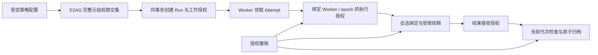

# E2AG 工作授权与凭据引用接线

状态：工程验证已完成，产品验收待用户参与（2026-11-13）；未提交、未推送。证据见 [工程验证记录](runtime-engineering-verification-20261113.md)。

对应 #33 凭据生命周期、#34 E2AG 产品化，连接 #30 持久运行、#56 ACP 与 #58 联合验收。当前交付为受信本地控制服务的授权实现；远端机器认证、发送方绑定令牌、完整动作审批和原生工具控制继续按计划实施。

## 授权链



现有 E2AG 决策核心新增 `evaluate_work_permission`，按 `(action, resource_kind, resource_id, resource_version, constraint_revision)` 完整元组对调用者、服务、工作负载和资源四层权限求交集。缺少层、空层、未识别字段或不匹配元组均拒绝。该路径与旧事件策略的兼容默认分开；策略文件不支持的约束字段明确报错。

策略由服务端 FileWorkPolicy 解析，绑定固定执行配置摘要、主体、服务 actor、工作期限与凭据引用。公开提交请求不能传入主体、策略层、工作授权引用或凭据内容。受管 profile 需要 `governance.mode=e2ag`；传统受信本地 profile 保持独立标识。

Run、WorkAuthorization 和首次准入证据在同一数据库事务中创建；相同请求键和输入返回同一 Run/授权。策略或请求内容改变后的同键请求产生幂等冲突。授权引用是内部记录定位符，不能作为 Bearer 凭据使用。

## 执行、续期与结果

工作授权默认最长 24 小时，策略可收短。执行授权最长 900 秒，剩余期限不超过 300 秒时在有效租约下重新核验并续期，始终不超过工作期限。内部续期使用作用域事务与记录版本串行提交，保持原权限；过期执行授权不原地复活。

执行授权绑定 Run、Attempt、Worker/instance、lease epoch、authorization epoch 和实际 Session。模型会话建立后先持久绑定，再报告会话阶段。报告、心跳和成功归档在原有所有权检查上增加授权状态检查，旧 Attempt、旧 Worker、旧会话及撤销代次均拒绝。

`execute` 与 `accept_result` 分开判定。恢复对账可以在工作授权仍有效时接收原尝试的完整结果，即使执行授权期限已过；此操作保留原执行绑定并校验会话，不续发执行权限。工作授权已过期时保留待对账；撤销和取消按既有实际退出证据收敛，完整结果不覆盖撤销。

成功、失败和取消终态关闭仍有效的工作/执行授权。工作授权撤销与 Run 授权代次更新在同一事务中提交，并持久记录拒绝原因。成功归档事务再次读取授权，策略回调返回允许后发生的撤销仍能阻止成功提交。

Worker 存活期间每轮读取取消/撤销，每 5 秒进行授权及凭据检查；授权或审计不可用时尝试停止受管执行对象并保存输出。Worker 丢失后的执行点撤销、失联硬隔离及 P99 撤销时延仍需 #34/#58 实测，当前没有相关性能承诺。

## 凭据 Provider

`FileSecretMounts` 根据逻辑 ref、固定 version、scope 和允许的 profile 解析只读挂载。文件摘要不匹配、版本变化、撤销、错误作用域或未获准 profile 均拒绝。普通 API、Run 输入、报告队列和授权记录仅包含引用与版本。

凭据目录由执行机操作员管理，使用每版本独立文件；底层文件权限、路径更新与 Docker 挂载访问由该受信环境保证。Provider 复核摘要，可发现原地内容变化。跨主机 Secret 服务、不可变文件句柄/快照及 Windows ACL 资格验证仍由 #33 承接。

ACP 包装配置继续把 `/run/secrets/...` 映射到子进程所需环境变量。凭据不进入 LaunchSpec 普通环境配置、Prompt 或报告；第三方 SDK/进程的实际脱敏与本机进程访问边界需要验收。

## 配置与操作

新增示例：

- `examples/runtime/work-policy.example.json`：固定 profile 摘要、四层完整权限元组和期限。
- `examples/runtime/secret-catalog.example.json`：本地凭据引用、版本、摘要与授权 scope/profile。
- `examples/runtime/cursor-task-profile.json`：E2AG 模式与凭据引用；默认仍停用。

示例中的 PIN_PROFILE_DIGEST、PIN_SECRET_SHA256 和宿主路径需要在隔离验收环境替换。API 使用 `DIOS_RUNTIME_POLICY_FILE`；Worker 使用同一策略配置和 `DIOS_RUNTIME_SECRETS_FILE`。所有路径均由操作员配置，公开请求不能指定。

命令入口：

```bash
python3 cli/dios runtime --scope local migrate
python3 cli/dios runtime --scope local worker --profile /path/to/profile.json --artifacts /path/to/objects --policy-file /path/to/policy.json --secrets-file /path/to/secrets.json
python3 cli/dios task revoke RUN_ID --revision VERSION
python3 cli/dios runtime --scope local reconcile RUN_ID --artifacts /path/to/objects --policy-file /path/to/policy.json
```

数据库连接通过已有 DIOS_RUNTIME_DATABASE_URL 提供。API 与 Worker 的 scope、策略、profile 和产物目录保持一致。

Console 展示工作授权状态、期限、策略、执行授权版本、会话绑定、凭据引用及最近决策；提供版本约束的“撤销工作授权”。HTTP 对应 `POST /api/os/runtime/runs/{id}/revoke`，使用既有操作员鉴权。撤销提交和执行端退出确认分开显示。

## 存储与兼容

新增独立 work-auth v1 组件，包含工作授权、执行授权和决策表；核心 runtime schema v1 保持不变。`runtime migrate` 显式增加该组件。治理数据缺失时受管任务要求迁移，传统本地任务继续按原契约处理。SQLite 备份校验已纳入新增组件；恢复副本仍遵守全局 restore_hold。

执行授权是控制数据库记录。AUTHZ-1.0.0 中的准入票据、远端 mTLS、audience/证书绑定和不透明令牌哈希服务尚待实现；本地记录不用于远端身份认证。FileWorkPolicy 和 FileSecretMounts 是首个可替换适配器，策略求值与授权提交保持分离。

## 待统一验收

新增/调整用例位于 `test_runtime_work_authorizations.py`、`work_auth_fixtures.py` 与既有恢复测试；当前均未执行。统一验收包括：

| 场景 | 预期 |
| --- | --- |
| 元组混配、缺少权限层 | 不产生跨资源或跨版本权限 |
| 准入审计写入失败 | Run 与授权同时回滚 |
| 重复提交 | 保留一个 Run 和一个工作授权 |
| 并发续期、临近工作截止 | 版本正确推进，期限不扩大 |
| 旧 Worker/epoch/Session | 请求被拒绝并保留决策证据 |
| 撤销与最终提交竞争 | 按事务提交顺序生效，迟到结果不覆盖撤销 |
| 执行授权过期、完整结果恢复 | 可在有效工作授权下接收结果，执行授权不复活 |
| 工作授权过期、审计故障 | 不成功提交，保留现场与对账身份 |
| 凭据跨 scope/profile、版本/摘要变化 | 拒绝解析或停止当前受管执行 |
| 授权表备份恢复 | 数据与证据保留，恢复副本保持调度关闭 |
| CLI/API/页面撤销 | 同一状态、代次、拒绝原因与待确认语义 |

之后按 #34 补充动作级审批与派发意图、MCP/原生工具的实际 PEP，按 #58 联合验收真实 Agent 的允许、拒绝、撤销和恢复。

#34 动作治理开发稿：[工具调用授权与审批](tool-authorization-34.md)。新增参数/执行身份绑定、独立审批人、派发前事务复核与 MCP 请求出口，Console/API/CLI 同步接线；自动化回归和隔离迁移已验证，产品验收待用户参与。

工程构建、自动化测试和开发部署以 [2026-11-13 验证记录](runtime-engineering-verification-20261113.md) 为当前依据；产品验收和真实第三方端点资格分别跟踪。
