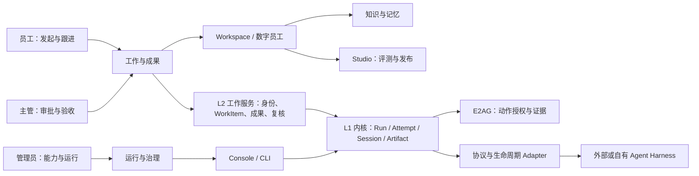
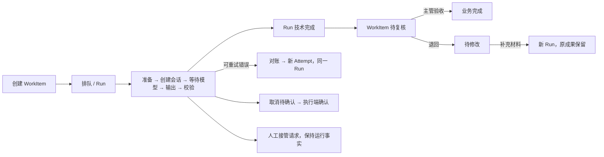

# 工作台信息架构与交互原型

任务：[F03-1 #28](https://github.com/HQIT/DiOS/issues/28) · P0 · 待产品评审。关联 [F03-2 参考验收](reference-scenario-acceptance.md)。

工作台围绕“目标、协作、成果、验收”组织；Console 和 CLI 管理内核。三种角色共享业务对象与事件事实，各自承担不同决定。当前交付为合成数据交互原型，真实服务接线沿 P1—P3 依赖推进。

## 入口与导航

运行 frontend 的 Vite 服务，打开 `/dios/#workbench/employee/overview`。角色预览可切换 employee、supervisor、admin。原型入口可独立访问，只包含内存中的合成资料；没有 API 请求、持久化、凭据或真实 Agent 调用。Console/Chat 保留原 AccessGate，默认入口保持 Console。未来真实 Portal 必须接入 #36 身份与服务端授权，禁止沿用演示角色切换作为认证。

| 页面 | 员工 | 主管 | 平台管理员 |
| --- | --- | --- | --- |
| 工作总览、工作与成果 | 发起、跟踪、接管请求、成果查看 | 团队交付、验收/退回 | 只读关联观察 |
| 审批与复核 | 观察审批及复核进度 | 查看上下文，审批/拒绝；业务验收/退回 | 观察，无业务批准权限 |
| 数字员工 | 岗位、绑定能力与相关工作 | 岗位覆盖与交付责任 | 实现、协议、端点及治理能力 |
| 工作空间 | 资料、会话、工作与成果关系 | 授权范围内的团队材料 | 服务状态；管理员身份不自动获得内容读取权 |
| 知识与记忆 | 检索引用与分享路径 | 复核来源与授权 | 后端接入、ACL 与审计 |
| Studio | 工作目标与变更预览 | 评测/发布审批 | 部署版本、兼容与回滚 |
| 运行与治理 | 本工作运行观察 | 团队运行与交付 | 运行健康、能力准入、Console/CLI |

表中为目标权限。原型使用四项共享合成工作，供三种角色预览；角色变化保持同一页和业务状态。端点绑定、文件上传/分享、生产治理、Studio 创建发布保持禁用，并注明前置服务。

## 核心交互与状态

WorkItem 状态沿用 `contracts/v1/domain.schema.json`。原型 `phase` 是 UI 观察模型，生产接线应由服务投影 Run/Attempt/Session 事件，不能直接作为领域状态写回。

动作审批与业务验收分离。外发审批绑定动作、对象、参数摘要、策略版本、Run/Attempt；批准后仍由 E2AG 在实际工具边界校验有效期、撤销和参数。原型只展示这一关系，不生成授权令牌。#34 的控制点不足、长任务续期和性能扩展继续按既定验收推进。

实际并发要求有效 Worker 进程与会话证据；配置上限另列。观测过期保留最后已知阶段，阻断演示推进/重试，恢复后先对账。取消请求进入“取消待确认”，只有执行端确认才能完成取消。业务修改建立新 Run，技术重试增加 Attempt，旧会话、部分输出和完整成果关联保留。

模型长等待、调度状态、进度同步和详情同步独立展示。当前无执行端数据的时间、并发、成本和趋势显示未知/未连接。原型演示事件使用序号，避免把浏览器时间当作 Worker 观测时间。

## 查询与报表口径

列表、总览卡片、数字员工贡献和 JSON 导出共用 `QuerySpec {scenario, state, search}` 与 `demo-vN` 水位；条件在总览/列表间保留。待办提醒显示组织演示范围并注明其独立口径。真实服务应以授权约束后的 QuerySpec、分页游标和快照水位提供统计与导出。

持续评审详情独立显示当前范围覆盖、全历史完成量和共享代码复用口径，均待覆盖账本接入。相同 blob 的存储复用与相容上下文的审查复用分别计数。证据不足不计成功覆盖；Excel、业务报表和小时/日趋势由 #59/#40/#43 承接，原型提供 JSON 视图与 Markdown 成果下载。

## 服务接入与工程边界

| 对象/能力 | 数据与命令归属 | 前置任务 |
| --- | --- | --- |
| 身份、工作空间和数字员工 | L2 身份/员工服务；主体与数据 ACL 双重约束 | #36/#37/#38 |
| 工作与验收、接管、协作 | L2 WorkItem 服务；版本条件、幂等键及事件 | #40；Run 来自 #30 |
| 历次 Run/Attempt/Session/Artifact | L1 可信历史查询，经 L2 按权限投影 | #30/#32；现有历史 CLI 不是公开 Portal API |
| 托管进程与开放协议 | Runtime 管进程，协议 Adapter 管会话/任务语义 | #10/#56/#58 |
| 端点与凭据、动作授权 | #33 凭据服务与 #34 E2AG，服务端决策及证据 | #27/#33/#34/#35 |
| Registry、Studio、运营 | 复用 Registry，固定版本评测发布和可观察性 | #31/#41/#44/#46 |

最小真实接入顺序：#10/#30 补齐真实 Worker 证据 → #33/#34 与 #56/#58 受控执行联合验收 → #36/#38/#40 接入真实工作闭环。原型可提前评审导航与业务状态，不改变上述门槛。

## 本轮验证

- `npm run build`；`npx eslint src/App.tsx src/apps/workbench`。
- Node ≥22.18：`npm run test:workbench`，9 项状态与查询测试。
- 浏览器验证记录见 [原型验收记录](workbench-prototype-verification.md)。

全量 lint 的 ChatPage、AgentList、EventLogList、SubscriptionEditor 存在 5 个既有错误、4 个警告；本轮涉及文件通过 lint。Vite 提示既有主 bundle 超过 500 kB，后续按页面拆包处理。
