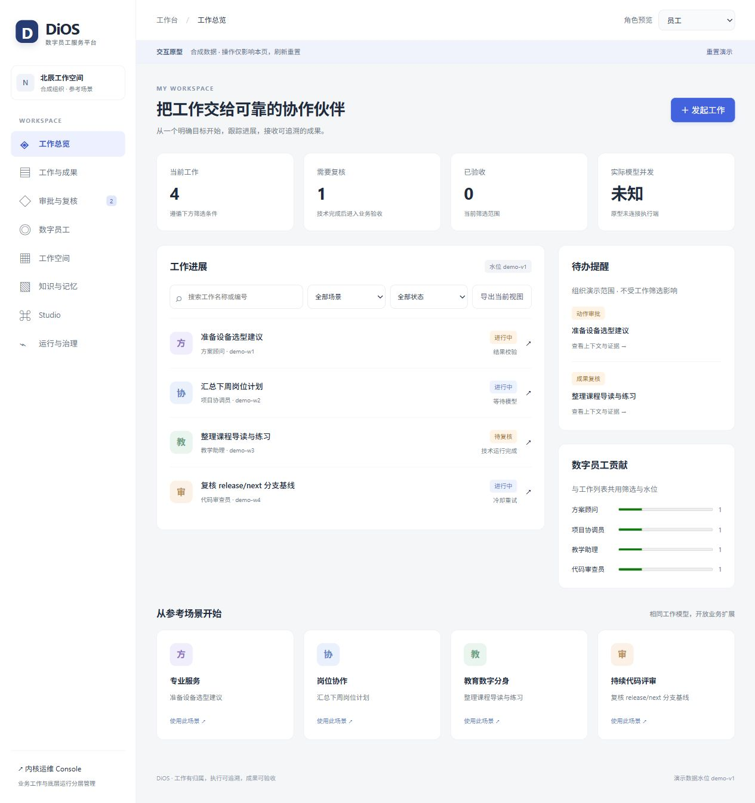

# 工作台原型验收记录

日期：2026-11-12。范围：F03-1 #28 / F03-2 #29，合成数据交互与状态语义。产品评审待确认，真实 Agent、权限强制执行和十八项运行故障注入由后续实现任务验收。

## 自动验证

| 检查 | 结果 |
| --- | --- |
| `npm run build` | 通过；Vite 主 bundle 大小警告保留 |
| `npx eslint src/App.tsx src/apps/workbench` | 通过 |
| `npm run test:workbench`（Node 25.1.0） | 9 项通过 |
| 合成场景 JSON | 4 场景可解析，与原型场景 ID 一致 |

状态测试覆盖技术完成与业务验收分离、管理员/员工无法验收、业务修改保留旧 Run/Artifact、技术重试保留旧 Attempt/Session/部分产物、观测过期阻断重派、取消确认、审批角色、同筛选导出、四场景阶段链与契约状态对齐。

全量 `npm run lint` 返回既有 5 个错误、4 个警告，位于未修改的 ChatPage、AgentList、EventLogList、SubscriptionEditor。新增原型文件与 App 路由通过定向检查。

## 浏览器路径

| 路径 | 观察结果 |
| --- | --- |
| 发起工作 → 选场景 → 填目标 → 创建 | 新工作进入列表；场景、员工、排队状态一致 |
| 逐阶段推进 → 技术完成 | 进入待复核，保留 Run/Attempt/Session/Artifact 关联 |
| 主管退回 → 员工发起新一轮 → 验收 | 原运行、原成果关联保留；新 Run 单独记录，业务已验收后总览更新 |
| 动作审批 → 完成运行 → 业务验收 | 三次独立状态变化，角色与审批提示一致 |
| 接管请求 → 取消请求 → 执行端确认 | 接管请求保留运行事实；取消待确认阶段可见 |
| 冷却 → 观测过期 → 恢复 → 重试 | 过期期间重试禁用；恢复后同 Run 新 Attempt，旧会话与部分产物保留 |
| 场景筛选 → 总览/贡献/导出 | education 样例筛选后 1 项、已验收 1 项；下载 JSON 同 QuerySpec、demo-v10 水位与计数 |
| 无匹配搜索 → 清除筛选 | 空态正确、无伪数据，清除后恢复列表 |
| Markdown 下载 | 文件内容可读、中文完整、包含工作/运行/产物关联 |
| 数字员工/空间/知识/Studio/审批/运行治理 | 导航可达，未接入能力有禁用说明；管理员无发起和验收按钮 |
| 刷新后不存在工作、未知路由 | 有返回入口，无空白页 |
| Console 跳转 | 仍显示 Access Token 入口，原型不授予后台访问 |
| 手机视口 390×844 | 总览与详情无页面横向溢出；导航横向滚动；主管复核可完成 |
| 桌面默认视口 | 总览双栏、卡片与导航完整；路由切换回到页首 |

原型演示操作不访问网络。进度/详情新鲜度、实际并发、用量和趋势保持未知/未连接；该记录不包含生产迁移或现有评审调度操作。
