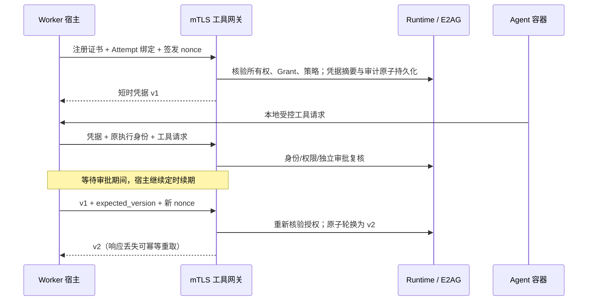

# Worker 短时凭据生命周期（#33）

日期：2026-11-13。实现：L1 Runtime 服务身份与工具网关。任务保持 In Progress。

## 能力与边界

Worker 使用注册的 mTLS 机器证书兑换绑定当前 Attempt 的短时工具通道凭据，后台续期，管理员可持久撤销。Agent 容器只接触本地 Unix socket；凭据原文留在宿主内存和 TLS 请求中。网关每次请求及派发前核验机器身份、所有权和 E2AG 工作授权。

传输凭据和执行 Grant 各自管理：凭据证明调用方身份，执行 Grant 决定原工作范围内允许的动作。签发和续期需要有效执行 Grant，不能借刷新传输凭据恢复已经失效的执行权。Session 由原 Attempt 与工作授权链路核验。



## 身份、存储与撤销

每个凭据族绑定 scope、audience、证书 SHA-256、Run、Attempt、Worker ID、进程 instance 和 fencing epoch。授权快照另绑定机器登记摘要、主体、profile 指纹、工作授权 ID/epoch、策略和权限摘要。更改任一绑定、撤销工作、失去租约或进入终态后拒绝新签发与续期。

`runtime_worker_credentials` 保存版本、状态、期限、绑定、当前/前一令牌摘要和 nonce。凭据值通过独立 32 字节发行密钥与域分离的 HMAC-SHA256 派生；响应丢失时能够返回同一版本和同一凭据，数据库无凭据原文。发行密钥由网关私有文件保存，POSIX 下拒绝组/其他用户可访问的文件及符号链接。备份需将发行密钥与数据库分开保管。

SQLite 事务与 PostgreSQL scope 锁保证轮换串行化；相同请求的并发重试得到同一版本。原子审计失败时签发一起回滚。前一令牌最多保留 30 秒且不超过其原到期时间，只用于承接在途请求；不能再开启另一条续期分支。重取已提交的续期响应可使用原请求，返回凭据仍受当前有效期约束。

默认 TTL 900 秒，可配置 60～900 秒，同时受机器登记、证书和工作授权到期时间约束。客户端以单调时钟在剩余有效期约 2/3 处刷新。故障退避上限 30 秒；保留未确认交换的 nonce/版本，先恢复原交换。凭据过期后重新签发仍须通过原工作授权检查。网络观测失败不会自动重发工具调用。

撤销以凭据族为单位持久生效；同一 Attempt 不能靠新 nonce 绕过撤销。机器登记可停用；登记变更须提升 revision，已有凭据会因绑定变化失效。已执行或执行中工具的结果沿既有回执流程对账，撤销不抹去历史证据。

## 接口和部署

| 接口 | 请求 | 结果 |
| --- | --- | --- |
| `credentials.issue` | mTLS 证书、完整绑定、43 字符随机 nonce | 新凭据或同 nonce 的原响应 |
| `credentials.renew` | 当前凭据、原绑定、expected_version、新 nonce | 新版本或原续期响应 |
| `credential status RUN_ID` | 可信管理 CLI、scope | ID、版本、状态、期限；无令牌/摘要/nonce |
| `credential revoke ID --revision N` | 可信管理 CLI、当前版本 | 原子撤销与审计；版本冲突须重新读取 |

协议消息仍使用现有网关 envelope，增加 `credential_mode: automatic`。Worker 的自动模式不需要 token_file；旧 file 模式保留兼容。示例见 `examples/runtime/tool-gateway-{server,client}.example.json` 与 `worker-identities.example.json`，均默认停用。机器登记显式设置证书摘要、subject、Worker ID 前缀、scope/profile、起止时间、revision、enabled 和 issuance_enabled。

网关配置 `issuer_key_file` 和 `credential_ttl_seconds`。发行密钥生成示例（Linux 私有目录，独占创建，已有文件时失败）：

```sh
python -c "import os,secrets; fd=os.open('/private/credential-issuer.key',os.O_WRONLY|os.O_CREAT|os.O_EXCL,0o600); os.write(fd,secrets.token_bytes(32)); os.close(fd)"
```

管理 CLI 沿用 `DIOS_RUNTIME_DATABASE_URL`：

```sh
python -m app.runtime.cli --scope pilot credential status RUN_ID
python -m app.runtime.cli --scope pilot credential revoke CREDENTIAL_ID --revision 2
```

新增独立 credential schema v1，保持已有 schema 校验和。先排空、备份，再显式 migrate；启动网关不自动迁移。SQLite 备份清单涵盖新增组件。还原状态保持 restore_hold，恢复对账前拒绝新签发。回退须排空后切回原 Provider，并保留新表和凭据审计；使用备份恢复须满足既有恢复门槛。

## 工程证据与后续

后端全量 319 项通过、2 项不适用跳过，失败和错误均为 0；启用 PostgreSQL 与真实 Docker。

自动化覆盖签发幂等、并发续期、丢失响应恢复、机器停用/登记变更、旧所有权、撤销、执行 Grant 到期、轮换宽限、事务审计失败、重启持久性与备份、日志脱敏和恢复隔离。SQLite/PostgreSQL 均执行；实际 TLS socket 覆盖自动签发、轮换与撤销拒绝。

开发环境使用 60 秒 TTL：浏览器创建真实 Docker 合成评审任务，等待独立审批期间凭据从 v1 自动升至 v2，随后批准并完成报告下载。证据见 [后端回归](evidence/worker-credentials-20261113.json) 与 [续期及审批链路](evidence/worker-credential-renewal-20261113.json)。第三方模型和双物理主机资格由 #58 单独验证。

下一主项为 #30 远程任务领取、心跳/补报与产物访问，复用本凭据校验和 E2AG 原执行身份。#33 继续证书/发行密钥托管轮换、外部账号凭据 Provider 和端到端访问控制；当前发行根密钥变更会阻止旧凭据续期，需排空并建立新 Attempt，尚无 KMS 或自动证书轮换。进入 G2 前依工程手册完成独立权限评审。
