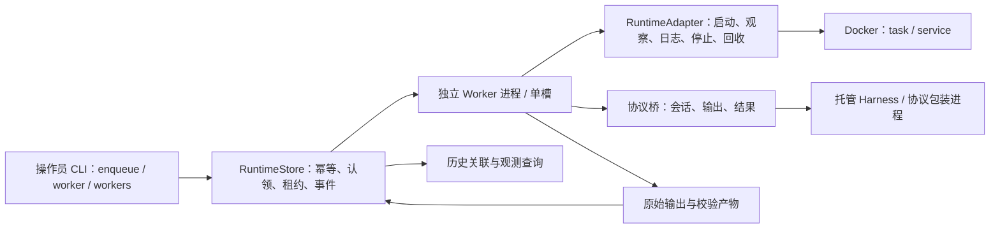

# Worker 执行与生命周期接入

对应 #10 Local Docker Runtime Adapter、#30 持久调度，阶段 P1。当前提供可信本地操作员的独立 Worker 路径；数据库与产物保留既有后端接口，未引入新的业务调度器。

## 执行链与责任



通用 Worker 只依赖 RuntimeAdapter。Docker 实现封装 SDK 类型，提供确定性 handle、作用域标签、实际镜像标识、启动配置摘要、task/service 生命周期、健康状态与有界日志。配置可表达镜像、命令、工作目录、只读挂载、网络、环境、用户、CPU/内存/PID 上限。默认无网络、非 root、只读根文件系统、drop capabilities、禁止新增特权、无自动重启；临时目录有界。

Agent 协议与生命周期分离。当前 `jsonl-v1` 面向注册包装进程：`session` 产生会话身份，`output` 提供有效输出事件，`result` 带同一会话 ID 与结果。它不等同于 ACP/A2A。厂商格式转换、原生工具拦截和协议恢复由 #56/#58 接入，生命周期层不解析厂商消息。

第三方 Harness 启动配置可用同一 LaunchSpec 表达，例如自建 Codex 镜像、`command=["codex", "exec", "--json", "..."]`、独立 workspace 只读挂载与显式网络。该配置仅说明生命周期表达能力；真实输出需要 Codex 协议桥及 #33 凭据、#34 E2AG 验收后接入，不能将原生厂商 JSON 当成 jsonl-v1。

现有 legacy `docker_runner` 调用方保留，迁移到统一生命周期接口仍属于 #10 后续收敛。当前实现没有公开任意命令执行 API。

## 持久身份与观测

每个 Worker 操作系统进程注册独立 worker_id / instance / PID，使用单槽认领。同一 runtime_profile 的任务可被多个进程竞争；其他 profile 不被领取。入队固定配置摘要，配置变化会在启动前拒绝。执行时以 Attempt ID 构造 handle，启动意图先持久化，重启后能按原 handle 找到容器。

容器进程身份由 container ID + StartedAt 组成，PID 来自 Docker inspect；会话 ID 来自协议消息。观察同时记录 Docker daemon 标识、Worker boot ID、数据库观测时间、阶段与最近有效输出。`workers` 分开返回注册槽位、确认存活进程数、确认运行会话数、未知尝试数与实际并发；过期、失租或待对账的尝试使整体实际并发为 null。新鲜度窗口默认 15 秒，可按部署调整。

原始 stdout/stderr 作为不可变产物保留，完整结构化结果另行校验入账。HistoryQueries 继续关联 Run/Attempt/Session/Artifact，`run.completed` 指向验收产物；`attempt.output_retained` 区分原始流。JSONL 在完整行边界解码 UTF-8，重复日志不重复推进，会话改变、日志游标丢失、截断、缺少证据字段及超限均不能成功。

当前结果校验保证包装协议结构与非空证据引用。代码位置、可达条件、业务正确性和覆盖率由 #59 的业务验证器承担。

## 退出、故障与恢复

| 触发 | 实际行为 |
| --- | --- |
| 取消请求 | 请求停止容器，确认 exited/dead、保留日志后记录取消成功 |
| SIGTERM/SIGINT 到 Worker | 停止领取，当前任务自然结束后退出；下个任务保留排队 |
| 作用域 drain | 新 Worker 也无法领取；活跃任务继续，最终产物/事件落盘后满足排空 |
| 进程非零退出 | 保留输出与错误，标记失败；有效格式的部分结果也不能覆盖失败 |
| 运行时限/输出上限 | 按显式资源策略停止，确认退出后记录对应错误 |
| 观察接口失败 | 保留执行对象，标记待对账并 fencing；不因查询超时终止或重派 |
| Worker 被强杀/数据库失联 | 容器与日志继续保留；租约过期进入待对账，新的 Worker 不重复领取同一 Run |
| 终态落盘后清理失败 | 终态保持；操作员可用 runtime-cleanup 重试，运行中对象拒绝删除 |

Worker 已接入本地持久补报、退出凭据和原 Attempt 结果恢复，见 [恢复对账与补报](worker-reconciliation-30.md)。容器缺失且没有退出凭据时保持待对账。跨主机接管、分类模型故障/半开熔断和完整工作授权继续由 #30/#33/#34 推进。

## 使用与验收

从 WSL 仓库根目录构建合成端点（复用本机 backend 基础镜像）：

```bash
docker build --pull=false -f examples/runtime/Dockerfile.fixture -t dios-worker-fixture:local examples/runtime
cd backend
export DIOS_RUNTIME_DATABASE_URL=sqlite+aiosqlite:////tmp/dios-worker-demo.sqlite
.venv/bin/python -m app.runtime.cli --scope isolated-demo migrate
.venv/bin/python -m app.runtime.cli --scope isolated-demo enqueue --profile ../examples/runtime/fixture-profile.json --key demo-1
.venv/bin/python -m app.runtime.cli --scope isolated-demo worker --profile ../examples/runtime/fixture-profile.json --artifacts /tmp/dios-worker-demo-objects --once
.venv/bin/python -m app.runtime.cli --scope isolated-demo workers
```

长期运行省略 `--once`。每个 Worker 单独启动一个进程；输入 JSON 通过 enqueue 的 `--file` 提供，按 `DIOS_WORK_INPUT` 传给注册包装程序。当前 SQLite 控制文件应位于控制主机本地文件系统，跨主机 Worker 通过未来认证传输接入，不能共享挂载 SQLite 文件。

查询/运维命令：`show RUN_ID`、`history run RUN_ID`、`runtime-inspect RUN_ID`、`cancel RUN_ID --revision N`、`upgrade drain/status/wait`、`expire`、`runtime-cleanup RUN_ID`。expire 仅 fencing，cleanup 仅允许已终态且确认不在运行的对象。

测试：`DIOS_TEST_DOCKER=1 .venv/bin/python -m unittest tests.test_runtime_worker -v`；完整回归由 `scripts/check_runtime_foundation.py` 记录。[本轮证据](evidence/worker-runtime-regression-20261112.json) 包括三路独立 Worker PID、容器进程与会话身份。

2026-11-12 验收：SQLite、隔离 PostgreSQL 和真实 Docker 参与完整回归，179 项通过、0 跳过；backend 镜像构建与容器内 CLI 迁移通过，新依赖镜像内 17 项 Worker/读取消/排空关键回归通过。新增 SQLite 读查询取消清理，确保缓冲数据库操作完成后释放游标与连接，短时观察超时不再遗留读锁；异步数据库依赖显式声明为 `sqlalchemy[asyncio]`。

## 下一步与生产门槛

保持 #10/#30 In Progress。恢复对账与 Worker spool 已接通。下一批沿 #30 最小观测查询完善 Console，并结合 #33/#34 接通凭据、工作授权、撤销和租约绑定；之后按 #56/#58 验证真实来源 Harness。E2AG 的原生工具控制、长任务续期和执行证据不足时须扩展实现，满足 AUTHZ-1.0.0 后开放企业工作负载。

当前运行仅用于合成/明确受信任务。配置中的环境与挂载尚未由 Secret 服务授权解析，命令行角色不代表企业授权。工作台继续使用合成数据；接入真实 Portal 需服务端身份、权限和查询投影，沿 #36/#38/#40 实施。现有评审保持原调度器与历史。
