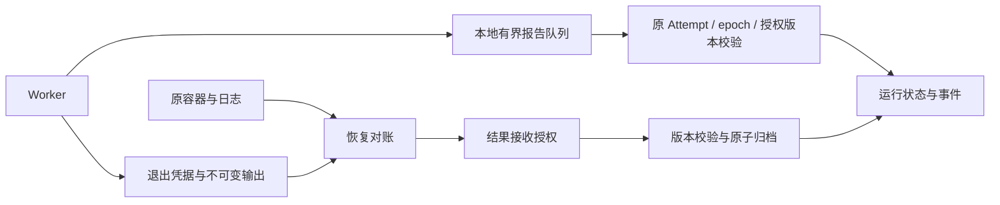

# Worker 恢复对账与离线补报

对应 #30，阶段 P1。独立 Worker 的阶段报告先写本地有界队列；进程退出的原始输出和凭据先保存，再提交终态。Worker 重启后，对已失去所有权的原 Attempt 做结果对账，复用完整输出进行校验。



## 持久报告与结果归档

每个产物目录、作用域使用独立 `.reports-<scope hash>.sqlite`，沿用 4096 条、8 MiB 总载荷、16 KiB 单报告的有界策略。报告保存原 Run、Attempt、Worker/instance、lease epoch、authorization epoch、序号和有效输出的原始观测时间。队列按每个 Attempt 的顺序补报，以事件身份和摘要确认接收；网络、存储连接失败和背压使用退避。

启动意图与 creating_session 均获确认后才启动执行对象。运行中的短暂报告失败可以补报；终态前阶段报告仍未送达时，保存退出凭据并转入恢复对账。完整控制数据库失联时暂停当前控制循环，保留执行对象，恢复后根据数据库时间判断租约；后台服务按 1–30 秒退避探测。

退出凭据保存在 `.exits-<scope hash>/`，包含原身份、授权版本、实际进程实例、退出状态、原始流摘要和已知失败原因。写入使用临时文件、fsync 和原子替换；原始流使用内容寻址产物存储。凭据与原始输出需要与执行机产物目录共同持久保存。现有控制库备份只包含已关联产物，执行机报告队列、待归档输出及退出凭据的完整备份策略由 #11/#32 继续承接。

## 对账状态与所有权

| 证据 | 处理 |
| --- | --- |
| 原租约仍有效 | 返回当前状态，保持现有控制权 |
| 查询失败 | 保留现场；查询超时本身不证明退出 |
| 租约过期 | fencing 原所有者，进入 reconciliation_required |
| 原进程仍存活 | 保留待对账，等待退出或后续有授权的接管 |
| 已退出且有完整结果 | 校验进程/会话、内容摘要、协议与接收授权，原子归档到原 Attempt |
| 已退出但结果不完整、非零退出或超限 | 保存原始输出，记录对应失败 |
| 容器缺失，有可信本地退出凭据 | 校验凭据身份与产物后对账 |
| 容器缺失，没有退出凭据 | 保持待对账 |
| 取消或撤权 | 确认实际退出后取消/失败，完整输出也不转为成功 |
| 进程、会话、凭据身份变化 | 拒绝合并，保留对账状态 |

对账事务核对 Run version、当前 Attempt、原 lease epoch 和授权版本，保持旧租约失效。并发对账只产生一次 `attempt.exit_reconciled`，其中记录原始流与结果产物链接。重复对账返回既有终态。对账不创建新 Attempt、不再次调用模型。

后台 Worker 启动及空闲循环定期做有界对账；单次最多 100 个候选，以游标循环扫描，旧的未解决任务不阻塞后续批次。正在处理长任务的 Worker 在该任务结束后进入下一轮，持续的独立对账服务由后续控制服务接线。恢复后的已退出容器保留到显式 `runtime-cleanup`，便于审计。

旧租约、已撤销授权的报告保留为 blocked 证据，不改写为新 epoch。终态对账不自动删除这些报告；容量达到上限时停止接受新报告。死信归档及保留期策略仍属 #30 的后续工作。

## E2AG 工作授权衔接

`WorkAuthorizationContext` 包含 scope、Run、Attempt、Worker/instance、原 lease epoch、authorization epoch、Session 和 work_authorization_ref。`authorize_work` 区分 `execute` 与 `accept_result` 两个动作，交给注入的异步 verifier。报告投递身份不提供执行或续期权限。

声明 work_authorization_ref 的工作缺少 verifier 时，启动前明确失败；恢复接收结果同样要求 verifier。未声明该引用的既有可信本地配置沿用兼容模式。CLI 当前不提供企业 verifier 配置，因此受管授权引用需要由后续服务组合层注入。

启动前重新检查当前所有权，终态提交再次核对撤权与版本。恢复接收使用原 Attempt/Session，不重新签发执行权。异步策略核验期间发生的撤权或取消会使事务版本校验失败；下轮按新状态处理。

#33 接入服务身份、SecretReference 与凭据解析；#34 将 verifier 接到 E2AG 的主体、资源、策略、预算和工作授权状态，并补齐原生工具控制、长任务续期及撤销传播。当前回调是接入契约，完整 E2AG 运行治理仍须联合验收。#56/#58 再验证真实 Harness、远端任务查询与认证传输。

## 操作入口

在 backend 目录中，使用已有 DIOS_RUNTIME_DATABASE_URL 与作用域：

```bash
.venv/bin/python -m app.runtime.cli --scope demo spool-status --file /path/to/objects/.reports-SCOPE_HASH.sqlite
.venv/bin/python -m app.runtime.cli --scope demo spool-flush --file /path/to/objects/.reports-SCOPE_HASH.sqlite
.venv/bin/python -m app.runtime.cli --scope demo reconcile RUN_ID --artifacts /path/to/objects
.venv/bin/python -m app.runtime.cli --scope demo history run RUN_ID
.venv/bin/python -m app.runtime.cli --scope demo runtime-cleanup RUN_ID
```

`worker` 默认使用其 --artifacts 目录中的报告队列和退出凭据；普通后台运行自动执行补报与对账。`reconcile` 是可信本地运维入口，按作用域读取现有 Run；跨主机身份校验、远端凭据签名及多节点接管按独立门槛验收。

## 验收与后续

2026-11-13：完整后端回归 210 项通过、0 跳过；backend 镜像构建、容器内 CLI 初始化与 15 项恢复测试通过；设计契约检查 681 项通过。验收记录见 [回归证据](evidence/worker-reconciliation-regression-20261113.json)。覆盖 SQLite/隔离 PostgreSQL 的恢复事务、重复/并发对账、进程与会话更换、取消/撤权、E2AG 接口及真实 Worker 补报；Docker 演练强杀 Worker，保留原容器，重启 Worker 后归档原会话与原 Attempt 的结果。

#30 保持 In Progress：分类模型故障与账号半开恢复、持久定时合并、死信处置、认证跨主机对账及工作授权续期继续按既定计划推进。

较直观的下一小步是 #30 的最小运行观测页，沿用 #28 信息架构并落在 L1 Console：展示真实任务、阶段、最近输出、失败原因、新鲜度与产物入口。先提供只读查询；L2 员工工作台的真实业务接入仍依赖 #36/#38/#40，#46 的全面运营能力仍安排在 P3。
