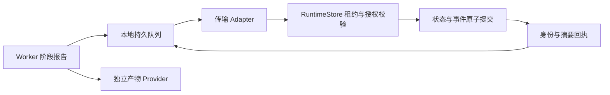

# Worker 离线阶段报告与恢复

日期：2026-11-11 · #30 / #32 进行中。

## 接入边界

`backend/app/runtime/spool.py` 提供 Worker 本地持久报告队列和有界补报入口。SQLite 文件位于执行机，控制服务仍由 RuntimeStore 负责 Attempt 所有权、租约、撤销和阶段转换。传输层通过 `send(Delivery) -> Receipt` 注入，当前由受信进程内适配接入正式 RuntimeStore；远端身份认证、HTTP Adapter 和真实 Agent 接管继续由 #30/#33/#34 实现。



报告使用 scope、Run、Attempt、Worker instance、epoch 和 sequence 保留原始身份。事件 ID 由 scope / Attempt / sequence 派生，摘要覆盖完整 UTF-8 字节。写入完成后返回本地持久回执；同身份同内容重试返回原回执，异内容拒绝。生产者按 Attempt 顺序持久保存阶段报告，恢复时复用原序号和内容。

阶段报告只携带轻量元数据和脱敏引用。大输出、结果正文及凭据分别归 Artifact 与 Secret Provider，上传故障与阶段补报独立处理。

## 容量、发送与恢复

默认最多保留 4096 条、8 MiB 有效载荷，每条上限 16 KiB；计数包含待对账的阻塞记录。SQLite 页数另设上限，默认约 24.1 MiB，删除已确认记录后复用空页。文件系统还需为回滚日志保留空间。配额由 Worker 配置统一设置，容量不足返回 `SPOOL_FULL`。接入 Worker 时必须据此背压、停止启动新工作并保留原始产物；队列保留所有尚未确认的报告。

每次 `flush_reports` 最多尝试 100 条，可配置到 1000 条。报告发送权在本地事务内认领；同 Attempt 的较早记录未确认时，后续序号等待，其他 Attempt 可继续。发送权有独立 token 和超时，进程崩溃后可重新认领；旧发送者不能删除或修改新发送者认领的记录。该 token 仅管理传输，执行授权仍取决于控制服务租约。

接收端提交成功后，发送端核验事件 ID 与摘要回执，再删除本地记录。提交后响应丢失会重复发送同一报告，RuntimeStore 幂等处理。尚未确认的记录在服务重启、Worker 重启和发送取消后继续保留；已确认回执不无限留存在本地，控制服务事件账本承担历史审计。

| 情况 | 处理 |
| --- | --- |
| 断网、请求超时、发送取消 | 保留内容与原身份，延迟补报；超时不触发任务重派 |
| 限流、控制服务写队列背压或排空 | 1、2、4…秒退避，上限 300 秒；本轮停止继续探测端点 |
| 租约过期、撤销、Worker 不匹配 | 阻塞并保留原记录，交协调器对账；不续租、不重置 Attempt |
| 摘要错误、回执错误、报告冲突或格式错误 | 阻塞并保留现场，不计成功 |
| 未知 Adapter 异常 | 保留通用错误码并上抛，错误文本不写入队列 |

单轮传输不负责账号级熔断、全局半开或长期调度；调用方负责调度下一轮、停止领取及自然排空。待对账记录的授权导出、处置和恢复入口属于后续交付，当前没有自动丢弃或跳过同 Attempt 记录的操作。

有输出的离线报告必须附稳定的 `output_observed_at`。接收时间记录在服务事件的 `created_at`，最近输出时间使用 Worker 报告的发生时间，上限截到接收时间，并保持单调。原始发生时间随事件保留；该时间依赖 Worker 时钟，时钟同步质量需在部署观测中展示。补报不会把历史输出统一改写为当前时间。

## 运维入口

在 WSL 仓库目录执行：

```sh
backend/.venv/bin/python cli/dios runtime spool-status --file /path/to/worker-report-spool.db
```

命令以只读连接返回保留条数、载荷字节、阻塞数、传输中数量、最早报告、下次可发送时间和错误码分布；不返回正文，也不创建缺失文件或初始化空库。传输中数量描述发送请求，真实 Agent 并发仍以进程、会话与租约证据统计。新建文件在 POSIX 使用 0600；目录访问权限、Windows ACL 与设备加密由部署配置负责。

`process.py` 在子进程结束或监督取消后显式关闭 asyncio transport，覆盖子进程已退出但后代仍持有管道的清理路径。等待继承管道仍受既有时限约束。Windows 隐藏启动设置保持，Windows 进程树回收实测待完成。

## 验收与后续

测试使用合成输入和隔离数据库，覆盖断网恢复、提交后丢回执、真实子进程提交后崩溃、双发送者竞争与旧 token、容量背压、限流退避、租约过期、授权撤销、发送取消、UTF-8、损坏数据、输出时间与只读 CLI。完整后端回归见 [检查记录](evidence/worker-spool-regression-20261111.json)。

下一步优先交付历史任务/尝试/会话/产物的关联查询投影，再补备份恢复与升级排空演练。跨主机认证传输、真实 Worker 生命周期和 E2AG 完整工作授权继续联合验收；单节点补报测试不代替跨主机与多副本控制面的故障验收。
