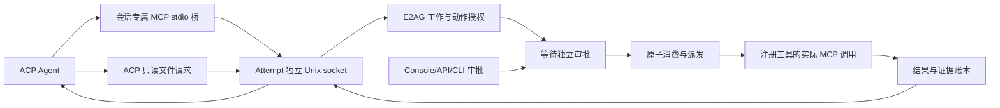

# #34 Worker 工具通道与 ACP 控制点

状态：工程验证已完成，产品验收待用户参与（2026-11-13）；未提交、未推送。证据见 [工程验证记录](runtime-engineering-verification-20261113.md)。

## 自动执行链



Worker 在启动容器前创建专属通道，将它只读挂载到该容器的 `/run/dios-tools`。通道持有服务端固定的 Run、Attempt、Worker/instance 和租约代次；Agent 请求仅包含工具别名、参数和幂等键。该通道没有审批、改主体、指定任意 URL 或切换任务的方法，操作员及审批凭据保留在控制服务。

ACP `session/new` 注入 DiOS MCP stdio 桥。包装器取得真实 Session 后向 Worker 输出会话标识；Worker 完成授权和持久会话记录后开放工具操作，包装器再发起 prompt。会话前只提供该 profile 获准工具的清单。协议依据：[ACP 会话建立](https://agentclientprotocol.com/protocol/v1/session-setup)。

请求先创建原调用记录；待审批时轮询同一记录，Worker 主循环继续心跳与撤销检查。审批通过后通道自动调用已有派发门禁。MCP 初始化、派发复核与实际调用继续按上一批约束执行。网络错误、查询超时和进程退出不生成新请求键或重新派发未知调用。

## 身份、生命周期与容量边界

首实现为 Linux 同机 Docker 的 Unix socket Provider，通过对端 UID 校验及容器专属挂载限制访问。宿主父目录权限为 0700，映射目录可由容器非 root 数字 UID 访问。容器内没有数据库连接、操作员令牌或上游工具凭据。工具 Secret 继续由宿主 Provider 解析。

每个通道最多 8 个连接，输入帧不超过 64 KiB，每个 Attempt 的通道入口最多接纳 128 个工具调用；自动派发同时进行一个。已完成调用返回经摘要验证的原产物。通道关闭时终止连接并移除 socket；旧容器不会获得后续 Attempt 的新通道。突然失去 Worker 后，通道不可用，原调用继续留在账本等待对账。

通道配置规范 JSON 被纳入 LaunchSpec 指纹。工具清单、ACP 名称映射或只读能力变化都要求重新固定执行配置版本和工作策略。每次请求检查工作授权、当前所有权和策略摘要；实际派发另校验当前工具注册版本、会话、审批及授权代次。

远程 Docker、Windows named pipe、rootless/user namespace UID 映射和跨主机 mTLS Provider 尚待实现/资格验证。平台目标仍面向多节点；本地通道是首个 Provider。未知工具结果仍按调用账本阻止 Run 提前成功或重新入队。

## ACP 原生客户端操作

可选 `client_read_tool` 将 `fs/read_text_file` 转换为受控工具调用，要求对应注册权限 action 为 `filesystem.read`。路径、行号、数量通过已注册输入 Schema 校验，读取由该工具 Provider 完成；只接受文本结果并限制返回大小。Provider 需在真实验收中证明规范化路径、允许根目录、符号链接处理与只读行为。协议依据：[ACP 文件系统能力](https://agentclientprotocol.com/protocol/v1/file-system)。

`fs/write_text_file`、终端方法及其他客户端操作继续拒绝，拒绝原因进入现有 E2AG 工作决策记录。通用 `session/request_permission` 保持 reject_once/cancelled；不同 Agent 对受管 MCP 的权限提示需在适配器资格验证中处理。

ACP 的工具通知与实际调用账本分开保留。具备工具名称及完整 rawInput 的通知，按 profile 的明确名称映射和参数摘要关联本 Attempt、Session 的实际受控调用；旧/未知名称、参数变化或找不到调用证据会阻止成果计成功。协议中的工具通知用于报告执行，真实控制仍由通道和执行出口承担。[ACP 工具调用](https://agentclientprotocol.com/protocol/v1/tool-calls)

不同 Agent 的通知名称与参数格式可能不同，需提供显式映射并验证；当前不按标题猜测工具。不完整通知保持待资格验证。该关联证据覆盖已观测活动；第三方 Agent 内部未上报的执行、工具旁路和模型网络访问仍需沙箱/出口策略与真实反例验收。

## 配置与现有管理入口

新增停用示例 `examples/runtime/cursor-governed-tools-profile.json`，在已固定执行 profile 上配置：

```json
{
  "tool_channel": {
    "tools": {"repository_search": "repository-search"},
    "acp_names": {"mcp__dios__repository_search": "repository_search"}
  }
}
```

`tools` 左侧为 Agent 可见别名，右侧为工具目录 ID；`acp_names` 是目标 Agent 实际通知名称的映射。若接入只读文件 Provider，可增加 `client_read_tool`，值为同一 tools 清单中的别名。

Worker 增加 `--tools-file`、`--approvers-file`，默认读取 `DIOS_RUNTIME_TOOLS_FILE`、`DIOS_RUNTIME_APPROVERS_FILE`。与 Console 使用相同作用域、工作策略、工具版本、审批人资格及产物目录。执行镜像需包含 DiOS 的 MCP 桥模块；示例名称映射须用真实 Agent 证据确认后启用。

审批窗口受 600 秒动作期限及 Grant 剩余期限限制；Worker timeout 和 ACP prompt_timeout 需留出审批与模型执行时间。示例仍停用，启用前重新固定 profile 指纹、工具实现摘要与权限元组。

Console/API/CLI 沿用已有调用状态：Agent 提交的申请会进入“工具调用与审批”，审批人完成批准后由 Worker 自动派发。人工派发与自动派发共享同一原子门禁，不产生两条执行链。

## 待统一验收与下一批

新增 `test_runtime_worker_tool_channel.py`，补充 ACP 客户端控制用例，已纳入完整回归。验收重点：会话握手无竞态、UID/跨 Attempt 隔离、幂等申请、审批后自动派发一次、撤销及过期拒绝、原生写入/终端拒绝、通知与调用证据关联、通道关闭及 Worker 退出后的未知结果保留。还需执行本地 Docker 挂载和真实 Cursor/Codex/CC/DSH 等适配器的资格验证。

#34 保持 In Progress。[工具结果回执与恢复对账](tool-receipts-34.md) 已提供本地待测接线：Worker 周期恢复沿用原身份和 E2AG 派发证据，完整结果校验后补入账本，部分结果保留待对账。下一步跨主机身份与通道 Provider 和 #33/#58 衔接。

跨主机工具链路的待测实现见 [Worker 身份与工具网关](remote-worker-tools-33-34.md)。网关保存原工具回执；完整远程调度、任务产物传输和自动凭据续期按该文档的后续任务推进。

工程构建、自动化测试和开发部署以 [2026-11-13 验证记录](runtime-engineering-verification-20261113.md) 为当前依据；产品验收和真实第三方端点资格分别跟踪。
