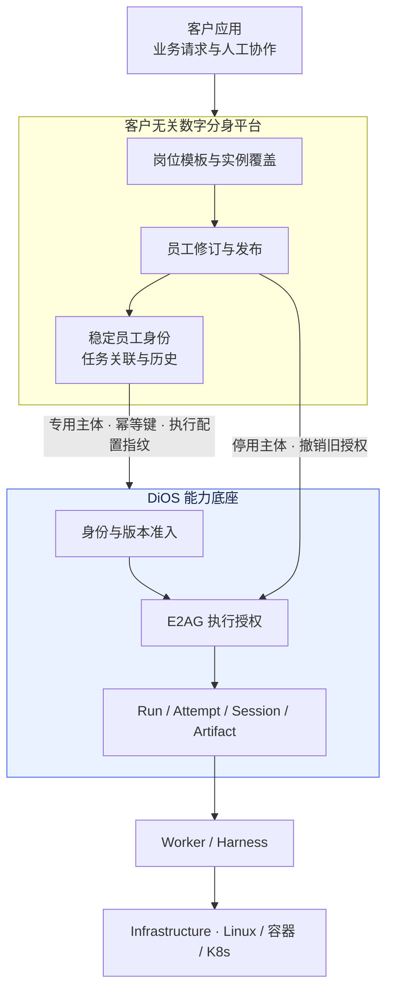

# 数字员工的稳定身份与受控发布

数字分身平台保存员工身份、岗位模板、配置修订和任务关联；DiOS 保存主体权限、执行配置、Run、Attempt、Session 和 Artifact。两层独立部署，客户应用组合员工服务。

## 能力和业务边界

| 对象/动作 | 责任层 | 关联方式 |
| --- | --- | --- |
| 员工、岗位、负责人、服务对象、知识/能力引用 | 上层平台 | 独立 SQLite 和不可变修订 |
| 模板和实例覆盖、配置发布、员工停用 | 上层平台 | 发布前检查公开契约、真实身份和可见执行配置 |
| 主体、权限、Work/Grant、实际撤权 | DiOS | 专用主体凭据；管理员 `identity-update` |
| 输入、任务、尝试、会话、成果与恢复 | DiOS | 原 Run ID、幂等键和执行配置指纹 |
| 客户业务规则、流程和页面 | 客户应用 | 调用上层员工服务或公开能力 API |

`applications/workforce-registry` 是独立可安装包，当前使用受信任运维 CLI。底座仅增加通用提交前置条件 `expected_profile_digest`，API、SDK 0.1.21 与 CLI 一致支持。该参数在持久入队前与已准备的执行配置比较；不符返回 `409 PROFILE_VERSION_CONFLICT`。契约声明 `profile-precondition: 1.0`。

稳定业务对象与执行修订分离，沿用 [Kubernetes Deployment 的修订/发布机制](https://kubernetes.io/docs/concepts/workloads/controllers/deployment/)的成熟原则；员工身份与实际执行主体保持明确关联。[RFC 8693](https://www.rfc-editor.org/rfc/rfc8693.html)中的主体/代理区分继续由现有 DiOS 委派契约承接。本包使用预置专用主体；目录人员、员工服务身份分别有唯一生命周期写入方。

## 状态与一致性

员工首次建档为 `draft`；发布成功进入 `active`。后续编辑产生新草稿，原 active 修订持续服务。发布要求 `run.submit`、`run.read`、E2AG 和所需接口版本；不支持的要求阻止发布。

提交账本先记录 `pending`，收到 Run 后记录 `accepted`。请求固定员工修订、工作类型、输入、目标、幂等键与 profile 指纹。进程重启或应答丢失后接续原请求；历史关联不随新模板/新发布改变。配置指纹变更后保留待对账请求，新请求按重新发布的修订进入。

停用先保存 `disabling` 意图，再调用管理员接口。停用后的主体无法新建任务，旧 Work/Grant 在执行和接受结果边界失效；确认回执后状态为 `disabled`。不确定回执可原版本重试，历史持续保留。重新启用要求显式恢复主体并发布，旧授权保持撤销。

独占锁覆盖整个 CLI 命令及授权更新子进程；状态目录 `0700`、数据库和凭据 `0600`。本包管理命令限受信任运维人员，未开放多人 Web 入口。

## #37 交付与验收

| 交付切片 | 工程结果 | 原验收的剩余条件 |
| --- | --- | --- |
| 模板、档案、不可变修订和历史 | 共享模板、实例覆盖、独占身份、应用重启历史通过 | 完整 Runtime/容器替换联合验收 |
| 兼容发布和任务关联 | 公开接口检查、配置指纹、真实 API/Worker/成果关联、两主体隔离通过 | 跨 Harness 真实切换保留业务历史 |
| 停用和 E2AG 撤权 | 真实管理员子进程、执行/结果拒绝、未知回执接续通过 | 平台多人入口和身份/代理联合验收 |

具体结果见[工程证据](evidence/workforce-registry-37-20261128.json)，操作见[安装与使用](../../applications/workforce-registry/README.md)。Worker 使用确定性测试适配器；此证据覆盖本地工程闭环。#37 原四条验收和 #36/#31/#35/#58 依赖保持，最终应用接受单独记录。

真实目录/SSO 与物理实测按当前安排暂缓。下一步推进既定 #40 WorkItem 的创建、员工绑定、任务成果关联与人工确认，再补 F03-2.02/.03 的跨层验收。该模块的工程开工消费已就绪的身份、E2AG 与公开契约，不等待真实企业目录。
