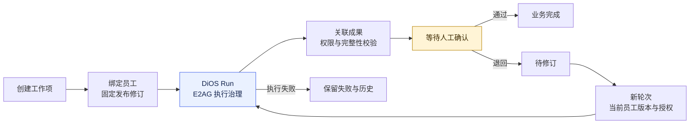

# 工作项、返工轮次与人工确认

WorkItem 表达业务目标和验收状态。员工承担工作，DiOS 负责技术执行与证据，复核人决定业务是否通过。Run 成功后进入待人工确认，工作项不会自动关闭。

## 分层与成熟机制

| 责任 | 所属层 | 实现 |
| --- | --- | --- |
| 业务目标、员工、复核人、业务状态 | 客户无关数字分身平台 | 独立包的 work_items / work_events |
| Run、Attempt、会话、执行重试、工具审批 | DiOS | 公开 SDK/API 和现有 E2AG 门禁 |
| 成果内容、版本与读取权限 | DiOS | 当前主体读取 API、摘要与大小校验 |
| 具体客户规则和页面 | 客户应用 | 组合平台工作项与底座能力 |

[Temporal 的 Activity 机制](https://docs.temporal.io/activity-definition)要求远端副作用可幂等重试；本实现将工作项 ID 映射为持久员工提交键，直接复用 DiOS 的调度与幂等契约。[Camunda 的人工任务生命周期](https://docs.camunda.io/docs/8.8/apis-tools/frontend-development/task-applications/user-task-lifecycle/)将分派、完成及操作归属分开；本实现分别保存员工绑定、技术结果和人工决策。本地包消费这些机制，当前部署无需新增工作流引擎。

## 状态与身份

`created → bound → dispatching → running → awaiting_confirmation → confirmed / needs_revision`。技术失败进入 `execution_failed`。应答未知保留 `dispatching`，查询超时保持原状态。员工绑定固定已发布修订；派发前若发布变化且尚无原提交回执，拒绝派发。已有未确认回执按原版本接续。

人工退回后可显式创建下一轮，状态回到 `bound`。业务工作项 ID、工作类型和登记输入保持，新的执行目标与员工当前发布版本固定到新轮次。同轮重试复用幂等键；新轮使用工作项 ID 与轮次组成的键，生成新 Run 和 E2AG Work。首轮沿用 0.2.0 的键格式，升级不会重复派发未确认任务。

创建固定业务目标和复核主体；同 ID 同内容返回原工作项，不同内容冲突。绑定使用本地版本前置条件，派发后不可改员工。执行使用员工自己的凭据进入 E2AG；复核使用另一个已认证主体，禁止相同发行方/subject 的员工自审。

复核人必须拥有原 Run 的读取与成果权限。WorkItem 不发布授权、不创建 Grant，不代替工具审批。观察成功要求成果完整；确认前再次检查身份、Run、全部关联成果及其 SHA-256 和长度。撤权使后续读取/确认失败。确认记录复核主体、意见、时间和证据摘要；历史决策回执持续保留。

业务确认与权限读取分属两个服务；确认使用读取时获准的证据。执行动作仍在 DiOS 的 E2AG 边界重检。当前 CLI 面向受信任运维人员，本地状态目录受系统权限保护；多人平台 RBAC 和企业 SSO 属后续入口联验。

## 返工与历史连续性

返工要求当前复核人仍可读取被退回的成果，员工处于 active 且当前配置兼容。旧轮快照、返工回执、新轮状态在同一 SQLite 事务中提交；旧目标、员工修订、Run、成果、人工决策不被新轮覆盖。回执未知后重放相同 key、目标和版本返回原回执；不同内容冲突。旧轮延迟消息不能确认新轮。

`show` 返回顺序排列的 `rounds` 和事件。历史只保存引用及校验信息；实际读取成果继续经过 DiOS 当前权限。每个新 Run 的复核共享单独授权，返工不复制旧 Work/Grant，也不自动扩大复核权限。员工权限在创建新轮后变化，实际派发仍由 E2AG 拦截。

独立应用库升级到 schema 2：原工作项作为第 1 轮，原提交键、事件与历史持续有效；旧版本包拒绝打开升级后的库。升级前备份完整状态目录，避免降级程序将新轮当作首轮处理。业务轮次表留在上层平台，DiOS 数据模型保持通用。

[旧版程序拒写验证](evidence/workitem-upgrade-fence-40-20261128.json)使用实际安装的 0.2.0 包读取 schema 2，返回 `UNSUPPORTED_REGISTRY_SCHEMA`。

## 本轮验收与后续 WBS

| 切片 | 状态 | 对应 #40 原要求 |
| --- | --- | --- |
| 创建、固定员工、关联任务和成果、人工确认 | 工程通过 | A01：Run 完成不自动等于业务验收通过 |
| 重复创建/派发、应答丢失、重启与复核撤权 | 本地场景通过 | A03/A05 的部分证据 |
| 人工退回、新轮授权、多个 Run 与历史关联 | 工程通过 | A03/A04/A05 的部分证据 |
| 多岗位与汇总复核 | 待实现 | A02/A04 |
| 接管、补偿、工具审批待办关联 | 待实现及联合验收 | A03/A04/A05 |
| 真实身份/SSO、物理环境 | 暂缓 | 按原跨层验收安排 |

首轮闭环的 18 项证据见[测试记录](evidence/workitem-40-20261128.json)；返工与升级的应用包回归见[多轮证据](evidence/workitem-rework-40-20261128.json)。真实 API、管理员子进程、Worker 和 E2AG 参与，Worker 使用确定性测试适配器。运行见[CLI 示例](../../applications/workforce-registry/README.md#退回返工与多-run-历史)。

下一切片为多岗位工作项拆分与汇总复核，再进入接管、补偿和审批待办联验。#40 原五条验收保持，A01 工程通过，A03/A04/A05 累积部分证据，当前整体仍在推进。
