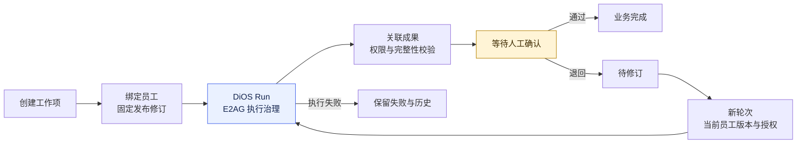
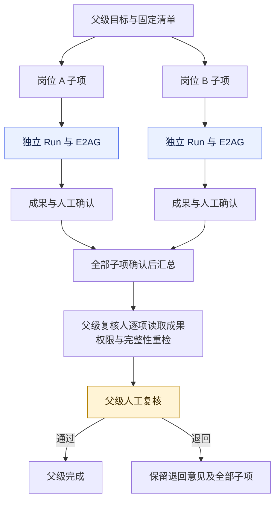
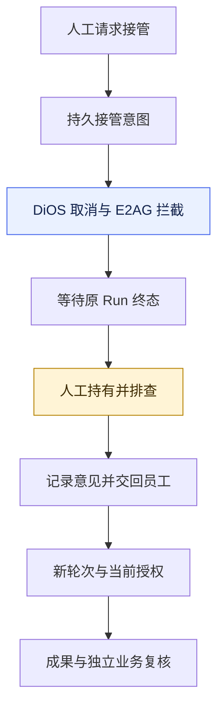
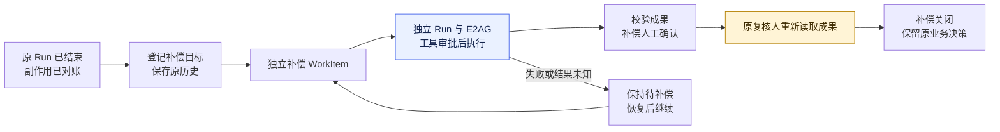

# 工作项、多岗位协作与人工复核

WorkItem 表达业务目标和验收状态。员工承担工作，DiOS 负责技术执行与证据，复核人决定业务是否通过。Run 成功后进入待人工确认，工作项不会自动关闭。

## 分层与成熟机制

| 责任 | 所属层 | 实现 |
| --- | --- | --- |
| 业务目标、员工、复核人、业务状态 | 客户无关数字分身平台 | 独立包的 work_items / work_events |
| Run、Attempt、会话、执行重试、工具审批 | DiOS | 公开 SDK/API 和现有 E2AG 门禁 |
| 成果内容、版本与读取权限 | DiOS | 当前主体读取 API、摘要与大小校验 |
| 具体客户规则和页面 | 客户应用 | 组合平台工作项与底座能力 |

[Temporal 的 Activity 机制](https://docs.temporal.io/activity-definition)要求远端副作用可幂等重试；本实现将工作项 ID 映射为持久员工提交键，直接复用 DiOS 的调度与幂等契约。[Camunda 的人工任务生命周期](https://docs.camunda.io/docs/8.8/apis-tools/frontend-development/task-applications/user-task-lifecycle/)将分派、完成及操作归属分开；本实现分别保存员工绑定、技术结果和人工决策。本地包消费这些机制，当前部署无需新增工作流引擎。

## 状态与身份

`created → bound → dispatching → running → awaiting_confirmation → confirmed / needs_revision`。技术失败进入 `execution_failed`。应答未知保留 `dispatching`，查询超时保持原状态。员工绑定固定已发布修订；派发前若发布变化且尚无原提交回执，拒绝派发。已有未确认回执按原版本接续。

人工退回后可显式创建下一轮，状态回到 `bound`。业务工作项 ID、工作类型和登记输入保持，新的执行目标与员工当前发布版本固定到新轮次。同轮重试复用幂等键；新轮使用工作项 ID 与轮次组成的键，生成新 Run 和 E2AG Work。首轮沿用 0.2.0 的键格式，升级不会重复派发未确认任务。

创建固定业务目标和复核主体；同 ID 同内容返回原工作项，不同内容冲突。绑定使用本地版本前置条件，派发后不可改员工。执行使用员工自己的凭据进入 E2AG；复核使用另一个已认证主体，禁止相同发行方/subject 的员工自审。

复核人必须拥有原 Run 的读取与成果权限。WorkItem 不发布授权、不创建 Grant，不代替工具审批。观察成功要求成果完整；确认前再次检查身份、Run、全部关联成果及其 SHA-256 和长度。撤权使后续读取/确认失败。确认记录复核主体、意见、时间和证据摘要；历史决策回执持续保留。

业务确认与权限读取分属两个服务；确认使用读取时获准的证据。执行动作仍在 DiOS 的 E2AG 边界重检。当前 CLI 面向受信任运维人员，本地状态目录受系统权限保护；多人平台 RBAC 和企业 SSO 属后续入口联验。

## 返工与历史连续性

返工要求当前复核人仍可读取被退回的成果，员工处于 active 且当前配置兼容。旧轮快照、返工回执、新轮状态在同一 SQLite 事务中提交；旧目标、员工修订、Run、成果、人工决策不被新轮覆盖。回执未知后重放相同 key、目标和版本返回原回执；不同内容冲突。旧轮延迟消息不能确认新轮。

`show` 返回顺序排列的 `rounds` 和事件。历史只保存引用及校验信息；实际读取成果继续经过 DiOS 当前权限。每个新 Run 的复核共享单独授权，返工不复制旧 Work/Grant，也不自动扩大复核权限。员工权限在创建新轮后变化，实际派发仍由 E2AG 拦截。

独立应用库升级到 schema 2：原工作项作为第 1 轮，原提交键、事件与历史持续有效；旧版本包拒绝打开升级后的库。升级前备份完整状态目录，避免降级程序将新轮当作首轮处理。业务轮次表留在上层平台，DiOS 数据模型保持通用。

[旧版程序拒写验证](evidence/workitem-upgrade-fence-40-20261128.json)使用实际安装的 0.2.0 包读取 schema 2，返回 `UNSUPPORTED_REGISTRY_SCHEMA`。

## 多岗位拆分与父级复核

一个父级目标拆成 2–16 个子工作项，分别绑定不同员工。拆分清单与顺序固定，子项只能属于一个父级。父级保留目标与复核状态，执行仍由子项的独立 Run 承担。

[Camunda 多实例活动](https://docs.camunda.io/docs/8.8/components/modeler/bpmn/multi-instance/)采用固定输入集合、逐实例执行和完成汇总，输出保持输入顺序。这里沿用固定集合与全员完成规则，由现有 DiOS 调度和预算控制实际并发。任何子项失败、待复核或返工，父级均保持等待；不能删减子项来完成父级。

父子关系、岗位分工、业务决策存于独立上层应用。每个子项沿用员工自己的身份、Run 与 E2AG 授权；业务拆分不授予委派权限、工具权限或成果访问权。父级复核人不能是任一执行员工，且须分别获得每个子项 Run 的成果读取权限。汇总与最终复核均重新读取、校验全部成果；撤权后拒绝确认。

汇总快照按拆分顺序保存子项 ID、员工修订、轮次、Run、成果摘要和人工决策，确认时重新比对。子项返工沿用原工作项 ID 并追加 Run；父级汇总采用完成的当前轮，旧轮仍可追溯。重复拆分与决策返回原结果，清单变化或冲突决策拒绝写入。

父级状态为 `group_draft → coordinating → awaiting_group_review → group_confirmed / group_needs_revision`。本切片支持一层拆分；父级退回保留决策及已确认子项，重新规划与接管由后续工作承接。嵌套拆分不列为本轮或 #40 新增验收要求。

独立应用库升级保留原工作项、轮次和提交键。升级前备份完整状态目录；[实际 0.3.0 旧程序验证](evidence/workitem-group-upgrade-fence-40-20261128.json)返回 `UNSUPPORTED_REGISTRY_SCHEMA`，阻止旧程序静默改派已拆分子项。DiOS 数据库和通用 API 保持原契约。

## 人工接管与审批关联

人工接管将业务归属与运行状态分开。原复核人登记接管原因和请求键，上层应用先保存意图，再使用原员工专用凭据请求 DiOS 取消。当前 API 继续校验员工的取消权限；复核人使用自己的权限读取 Run。持有成果读取权限不自动取得运行控制权。

状态 `takeover_pending → human_owned → bound` 分别表示等待取消确认、人工持有和交回新轮。查询超时、取消应答未知和重启不会结束等待或新建 Run；同请求键可接续原意图。已有取消请求时读取实际执行状态，Worker 确认终态前禁止派发。旧执行者的后续动作继续受 E2AG 限制。未确认派发的工作项先沿原提交键取得回执，再申请接管。

`handback` 固定原员工，记录人工处理意见和新目标；原轮、Run、成果及接管记录留存，新轮重新验证员工发布和当前授权。人工持有、审批通过与业务完成各自独立。父级汇总仍等待子项重新执行和人工确认。

审批关联使用现有 `GET /runs/{run_id}/tools` 和单调用读取 API。上层保存轮次、Run、Attempt、Session、调用 ID、参数摘要、审批决定、审批人、有效期、错误及观察时间；审批决定仍通过 DiOS Console/API 的独立审批凭据与 `tool.approve` 门禁执行。审批失效和执行拒绝可继续刷新到原工作项，业务状态不随审批通过而关闭。

列表提供最近 50 条调用，达到上限时标记部分观察；已知历史调用支持按 ID 刷新，旧记录不因缺席当前列表而丢失。同步失败保留历史并标记不可用，低版本不能覆盖高版本。缓存展示是带时间的观察，执行时的审批有效性由 DiOS 再检查。

数据表 `work_takeovers / work_handbacks / work_approvals / work_approval_sync` 均位于独立上层应用。DiOS 仅增加 SDK 的通用工具读取方法，服务端和 E2AG 契约不变。独立应用 schema 4 阻止 0.4.0 旧包写入，见[旧程序拒写证据](evidence/workitem-intervention-upgrade-fence-40-20261128.json)。

[人工接管与审批 CLI](../../applications/workforce-registry/README.md#人工接管与运行时审批关联)提供可运行命令。入口面向受信任运维人员；接管后可交回原员工，补偿通过独立工作项执行。

## 显式补偿与业务关闭

上层应用明确补偿目标、原副作用资源标识、执行员工和复核人。补偿使用独立 WorkItem 与 Run，复用既有 E2AG 授权、工具审批、技术重试、成果校验和人工确认。[Azure 补偿事务模式](https://learn.microsoft.com/en-us/azure/architecture/patterns/compensating-transaction)同样要求补偿由业务定义、保留恢复信息，并允许失败后继续处理及人工介入。

每个原轮次绑定一个独立补偿工作项。规划保留原快照，将原项置为 `compensation_pending`，随后显式派发补偿项。绑定固定，禁止递归补偿及把补偿项加入岗位拆分。补偿成功且完成独立人工确认后，原复核人重新核验当前成果访问权和内容，明确执行 `confirm-compensation`，原项才进入 `compensated`。原目标、Run、成果和人工决策仍可追溯；父级不将补偿关闭计为子项成功。

失败/取消的原 Run 可能仍有未知工具副作用。规划和关闭要求当前 `tool.read` 权限及完整调用观察，拒绝 `dispatched`、`result_unknown`、观察失败、迁移未完成或列表不完整的状态。先由 DiOS 对账，再继续补偿。成功 Run 复用底座接收结果前的工具结清约束。超过当前列表容量的失败 Run 保持待处理，本切片不新增底座分页契约。

补偿失败保留原项待补偿状态与所有尝试；使用既有技术恢复、人工接管交回或退回返工接续补偿工作项。补偿请求和确认均可幂等重放，冲突内容拒绝。原复核人不能是补偿执行员工；绑定不授予工具权限或成果读取权。工具审批与业务复核各自保留，任何补偿动作仍在 DiOS 执行控制点授权。

`work_compensations` 位于上层独立应用库，schema 5。实际安装的 0.5.0 程序拒绝打开新库，见[升级拒写证据](evidence/workitem-compensation-upgrade-fence-40-20261128.json)。[补偿 CLI](../../applications/workforce-registry/README.md#补偿与独立业务关闭)提供登记、派发和关闭命令。

## 原五条验收与后续 WBS

| 原要求 | 工程状态 | 剩余事项 |
| --- | --- | --- |
| A01 Run 完成不自动等于业务验收通过 | 通过 | 最终业务接受 |
| A02 上级→多岗位→汇总复核可闭环 | 通过 | 最终业务接受 |
| A03 失败、人工接管、重复事件和审批撤销可追踪 | 通过 | 最终业务接受 |
| A04 多实现协作重试、补偿、审批关联保留，业务复核关闭 | 通过 | 最终业务接受 |
| A05 重复触发、技术重试、人工验证与业务关闭独立，无默认外发 | 通过 | 最终业务接受 |

[安装包联合验收](evidence/workitem-closure-40-20261128.json)使用应用 0.6.0、SDK 0.1.22，共 39 项通过、0 跳过，其中 28 项为 WorkItem 场景。38 项覆盖真实 API、E2AG、管理员子进程及确定性 Worker；另 1 项在实际 Docker 中运行隔离的 JSONL 与生产 ACP 桥接进程。原生样例用受控本地工具登记并释放资源，没有外部模型或客户系统调用。

联合场景将事件、定时、人工入口的相同业务 ID 重放到同一 WorkItem；网络故障触发同一 Run 的第 2 次尝试；独立补偿 Run 在审批前保持无副作用；原项与补偿项分别人工确认后关闭。实际记录 2 个 Run、3 个进程实例和会话，资源登记与释放各 1 次。触发映射覆盖统一幂等入口；已有事件源与定时调度器资格沿用底座证据，本样例不新建后台调度器。

[人工接管与审批证据](evidence/workitem-interventions-40-20261128.json)、[返工证据](evidence/workitem-rework-40-20261128.json)、[多岗位证据](evidence/workitem-groups-40-20261128.json)持续复用。SDK 和 DiOS 运行时契约未改；实际 Harness 与外部环境资格保持原专项记录。

#40 原五条工程验收均通过，保留最终业务接受和原依赖。后续按既定 F03-2.02/.03 回填应用联合证据，持续评审业务的范围、覆盖账本与旧系统适配仍由 #59/#60 承接。真实目录/SSO 与物理环境继续暂缓。底座统计保持 61/79，上层 #40 单独记录为工程 5/5。
