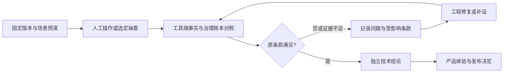

# DiOS 人在回路验收

验收围绕一项可操作的任务展开：Agent 请求读取一份测试资料，等待人工决定，执行后留下结果和记录。人在现场观察行为、提出疑点并签署对应结论，工程负责环境、测试、证据和修复。

本方案承接 #33 身份凭据、#34 工具治理、#35 委派安全及 #51 发布接受。底座维持 66/79；方案完成不计为验收通过。

## 用户实际做什么

工程准备好场景后，给徐刚一份带任务链接的操作单。首轮产品操作以 15–20 分钟为目标，必要的技术复核另行安排。

| 场景 | 你操作什么 | 应该看到什么 | 你需要判断什么 |
| --- | --- | --- | --- |
| 允许一次读取 | 打开待审批任务，查看要读的资料及原因，以独立审批身份点“批准本次调用” | 原任务继续执行，出现对应成果；工具调用记录只有一次 | 能否看懂批准的对象、动作和影响，成果是否找得到 |
| 拒绝读取 | 在另一项测试任务点“拒绝” | 显示拒绝原因，工具调用次数为零 | 拒绝是否明确，后续状态是否容易理解 |
| 撤销后再操作 | 工程在专用测试工作中撤权；你刷新原任务并观察后续动作 | 新动作被拒绝；已经发生的动作和结果仍可追踪 | 能否分清“请求停止”“已经停止”和已发生的结果 |
| 结果暂时未知 | 工程运行专用回执中断场景；你查看原任务记录 | 显示“结果待对账”，保留原调用；已有回执时可“校验并恢复回执” | 是否清楚当前在等什么、接下来能做什么 |
| 追踪来源和成果 | 从任务打开审批、调用、尝试和成果记录 | 各条记录属于同一工作；拒绝、失败与重试保留各自身份 | 能否解释谁让 Agent 做了什么、谁批准、结果在哪里 |

页面当前已有批准、拒绝、派发和回执恢复入口。是否由 Worker 自动继续派发由该场景的执行配置确定；需要操作者“派发本次调用”时，操作单必须注明。撤权和故障准备可由工程通过现有受控接口完成，界面没有的入口不写成可点击按钮。

用户记录“符合预期 / 需改善 / 未能判断”，并指出具体场景。技术安全结论由技术评审单独记录。

## 角色与结论

| 角色 | 工作 | 结论权限 |
| --- | --- | --- |
| 工程操作者 | 固定版本、部署、合成数据、场景执行、日志和问题修复 | 记录执行事实与自动断言，不代签人的意见 |
| 产品验收人：徐刚 | 亲自操作或观看现场操作，评价可理解性与可用性 | 产品体验及范围决定 |
| 独立技术评审人：待认领 | 具备身份授权、事务和故障恢复经验；查看原条款、代码/config及原始证据，选择疑点补证 | #33/#34/#35 技术安全接受；与实现者独立 |
| 发布接受人：徐刚 | 查看技术结论、交付条件、回退方案及剩余问题 | #51 具体版本发布接受 |

产品演示通过后，安全条款仍按实际技术证据逐项判断。身份、权限、不可逆副作用等高影响问题需在发布前处理；普通可用性问题可记录责任人、关闭条件与复审条件后有条件接受。

## 开始验收前必须具备的环境

工程提供一个隔离 Linux/WSL 安装，合成资料和只读工具，E2AG 为 enforce。测试发起者 A、独立审批人 B、无访问权观察者 C 使用各自凭据；不向用户分发共享管理员令牌。

每个场景需有：任务/审批/成果入口、操作顺序、预期现象、Run/Attempt/Session/Invocation ID、实际工具调用账本、文件与出口观察记录。调用计数和副作用证据来自工具端或隔离环境观察，不能只依赖 Console 的状态字样。计数须包含记录前基线与观察窗口；日志采集失效时，零条记录不算零调用。

验收包锁定提交 SHA、后端/前端/Harness 镜像摘要、SDK、策略摘要、数据库后端、Provider 配置摘要、身份及环境范围。身份材料只保留非敏感标识和摘要。任一关键配置变化后标记相关观察过期，仅重验受影响条款。

工程在开始前完成一次预演，提供实际可用的链接和两套独立身份。现场记录明确区分真实模型、合成 Agent、真实协议服务、模拟时间边界和历史证据。此前 13582 候选为空安装，缺执行 Profile、场景资料和验收身份，当前准备状态为 `not_ready`。

## 技术场景卡

| ID | 工程提供的动作或证据 | 技术评审人核对的事实 | 主要条款 |
| --- | --- | --- | --- |
| H01 批准与拒绝 | 同一只读工具的正向与拒绝任务；人工分别批准、拒绝 | 批准前零调用、批准后一次、拒绝后零调用；请求参数与实际参数一致 | #34 A01/A03/A07 |
| H02 身份与资源隔离 | A/C 各自登录、读取各自测试对象；复用内容但分别授权 | 共享摘要不扩大 ACL；无权主体的实际 API 读取拒绝；UI、API 使用同一主体 | #33 A01/A02/A05，#35 A01 |
| H03 撤权与在途结果 | 专用任务在审批前、初始化后及已提交派发后分别撤权 | 新动作拒绝；已提交动作的在途结果保留；取消请求与实际退出分开 | #33 A02，#34 A07，#35 A02/A04 |
| H04 参数、会话和期限 | 复核既有参数/会话变更与最后一次委派响应跨期限的定向记录 | 旧审批不批准新参数、会话或执行权；租约/Grant 过期时零工具调用 | #34 A02，#35 A05 |
| H05 单次消费与未知结果 | 同一批准调用的重复操作、结果丢失和回执恢复场景 | 单次消费；未知结果保持原调用，不自动重复执行；完整回执恢复不新开模型会话 | #34 A02/A07 |
| H06 委派和独立审批 | 三层委派、上游撤权、重复/乱序事件及审批资格变化证据；人工观察拒绝结果 | 每层权限收窄；自审批拒绝；来源撤销影响后续动作；乱序事件不恢复旧权限 | #35 A01/A02/A03/A04/A05/A06 |
| H07 凭据生命周期 | 既有轮换/续期/撤销记录及当前版本差异；凭据交换等待跨期限疑点单 | 身份独立、凭据受众和期限匹配；换所有者/终态/撤权后不能续期；正常长任务续期不提权 | #33 A02/A04/A06/A07 |
| H08 Secret 与脱敏 | 固定测试凭据的配置、Prompt、日志、产物检查记录 | 普通响应及日志不暴露原文；具备完整观察范围和检测方法；生命周期事实可追溯 | #33 A03/A04/A05 |
| H09 Harness 原生能力 | 固定 Cursor 主路径的治理声明、准入及原生文件/网络控制证据；DSH 复用已验证组合 | 实际执行控制与声明一致；不具备相应控制的端点被限制准入；通知不算强制拦截 | #34 A03/A04/A05/A06 |
| H10 实现一致性 | 已有 SQLite/PG、内置策略/OPA 四组契约结果与当前差异；审查事务和拒绝记录 | 相同输入的权限/审批结论及撤销顺序一致；审计故障不静默放行；新修改的适用范围单列 | #34 A07/A08 |

完整 21 条原验收、场景映射和已有证据见 [HIL 清单](hil-acceptance-cases.json)。每张卡允许覆盖多条要求，每条仍保留独立人工结论。H09 使用原固定组合证据；源码、镜像或治理配置变化时由工程补受影响场景，不能把合成回放标成当前真实模型验证。

H07 的凭据交换期限线索尚未确认为漏洞，技术评审需要形成“已排除”或“已修复并验证”的记录；未判定前该条保持待核验。真实目录/SSO、全新跨主机实验和容量任务继续按原延期范围处理，已有双机证据可供审阅。

## 现场流程与证据包

每场开场核对版本和身份，之后人工选择并观察场景。现场先走 H01/H02/H03/H05 的可感知路径；技术评审复核其余场景及固定版本证据。历史观察标记为 `retained`，现场观察为 `observed`；证据不足为 `insufficient`，不会自动生成通过意见。

证据包包括 `manifest.json`、每卡观察记录、脱敏日志/截图、机器断言、问题清单和人工决定。每条记录含 case ID、原条款 ID、版本/环境摘要、操作者、观察人、时间、预期与实际、产物摘要及差异。采用现有 Git/Issue 留存文件和具名确认；历史记录追加保留。哈希用于检验一致性，签署人的身份由其登录账号和确认记录确定。

人工结论可填“通过 / 有条件通过 / 需修订 / 未观察”，同时留下理由和证据定位。[记录模板](hil-acceptance-record.template.json)的人员、观察与签署字段均留空；工程不能将自动测试 PASS 填入人工结论。无条件通过要求所有本期适用条款有充分证据且阻断问题已关闭；有条件通过列清限制、责任人、截止条件及复审触发。越权、未经批准执行、泄密、过期执行或无法解释的重复副作用阻断发布。

## 结项门槛与工程安排

| 门槛 | 需要的结果 | 可更新的状态 |
| --- | --- | --- |
| H0 可开始 | 固定版本、Profile、A/B/C 身份、十张场景卡入口、可用观察记录、一次预演 | 验收就绪；66/79 不变 |
| H1 技术安全结论 | 实现者之外的适任技术评审人逐条确认 21 条要求，记录范围与剩余问题 | 对应 #33/#34/#35 分别结项 |
| H2 产品体验 | 徐刚完成上述操作并记录具体可用性意见 | 用户验收记录；不重复技术测试 |
| H3 发布接受 | H1 完成、体验问题有处置、固定版本的安装/升级/回退证据齐备，发布人作决定 | #51 结项 |

接续工作都归现有 #33/#34/#35/#51：先给候选安装配置合成 Profile、只读资料、独立身份和任务链接；把既有证据与版本差异装入卡片；完成 H0 后再邀请人工操作。当前只完成 HIL 设计和追踪清单，尚未执行人工验收。

自动审查工具的拦截记录保留，后续工具调用继续遵守其限制。人工技术评审承担独立的检查与判断职责，验收结果只覆盖已观察和已复核的范围。

## 方法依据

[NIST SP 800-53A Rev.5](https://csrc.nist.gov/pubs/sp/800/53/a/r5/final)采用检查材料、访谈和测试三类评估方法。本方案把它们落到版本证据、人工提问和现场操作。

[OWASP ASVS 5.0 验证指南](https://github.com/OWASP/ASVS/blob/v5.0.0/5.0/en/0x04-Assessment_and_Certification.md)强调权限与业务逻辑需要结合源码、配置和充分证据验证；单一自动工具不能完成全部验证。本方案用于 DiOS 原条款验收，不作 ASVS 全量认证声明。
