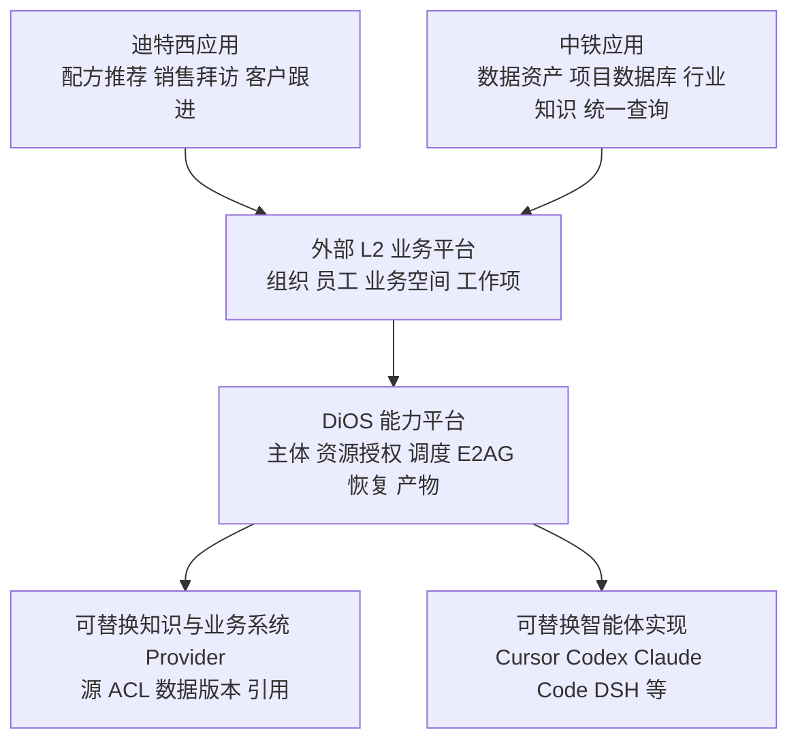

# DiOS 与衢州迪特西、中铁建工应用需求的能力差距

## 产品边界修订（2026-11-24）

DiOS 仅承载通用能力，见 [ADR 0011](../adr/0011-capability-only-platform-boundary.md)。本表 L2 的组织、数字员工、业务 Workspace、WorkItem 和业务运营属于 DiOS 之外的管理平台；通用身份验证、资源授权、对象生命周期、Provider、发布和技术观测属于 DiOS。原客户范围与代码证据保留。

“企业身份”分为上层的企业/部门/成员关系和底座的可信主体验证；“项目范围”由应用映射为不透明资源约束；“资料与成果权限”由业务/源系统决定归属和规则，DiOS 执行对象级读取、下载、工具授权及撤销。project_id 不作为底座业务实体或授权证明。

当前主线先完成 DiOS 既定能力；原 #36/#37/#40 的业务管理实现由上层产品独立交付。#38/#39/#47 分别抽出对象授权、Provider 契约、应用接入的通用部分，不以组织和岗位表为前置。

#47 已交付公开 SDK、三个独立应用/Provider 包、动态输入和结果 Schema，真实验证独立升级/回滚及其他应用在途授权保持。详见[应用包契约](../design/application-packages-47.md)。下一能力批次为 #33/#35/#38 主体、委派和对象权限；应用安装管理与双执行实现资格继续保留原验收。

基线日期：2026-11-23。工程分支 `feat/lightweight-runtime-32`；授权知识任务切片已提交 `caed140`，主题与语言功能随本次前端交付记录。客户业务范围沿用原项目资料和确认清单。

**DiOS 已具备可复用的执行与工具治理底座，接下来优先完成 DiOS 的通用接入、主体与资源授权、对象权限及既定执行能力。** 迪特西与中铁的业务规则、数据模型和产品界面由各自应用承接。当前资料核查已在合成样例中跑通；实际客户资料接入的前置是可信主体验证、业务授权映射及对象权限通过对应验收。

## 需求依据与分层

| 来源 | 本次采用的范围 | 仍待确认的输入 |
| --- | --- | --- |
| 衢州迪特西原项目话题，11 月 22 日明确的产品方向；57 项清单 20261117、首阶段资料准备清单 20261120 | 知识问答；根据客户需要推荐产品/配方并说明依据；拜访前汇总背景、历史沟通、目标和问题；拜访后生成跟进记录、待办和提醒，由销售确认 | 首批功能组合、接口及资料范围、人员分工、演示日期；真实配方候选、适用条件和判断案例；CRM/客户沟通接口 |
| 中铁建工《数据与知识治理平台专项合同及附件》终稿 20261116，附件 1 | 资源盘点、项目数据库、行业知识库、统一查询与共享接口、试点交接；按身份/项目/资料权限返回内容与出处，保留版本及更新记录 | 首批部门与场景、数据资产与接口清单、授权规则、查询样例及客户环境 |
| DiOS 架构基线、Project #2 和实际代码 | L1 运行与 E2AG；L2 员工、工作空间、知识、工作项；L3 独立应用；开放智能体与可替换 Provider | 客户规模/SLO/预算仍需在试点确认；既定小型试点与多节点扩展两档用于设计，尚无客户容量实测 |

迪特西 VPN 和脱敏资料准备的承诺是截至 11 月 22 日的话题状态；本次没有客户环境连通与资料到账的实测证据。该项目继续沿用既有 UI、清单及行动计划。中铁具体业务任务由确认实施清单约定，专项交付范围按上述合同执行。

## 能力差距矩阵

“已可复用”指相应工程路径有代码与测试；“局部可用”指限定条件下已运行；“待建设”按既定任务推进。业务验收与工程测试分别记录。

| 能力与需求 | DiOS 当前依据 | 差距及责任层 | 优先级 / 原任务 |
| --- | --- | --- | --- |
| 企业身份、部门/岗位、项目成员与数据可见范围；两项目共用 | Console 使用可信操作员 Token；E2AG 接受受限主体与四层工作权限；知识样例凭据映射固定 subject/project/documents | **局部可用。DiOS** 接入可信身份源、主体与停用事件；**外部 L2** 管用户/岗位/项目角色并提供授权映射。实际用户与凭据身份、原始发起人须可追溯 | **P0 · #33/#35；外部 #36** |
| 资料、会话、任务和成果的所属空间与分享权限；两项目共用 | Runtime 按 scope 隔离；产物有 Run/Attempt、摘要和下载校验。当前 Console 操作员可读该 scope 内全部任务 | **局部可用。DiOS** 建对象 ACL、读取/撤销及留存机制；**外部 L2** 建业务 Workspace、分享规则与业务会话关联。检索权限与既有成果的读取权限需分别执行 | **P0 · #38、#33/#35；外部 #36** |
| 来源、版本、引用与授权检索；两项目共用 | 新增 `services/knowledge.py`：项目/资料白名单、来源与正文指纹、读取前过滤及返回前重检授权；真实 Worker 经 E2AG 调用成功 | **局部可用。L2 + Provider** 补知识空间、文档解析/分段、更新/删除传播、源 ACL、检索质量、替代 Provider 验证。当前本地文字检索、手工登记、最多三份资料适合工程切片 | **P0 · #39、#38** |
| 数字员工的稳定身份、职责、负责人及能力绑定；两项目共用 | 已有 Agent/执行 profile；工作台中的岗位员工为合成展示 | **待建设。L2** 员工 ID 与 Agent/容器/会话分离；岗位模板、版本、发布/停用、多个实现绑定与历史连续 | **P1 · #37**；保留 #31/#35/#58 依赖 |
| 工作、执行、审批、成果复核和业务关闭；两项目共用 | Run/Attempt/Session/Artifact 持久关联；技术执行与 E2AG 工具审批已接通；报告标记 pending_review；工作台协作为内存原型 | **局部可用。跨产品拆分，见本表边界修订。L2** WorkItem 持久化、负责人、时限、业务确认、退回修改、复核记录与幂等动作。**L3** 定义销售确认、中铁资料/查询确认的具体规则 | **P1 · #40、#37/#38** |
| 长期后台、独立 Worker、失败恢复和定时任务 | 已有队列、租约/epoch、幂等、进程/会话观测、对账、离线补报、分类故障、限流/额度熔断与单路恢复；有开发证据 | **局部可用。L1** 继续定时触发重叠合并、死信处置及实际跨主机资格验证；**L3** 定义拜访提醒和资料更新触发时机 | **P1 · #30、#29** |
| 第三方 Agent 与工具动作授权 | Cursor ACP 固定版本的真实任务、审批、检索、报告及完成输出恢复有证据；新知识样例复用同一 E2AG 工具通道，运行无需模型 | **局部可用。L1/适配层** 补真实取消/撤销、内置工具路径、第二来源 Agent、A2A 与各厂商续接语义资格。业务接入选择已通过所需控制点的实现 | **P1 · #56/#58、#34/#35** |
| 业务系统接入、数据资产与结构化数据 | 有 Connector/事件、MCP 工具注册与授权通道；任务目录支持应用自行命名类型与数据化登记输入；尚无两个客户的已验证数据接口 | **局部可用。L2/连接器** 提供身份委托、凭据、限流、同步水位与来源契约，扩展开放应用的输入/结果登记机制。**L3/数据服务** 负责客户/配方/项目业务模型、字段口径、数据质量与资产盘点 | **P0 确认接口，P1 接入 · #29/#39/#47** |
| 配方/产品推荐与销售拜访 | 已有“销售资料核查”合成样例，产物含引用与待复核状态；DiOS 没有真实配方推荐或 CRM 流程 | **客户应用层缺口**：客户需求结构化、候选配方约束/匹配、推荐依据与反馈、拜访上下文和确认后的跟进动作。DiOS 供给受控知识、任务和审批接口 | **迪特西首批应用**，复用 #39/#40；参考 #48 |
| 项目数据库、行业知识库、统一查询与共享接口 | 已有“项目资料引用核查”合成样例；项目数据库和数据治理产品尚未接入 | **客户应用/数据服务层缺口**：项目对象/编码/字典、资源目录、接入治理与更新、行业知识组织、统一查询产品和专项接口；L2 供给通用授权、引用与任务能力 | **中铁首批专项**，复用 #38/#39；参考 #47 |
| 面向业务用户的产品界面 | Console 的真实任务、Worker、审批和报告可用；员工/主管工作台仍是合成原型。已新增主题 Light/Dark/Auto 和浏览器 Locale 默认的中文/English | **局部可用。跨产品拆分，见本表边界修订。L2** 把通用工作台接到真实员工、Workspace、WorkItem；**L3** 保持客户产品 UI，与原页面及业务导航集成 | **P1 · #28/#37/#38/#40** |
| 质量、运营、成本与审计 | Runtime 保留事件、错误、尝试与产物；已能区分运行状态和观测新鲜度 | **局部可用。跨产品拆分，见本表边界修订。L2** 检索/推荐质量集、成本归属、任务漏斗、跨层 Trace、统一筛选口径。**L3** 提供业务判断样本、正确引用/推荐及完成标准 | **P1/P2 · #43/#46/#42** |
| 版本、部署、升级、备份与扩展 | 固定镜像和策略摘要；有排空/备份/恢复基础与开发部署。当前业务样例在 WSL 单节点运行 | **局部可用。L1/交付层** 版本发布/回滚产品化、安装升级、生产数据库与共享产物存储、多节点/HA、容量及运维交接。单节点是验证路径，目标保留跨主机扩展 | **P1 起步交付，P2 扩展 · #31/#51–#54** |

## 两条应用链路的首批落点

**迪特西：客户需求 → 授权产品/配方资料 → 推荐依据 → 销售/技术确认。** 本次打通中间的受控取证和成果链路。下一段由应用提供一个已脱敏案例、候选配方及适用条件，接入 L2 知识接口，验证引用和人工反馈，再扩展拜访前背景汇总与拜访后跟进。业务应用保存客户/拜访记录，WorkItem 保存工作归属与确认状态，Runtime 保存具体执行尝试。提醒的渠道与实际发送由客户流程明确授权。

**中铁：授权资源盘点 → 项目/知识数据服务 → 按身份和项目查询 → 引用与业务核验。** 首批选择一个确认的项目资料集合和查询用途，先检验不同角色的资料可见性、引用定位及版本更新，再对接约定业务系统。项目数据库、行业知识组织和资产目录是专项数据服务的交付；通用授权、知识调用、运行与证据由 DiOS 提供。

上述业务样例沿原项目清单确认后进入接入。尚缺真实数据时，继续完成身份、对象权限、契约和合成隔离验证。

## 下一步执行顺序与验收门槛

| 顺序 | DiOS 能力交付 | 上层产品职责 | 验收证据 |
| --- | --- | --- | --- |
| 1 · #47 | 数据化输入登记、通用任务接入、独立应用包/客户端 | 应用输入、业务校验和发布包 | 新类型无需修改 DiOS；升级/停用后历史保留；独立包发布回滚 |
| 2 · #33/#35/#38 | 可信主体、委派、对象权限、受限读取/下载、撤销 | 组织/项目成员与资料分类规则及映射 | 同查询按授权过滤；跨对象下载拒绝；撤销阻断后续动作 |
| 3 · #31/#29/#30/#39 | 版本发布、Connector、持久调度恢复、Provider 契约 | 配方/拜访/项目数据映射、业务确认 | 技术链路恢复、版本证据、更新/删除传播与替代 Provider |
| 4 · #34/#56/#58/#44–#46/#51–#54 | E2AG、跨 Agent、能力治理、资源与观测、部署和容量 | 业务效果与客户应用验收 | 既定能力逐项通过工程测试、部署与故障验收 |

#36/#37/#40 的业务组织、员工和工作流在外部平台建设；DiOS 不等待这些业务模型完成。真实客户资料仍需对象授权验收和客户数据授权；Codeup 现有生产评审继续独立运行，接管按 #60 单独批准。

## 现状证据

- [分层架构](../architecture/system-design.md)、[工程路线](project-plan.json)、[授权知识接入契约](../design/business-evidence-39.md)。
- `backend/app/runtime/`：执行、授权、工具、恢复、历史与产物；`backend/app/services/task_console.py` 和 `backend/app/api/os/runtime_tasks.py`：受保护任务入口与结果查询。
- `backend/app/services/knowledge.py`、`backend/app/apps/evidence_brief.py`、`examples/business/`：同仓参考 Provider、应用及合成输入；独立发布包待 #47。
- [业务样例证据](../design/evidence/business-evidence-20261123.json)：12 项新增测试；后端本轮 290 通过、117 环境条件跳过；实际 Docker Worker、E2AG 批准/拒绝、页面/CLI 报告一致性独立验证。
- [Cursor 工程证据](../design/cursor-acp-56-58.md)：11 月 20 日固定厂商版本与既有集成范围；更广智能体和物理跨主机资格按 #58 推进。
- [主题与语言证据](../design/evidence/preferences-20261123.json)：默认值、持久化、实时系统变化、语言切换、输入保持、跨页与移动布局。

客户范围来源：迪特西话题 `01a16bf1-fdeb-7790-bc2a-42a20e744e48`；中铁话题 `01a18011-4363-7be0-97ec-078e3ec93bf5`。本表维护在 DiOS 工程计划中，原客户材料继续作为各自业务范围依据。
